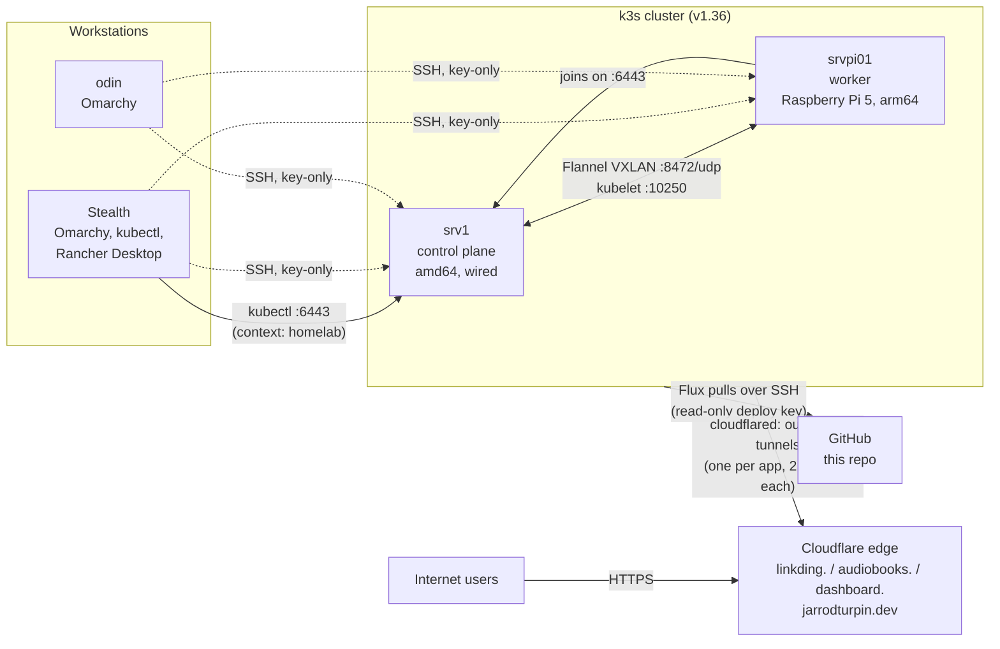

# Homelab Architecture Overview

## Infrastructure Layout

- **Stealth (primary laptop):** daily workstation on Omarchy (Arch Linux). Manages the homelab cluster with `kubectl` and runs a separate local cluster in Rancher Desktop. The two are kept apart as separate `kubectl` contexts (`homelab` and `rancher-desktop`).
- **odin (ThinkPad T480):** second Omarchy workstation, reached over SSH with key-only auth.
- **srv1 (KAMRUI AM21 mini PC):** k3s server (control plane). AMD Ryzen 7 8745HS, 24 GB RAM, 1 TB NVMe, Ubuntu Server 26.04 LTS, wired network only.
- **srvpi01 (Raspberry Pi 5, 8 GB):** k3s agent (worker), Ubuntu Server 24.04 LTS.

## Kubernetes

- **Distribution:** k3s, installed with the official script. It bundles containerd, Flannel networking, CoreDNS, Traefik ingress, ServiceLB, local-path storage, and metrics-server.
- **Mixed architecture:** the control plane is amd64 and the worker is arm64, so every image needs builds for both.
- **Network policy at the host:** ufw on both nodes allows only what the cluster needs: the API server (6443/tcp) from the LAN, kubelet (10250/tcp), Flannel VXLAN (8472/udp) and node-exporter (9100/tcp) between the two nodes, and the pod and service networks.
- **GitOps:** FluxCD v2.9 runs in the `flux-system` namespace. It checks this repo every minute and applies `clusters/staging` (with pruning, so anything removed from Git is removed from the cluster). Flux authenticates with a read-only SSH deploy key; no GitHub token is stored in the cluster.
- **Public access:** Cloudflare Tunnels, one per app. Each app has two `cloudflared` pods holding outbound connections to Cloudflare, which forwards requests for `linkding.`, `audiobooks.` and `dashboard.jarrodturpin.dev` to that app's Service. No router ports are open and the home IP isn't published in DNS. The tunnel credentials are a SOPS-encrypted Secret in Git.
- **Secrets:** committed to this repo encrypted with SOPS and age. Flux decrypts them with a private key held in one Secret created by hand; a pre-commit hook blocks unencrypted Secrets and leaked credentials.
- **Monitoring:** kube-prometheus-stack (Prometheus, Alertmanager, Grafana, node-exporter on both nodes) installed by a Flux HelmRelease from an OCI chart registry, with the Grafana login in a SOPS Secret. See [docs/monitoring.md](docs/monitoring.md).
- **LAN access:** k3s's bundled Traefik routes `*.home.arpa` hostnames to Linkding, Grafana and Homepage through Ingress rules (Grafana's generated by its Helm chart, with a SOPS-encrypted self-signed TLS certificate). Reachable from the LAN only.
- **Repo layout:** `apps/` for what the cluster runs, `infrastructure/controllers/` for tools that run the cluster, `infrastructure/configs/` for cluster-wide settings (StorageClasses), `monitoring/` for the monitoring stack, each applied by its own Flux Kustomization from `clusters/staging/`. See [docs/gitops-apps.md](docs/gitops-apps.md).
- **Updates:** Renovate runs hourly as a CronJob and opens pull requests for new image and chart versions, signed in as a GitHub App installed on this repo only: an init container exchanges the app's key for a token that expires in an hour, so there is no long-lived token to renew. Nothing merges automatically.
- **CI:** a GitHub Actions workflow builds every Flux path and validates it with kubeconform (`-strict`, Kubernetes and Flux CRD schemas) on every push and pull request, so a Renovate PR or a misplaced key shows a red cross before Flux applies it. The same `scripts/validate.sh` runs on the laptop; `mise.toml` pins the tool version for both.
- **Apps:** Linkding (bookmarks) and Audiobookshelf (audiobooks and podcasts, the course capstone: translated from Docker Compose, four persistent volumes, non-root, its own tunnel). See [docs/audiobookshelf.md](docs/audiobookshelf.md). Dashboard: my own public status page (Python, FastAPI) that reads fixed queries from Prometheus, built into a multi-arch image by its own repo's CI and published to GHCR; it runs with no API token, the restricted pod security settings and a NetworkPolicy. See [docs/dashboard.md](docs/dashboard.md).
- **Next:** LAN DNS and trusted certificates (cert-manager), and the PDF Q&A AI stack as a platform service.

## Sync Strategy

- Homelab docs and cluster configuration: this public repo
- Dotfiles: chezmoi, one private repo applied to every machine (desktop profile on the laptops, server profile on srv1 and the Pi)
- System snapshots (fstab, firewall, sshd, VM definitions): GitHub, per host
- Course work: public `lab` repo on GitHub
- Obsidian vault: private Git repo, plus backups to Proton Drive
- Personal files: rsync to a LUKS-encrypted USB drive and Proton Drive

## Tools Used

- Arch Linux (Omarchy), Ubuntu Server, systemd, ufw
- Bash, Git, chezmoi, mise, Python (FastAPI, uv, pytest)
- Docker, Kubernetes (k3s), Helm, Prometheus, Grafana
- FluxCD (GitOps), Kustomize, Renovate
- GitHub Actions, kubeconform
- Cloudflare Tunnel (cloudflared)
- Claude Code for AI-assisted scripting and troubleshooting

## Privacy & Security

- Full-disk encryption (LUKS) and UEFI Secure Boot on the laptops; LUKS on srv1
- SSH key-only authentication with a hardened sshd config on every machine
- Host firewalls on the servers allow SSH only from the workstations
- Kubernetes Secrets are stored in Git only SOPS-encrypted; tokens, keys and kubeconfigs never are
- The `main` branch, which Flux deploys from, is protected against force pushes and deletion
- CI jobs get read-only repo access, and third-party actions are pinned to commit SHAs
- The public dashboard pod has no Kubernetes API token, and a NetworkPolicy limits it to traffic from its tunnel and to DNS and Prometheus
