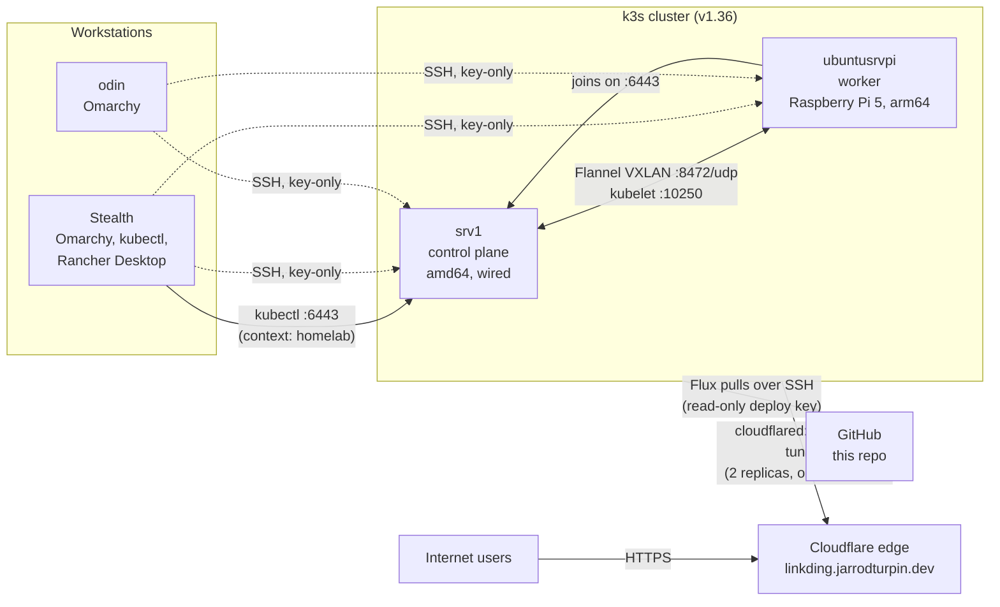

# Homelab Architecture Overview

## Infrastructure Layout

- **Stealth (primary laptop):** daily workstation on Omarchy (Arch Linux). Manages the homelab cluster with `kubectl` and runs a separate local cluster in Rancher Desktop. The two are kept apart as separate `kubectl` contexts (`homelab` and `rancher-desktop`).
- **odin (ThinkPad T480):** second Omarchy workstation, reached over SSH with key-only auth.
- **srv1 (KAMRUI AM21 mini PC):** k3s server (control plane). AMD Ryzen 7 8745HS, 24 GB RAM, 1 TB NVMe, Ubuntu Server 26.04 LTS, wired network only.
- **ubuntusrvpi (Raspberry Pi 5, 8 GB):** k3s agent (worker), Ubuntu Server 24.04 LTS.

## Kubernetes

- **Distribution:** k3s, installed with the official script. It bundles containerd, Flannel networking, CoreDNS, Traefik ingress, ServiceLB, local-path storage, and metrics-server.
- **Mixed architecture:** the control plane is amd64 and the worker is arm64, so every image needs builds for both.
- **Network policy at the host:** ufw on both nodes allows only what the cluster needs: the API server (6443/tcp) from the LAN, kubelet (10250/tcp) and Flannel VXLAN (8472/udp) between the two nodes, and the pod and service networks.
- **GitOps:** FluxCD v2.9 runs in the `flux-system` namespace. It checks this repo every minute and applies `clusters/staging` (with pruning, so anything removed from Git is removed from the cluster). Flux authenticates with a read-only SSH deploy key; no GitHub token is stored in the cluster.
- **Public access:** a Cloudflare Tunnel. Two `cloudflared` pods (one on each node) hold outbound connections to Cloudflare, which forwards requests for `linkding.jarrodturpin.dev` to the Linkding Service. No router ports are open and the home IP isn't published in DNS. The tunnel credentials are a Kubernetes Secret created outside Git.
- **Next:** secrets management in Git, monitoring, and Traefik ingress.

## Sync Strategy

- Homelab docs and cluster configuration: this public repo
- Dotfiles: chezmoi, one private repo applied to every machine (desktop profile on the laptops, server profile on srv1 and the Pi)
- System snapshots (fstab, firewall, sshd, VM definitions): GitHub, per host
- Course work: public `lab` repo on GitHub
- Obsidian vault: private Git repo, plus backups to Proton Drive
- Personal files: rsync to a LUKS-encrypted USB drive and Proton Drive

## Tools Used

- Arch Linux (Omarchy), Ubuntu Server, systemd, ufw
- Bash, Git, chezmoi, mise
- Docker, Kubernetes (k3s), Helm, Prometheus, Grafana
- FluxCD (GitOps), Kustomize
- Cloudflare Tunnel (cloudflared)
- Claude Code for AI-assisted scripting and troubleshooting

## Privacy & Security

- Full-disk encryption (LUKS) and UEFI Secure Boot on the laptops; LUKS on srv1
- SSH key-only authentication with a hardened sshd config on every machine
- Host firewalls on the servers allow SSH only from the workstations
- Secrets, tokens, and kubeconfigs are never stored in public repos
