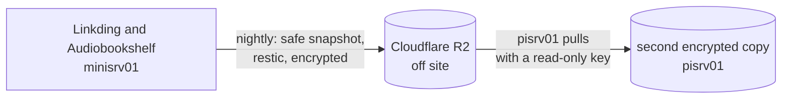

# App backups: Linkding and Audiobookshelf

AI-assisted (planned and written with Claude Code). **Status (2026-11-27):** both apps back up nightly to R2, pisrv01 pulls a second copy, alerts and a monthly restore check are in place, and both apps have been restored from R2 and from pisrv01 and started as separate copies. Scheduled (not hand-started) runs have not been observed yet.

The BlockOne Crypto Tax app has its own backups ([blockone-crypto-tax.md](blockone-crypto-tax.md), "Backups and restore"); this plan doesn't change them.

## Goal

Get Linkding and Audiobookshelf back after losing all the equipment at home, losing at most one day of changes while the nightly jobs work.

## Decisions

| Area | Decision |
|---|---|
| Tool | restic 0.20.0, image pinned by digest (amd64 and arm64) |
| History | Nightly, 35 days in each place, each cleaned up on its own. The window counts back from the newest backup, so old ones stay if new ones stop |
| Access | Its own R2 bucket, with one read-and-write key and one read-only key |
| Downtime | None: SQLite databases are copied with SQLite's online backup API |
| Alerts | Telegram through Alertmanager: a failed job, or no success in 26 hours |
| Secrets | SOPS-encrypted in Git; the restic password and the SOPS age key are also kept in a password manager |
| Deletion protection | The copy on pisrv01. No R2 bucket lock yet, so someone with the write key could delete the R2 copy |

**Not covered:** audio and podcast files (the library was empty on 2026-11-27: revisit before adding any), the k3s datastore, monitoring history, staging data, model files and claim-watch state. Rebuilding the cluster from Git is a separate test; restoring these apps doesn't prove it.

## Build order

- [x] 1. Record the plan
- [x] 2. Linkding backup and restore with test storage and sample data
- [x] 3. Create the R2 bucket, keys and password; start real Linkding backups
- [x] 4. Add Audiobookshelf
- [x] 5. Copy to pisrv01
- [x] 6. Alerts, triggered with a safe test failure (it arrived on the owner's phone)
- [x] 7. Restore drill from R2 and from pisrv01
- [x] 8. Monthly restore check, restore instructions (below), other docs updated

## Done means

- Both apps start from restored copies, kept apart from the live apps.
- Restores work from R2 and from pisrv01.
- Bookmarks and users match what the backup saved.
- A deliberately failed or damaged backup is reported as a failure.
- The test alerts arrive.
- The restore instructions say where to get the keys and the password.
- What was and wasn't tested is written down.

## How the scripts work

| File (`apps/base/app-backup/`) | What it does |
|---|---|
| `linkding.json` | What to save (database, folders, secret key), what must exist, and which row counts to record |
| `snapshot.py` | Copies the database safely, checks its integrity, copies the files and writes `manifest.json` (checksums and counts). Refuses a database with no users, so a freshly emptied app isn't saved as a good backup |
| `backup.sh` | `restic backup`, then `forget --keep-within 35d --prune`, then `check --read-data`. Never creates the repository itself |
| `verify.py` | Checks restored data against the manifest |

Linkding's task queue (`tasks.sqlite3`) is left out. Files are copied after the database, one at a time, so a file the app deletes during the snapshot can be missing from it, or can make the snapshot fail.

`check --read-data` downloads the whole repository every night. That suits a few megabytes; revisit it if the data grows.

## The nightly job (Linkding)

CronJob `linkding-backup` in namespace `linkding`, 02:30 America/Los_Angeles. An init container (Linkding's image) takes the snapshot into a temporary volume; then restic uploads it, applies retention and reads the repository back. It runs as Linkding's user with a read-only root filesystem, all capabilities dropped and no service account token. Its network policy allows only DNS and HTTPS to public addresses. The local-path volume keeps the pod on Linkding's node. A new Linkding image needs the same tag here.

Audiobookshelf has the same job (`apps/staging/audiobookshelf/backup.yaml`), at 02:45, as user 1000, with its config and metadata volumes. Both apps share one restic repository, kept apart by restic's host name; `--retry-lock 10m` makes one job wait while the other holds the lock. Its Secret holds the same values as Linkding's, in the `audiobookshelf` namespace. From `audiobookshelf.json`: the database, `config/migrations`, `metadata/items` and `metadata/authors`. Cache, logs, streams, temporary files and Audiobookshelf's own `metadata/backups` folder are left out.

## Alerts

`apps/staging/app-backup-alerts/rules.yaml`, sent to Telegram: `AppBackupStale` (more than 26 h since a success), `AppBackupNeverSucceeded`, `AppBackupMissing` (a CronJob that no longer exists), `AppBackupRestoreCheckStale` (no successful monthly restore check for 33 days) and `AppBackupJobFailed` (hidden while the stale alert fires). `./scripts/test-app-backup-alerts.sh` unit-tests them with promtool (not part of `validate.sh`: changing that script needs the `production-change` label).

Alert test, 2026-11-27: a Job made from the CronJob with its first step replaced by a deliberate failure (no app data mounted). `AppBackupJobFailed` became active with receiver `telegram`, and Alertmanager's Telegram failure counters stayed at 0. The Job was then deleted.

## The copy on pisrv01

CronJob `app-backup-mirror` in namespace `app-backup-mirror` (Pod Security `restricted`), 05:30. `mirror.sh` copies new backups from R2 with `restic copy`, applies its own 35-day retention, reads the local repository back, and restores the newest backup of each app, which `verify.py` then checks. R2 is read with a token that has **Object Read only**, and with `--no-lock`; `scripts/setup-app-backup-mirror.sh` refuses keys that can write. If the local repository is missing, the job makes a new one and says so in its log.

First run, 2026-11-27 (started by hand): completed on pisrv01 in 23 s; three backups copied, both apps' newest restored and verified (748 bookmarks and 1 user; 2 users and 1 library). A copy that stops, fails or disappears raises the same alerts.

## Restore

**Monthly check (automatic):** `<app>-backup-restore-check`, 05:00 on the 1st, restores the newest backup into a temporary volume and runs `verify.py`. It checks the data, not that the app starts.

**Drill (by hand):** `./scripts/app-restore-drill.sh linkding` or `audiobookshelf`; add `--from-pi` to use the copy on pisrv01 (it then runs there). It restores into a temporary pod, verifies, and starts a second copy of the app on that data, without touching the live app. With `--keep` the copy stays (it stops after an hour) for a look through `kubectl port-forward`; the script prints the commands, including how to delete it.

First drill, 2026-11-27, both apps: restore and verify passed and each copy became ready. Compared with the live apps without printing any values: Linkding's account (username and stored password record) and all 748 bookmark addresses and titles were identical; Audiobookshelf's two account records and library name were identical, and the copy reported itself as set up. **Not done:** signing in to a restored copy with a real password. The first run of the drill failed (`path work: not found`) because the script named a folder that isn't in the backup; the local tests used a different restore command and had not caught it.

From pisrv01, 2026-11-27: both apps restored, verified and became ready on the Pi (arm64), and the same comparisons with the live apps were identical. Linkding failed twice first: only the mirror job's user can read the copy's files, and restic makes the restored folder private to that user. The drill now restores as that user and then copies the files as the app's user. Anyone restoring by hand from pisrv01 has the same two steps.

**Replacing live data after a real loss** has not been rehearsed. Outline: bring up the cluster from this repository; stop the app (a Git change to 0 replicas); `restic restore latest --host <app>` into the empty volume (Linkding: the files go to `/etc/linkding/data`; Audiobookshelf: `config/` and `metadata/` go to the two volumes), keeping the app's user as owner; start the app. You need the restic password and R2 access (password manager and Cloudflare account, or the Secrets in Git with the SOPS age key).

## One-time setup (done 2026-11-27)

1. R2 bucket `homelab-app-backups`: Standard storage, public access off, no lock rule.
2. An account API token with **Object Read & Write** on that bucket only.
3. `./scripts/setup-app-backup-r2.sh` in the owner's own terminal. It asks for the endpoint and the two keys, makes the restic password and waits until the password manager's copy matches, creates the repository, and writes `apps/staging/linkding/linkding-backup-secret.yaml`.

Restoring after losing the cluster needs the restic password and R2 access: from the password manager and the Cloudflare account (a new token can be made there), or from that Secret with the SOPS age key.

## Test

`./scripts/test-app-backup.sh` needs Docker. It runs the real Linkding image with sample data and a throwaway restic repository on local disk. It is not part of `validate.sh` or CI.

Run on 2026-11-27, all 19 checks passed:

- A snapshot taken while bookmarks were being added; backup, restore and manifest check.
- A second Linkding started from the restored data: sign-in with the saved password works, a saved bookmark is shown, the bookmark count matches, bookmarks added after the backup are absent, and a sample asset file is back.
- Retention: 40 and 60 day old backups removed, a 30 day old one kept; old backups survive when none are newer.
- Reported as failures: non-empty destination, missing secret key, empty database, broken database, unfinished snapshot, changed file, missing file, wrong row count, wrong password, damaged backup file, missing repository.

Also on 2026-11-27:

- The CronJob in a temporary kind cluster, with a fresh Linkding and a restic repository on a temporary volume instead of R2: it completed with the security settings above. A first attempt that started before Linkding had created its database failed with `database not found`, and the retry succeeded. The network policy's effect was not checked there.
- The setup script with fake keys and a fake Docker and clipboard: bad input, password mismatch, rejected keys and an existing Secret stop it without writing a file. Its real run created and read back the repository in R2.

First run on the homelab cluster, 2026-11-27 (a Job created by hand from the CronJob): completed in 14 s. The snapshot held 705 files with 748 bookmarks and 1 user, the same counts as the live database just before; 1.3 MiB, 759 KiB stored. `check --read-data` found no errors, and Linkding's public health page answered 200 afterwards.

`./scripts/test-app-backup-audiobookshelf.sh` (6 checks passed 2026-11-27): the real Audiobookshelf image with sample users, a library and a metadata file; backup, restore, and a second Audiobookshelf started from the restore, where the saved login works and shows the saved library and both users but not one added after the backup. An app with no users is refused.

**Not tested yet:** a scheduled (not hand-started) nightly or monthly run, whether the network policies block other traffic, signing in to a restored copy with a real password, and replacing live data.
