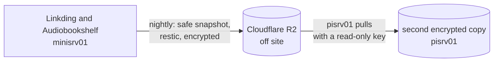

# App backups: Linkding and Audiobookshelf

AI-assisted (planned and written with Claude Code). **Status: not running yet.** The Linkding backup and restore scripts are tested locally with sample data. Nothing is deployed and no real data has been backed up by them.

The BlockOne Crypto Tax app has its own backups ([blockone-crypto-tax.md](blockone-crypto-tax.md), "Backups and restore"); this plan doesn't change them.

## Goal

Get Linkding and Audiobookshelf back after losing all the equipment at home, losing at most one day of changes while the nightly jobs work.

## Decisions

| Area | Decision |
|---|---|
| Tool | restic 0.20.0, image pinned by digest (amd64 and arm64) |
| History | Nightly, 35 days in each place, each cleaned up on its own. The window counts back from the newest backup, so old ones stay if new ones stop |
| Access | Its own R2 bucket, with one read-and-write key and one read-only key |
| Downtime | None: SQLite databases are copied with SQLite's online backup API |
| Alerts | Telegram through Alertmanager: a failed job, or no success in 26 hours |
| Secrets | SOPS-encrypted in Git; the restic password and the SOPS age key are also kept in a password manager |
| Deletion protection | The copy on pisrv01. No R2 bucket lock yet, so someone with the write key could delete the R2 copy |

**Not covered:** audio and podcast files (the library was empty on 2026-11-27: revisit before adding any), the k3s datastore, monitoring history, staging data, model files and claim-watch state. Rebuilding the cluster from Git is a separate test; restoring these apps doesn't prove it.

## Build order

- [x] 1. Record the plan
- [x] 2. Linkding backup and restore with test storage and sample data
- [ ] 3. Create the R2 bucket, keys and password; start real Linkding backups
- [ ] 4. Add Audiobookshelf
- [ ] 5. Copy to pisrv01
- [ ] 6. Alerts, triggered with safe test failures
- [ ] 7. Restore drill from R2 and from pisrv01
- [ ] 8. Monthly restore check, restore instructions, update the other docs

## Done means

- Both apps start from restored copies, kept apart from the live apps.
- Restores work from R2 and from pisrv01.
- Bookmarks and users match what the backup saved.
- A deliberately failed or damaged backup is reported as a failure.
- The test alerts arrive.
- The restore instructions say where to get the keys and the password.
- What was and wasn't tested is written down.

## How the scripts work

| File (`apps/base/app-backup/`) | What it does |
|---|---|
| `linkding.json` | What to save (database, folders, secret key), what must exist, and which row counts to record |
| `snapshot.py` | Copies the database safely, checks its integrity, copies the files and writes `manifest.json` (checksums and counts). Refuses a database with no users, so a freshly emptied app isn't saved as a good backup |
| `backup.sh` | `restic backup`, then `forget --keep-within 35d --prune`, then `check --read-data`. Never creates the repository itself |
| `verify.py` | Checks restored data against the manifest |

Linkding's task queue (`tasks.sqlite3`) is left out. Files are copied after the database, one at a time, so a file the app deletes during the snapshot can be missing from it, or can make the snapshot fail.

`check --read-data` downloads the whole repository every night. That suits a few megabytes; revisit it if the data grows.

## Test

`./scripts/test-app-backup.sh` needs Docker. It runs the real Linkding image with sample data and a throwaway restic repository on local disk. It is not part of `validate.sh` or CI.

Run on 2026-11-27, all 19 checks passed:

- A snapshot taken while bookmarks were being added; backup, restore and manifest check.
- A second Linkding started from the restored data: sign-in with the saved password works, a saved bookmark is shown, the bookmark count matches, bookmarks added after the backup are absent, and a sample asset file is back.
- Retention: 40 and 60 day old backups removed, a 30 day old one kept; old backups survive when none are newer.
- Reported as failures: non-empty destination, missing secret key, empty database, broken database, unfinished snapshot, changed file, missing file, wrong row count, wrong password, damaged backup file, missing repository.

**Not tested yet:** R2, the Kubernetes jobs and their permissions, file ownership on the real volume, the arm64 run on pisrv01, alerts, and anything with real data. Audiobookshelf has no spec file yet.
