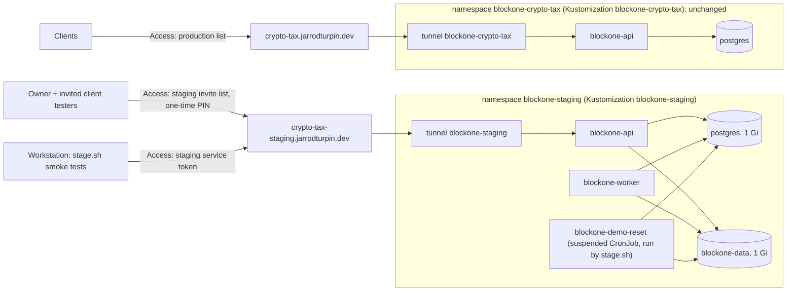

# BlockOne Crypto Tax: staging

Status: **built, not deployed** (2026-11-12, branch `feat/blockone-staging`). Waits for the owner steps below.

AI-assisted: the overlay, the isolation check, the release scripts (app repo, `scripts/release/`) and this page were written with Claude Code. The owner set the requirements: a staging phase where updates are tested automatically and by the clients who asked for a feature, with nothing reaching production until the owner approves; no client data in staging; a rollback for the app and its data.

Production is `docs/blockone-crypto-tax.md` (namespace `blockone-crypto-tax`, `crypto-tax.jarrodturpin.dev`, real client data). Despite the cluster being called "staging" (`clusters/staging`), that deployment is production. This page is the separate staging deployment next to it. The release process (stage, client testing, promote, rollback) is in the app repo's `docs/release_process.md`.

## What runs where



| Piece | Where | Notes |
|---|---|---|
| Flux Kustomization | `clusters/staging/blockone-staging.yaml` | its own, `prune: true`, `targetNamespace: blockone-staging`, SOPS decryption |
| Overlay | `apps/staging/blockone-crypto-tax-staging/` | the production base (`apps/base/blockone-crypto-tax`) with patches; nothing in the base or the production overlay changed |
| Settings | `configMapGenerator` merge | `BLOCKONE_WEB_SITE_MODE=staging` (STAGING banner on every page, an upload warning, a synthetic demo taxpayer per tester, the demo reset allowed); `BLOCKONE_WEB_PRICES_ONLINE=false`. Everything else as production, including `ENVIRONMENT=production` and Cloudflare auth |
| Demo reset | `demo-reset.yaml` | a suspended CronJob used as a Job template; `stage.sh` runs it after each deploy. Its own NetworkPolicy: DNS and PostgreSQL only |
| Quota | `quota.yaml` | 1 CPU and 1.5 Gi requested, 4.5 Gi of limits, 4 Gi of volumes, 12 pods, no LoadBalancer or NodePort Services |
| Tunnel | `cloudflare.yaml` | tunnel `blockone-staging`, one `cloudflared` replica, hostname `crypto-tax-staging.jarrodturpin.dev` |
| Secrets | `*-secret.yaml` (+ `.example`) | `blockone-db` and `blockone-staging-keys` were generated for staging and SOPS-encrypted; `blockone-app`, `ghcr-pull` and `tunnel-credentials` are owner steps |
| Removed from the base | patches `$patch: delete` | the backup and mirror CronJobs, the mirror volume, their NetworkPolicies, the backup alerts (the rules name production's namespace, so a copy would only duplicate production's alerts) |

**No backups for staging.** It holds only synthetic demo taxpayers and whatever testers make from them, and all of it is wiped at every staging deploy. Its volumes use the `local-path` class (deleted with the claim) and have no "keep on prune" annotation, so removing staging removes all of it.

## How staging is kept away from production

- **Namespace.** Every object is in `blockone-staging`: the overlay's `namespace:` field, and Flux's `targetNamespace` as a second guard.
- **CI check.** `scripts/check-staging-isolation.sh` (run by `validate.sh`, so in CI too, with the full history checked out) fails if: the staging build fails; any staging object is cluster-scoped or outside `blockone-staging`; the text `blockone-crypto-tax` appears anywhere in the staging render except the image name; the staging Flux Kustomization's name, path, `targetNamespace` or `prune` change; or **production's full render** (base included) differs from `origin/main`'s beyond app image lines. Image-only changes (promotions, Renovate pins) pass and are listed; any other production change needs the PR label **`production-change`** (CI then sets `BLOCKONE_ALLOW_PROD_CHANGE=1`), which the app repo's rollback PRs carry and only maintainers can set. A missing `origin/main` fails the check. Tested 2026-11-12: each of those failures, and an image-only change passing.
- **Flux.** Its own Kustomization. Pruning can only delete what this Kustomization applied, which is only staging. Production's Kustomization, path and objects are untouched, so its `prune: true` has nothing new to act on.
- **Network.** Each namespace has default-deny NetworkPolicies, and the allow rules select pods by label within their own namespace. A staging pod can't reach production's PostgreSQL or API (and the other way round).
- **Data and secrets.** Its own PostgreSQL, password, tax id key and volume: no production value is copied. The demo data is synthetic (made-up exchange and wallet names, no addresses, no tax ids). The demo reset refuses unless the app is in staging mode and the data volume carries staging's marker file (or is empty), so even pointed at production it would delete nothing.
- **Access.** Its own Cloudflare Access application and invite list, separate from production's; the app's own `BLOCKONE_WEB_ALLOWED_EMAILS` is separate too. The smoke-test service token is allowed only on the staging application, and the app refuses service tokens unless `BLOCKONE_WEB_SITE_MODE=staging`.
- **Resources.** The quota caps staging well below what minisrv01 has spare (24 GiB node, about 5.4 GiB in use on 2026-11-12). Staging's pods use the **PriorityClass `blockone-staging`** (value -100, never preempts; `infrastructure/configs/base/scheduling`, cluster-scoped, applied by `infra-configs`, which staging's Kustomization depends on). Production keeps the default priority 0, so under memory pressure the scheduler and the kubelet's eviction order favour production. **Owner note:** this is the one cluster-scoped object the staging work adds; production's manifests are not changed for it.
- **Disk.** `local-path` doesn't enforce a volume's size: staging's "1 Gi" volumes can grow until minisrv01's disk is full, which would hurt production on the same disk. The quota counts requested sizes, not use. Mitigations, in order of effort (proposed, not done): watch the node's filesystem (node-exporter's `node_filesystem_avail_bytes` alert, once Alertmanager has a receiver); put staging's volumes on a separate disk or partition with its own local-path `StorageClass` (a `nodePathMap` entry for another path); or move staging to pisrv01 once it has its SSD.

## Cost

Requests: about 90m CPU and 0.5 Gi memory at rest (API 20m/128 Mi, worker 50m/192 Mi, PostgreSQL 20m/64 Mi, cloudflared 10m/32 Mi), plus a demo-reset pod for a few seconds per deploy. Limits: 512 Mi + 1 Gi + 256 Mi + 128 Mi. Disk: 2 Gi on minisrv01. One more tunnel and Access application (both within Cloudflare's free Zero Trust plan, which covers up to 50 users). No R2 storage.

## How the automated tests get in

The smoke suite (`tests/e2e` in the app repo, run by `stage.sh` from the workstation) goes through Cloudflare like a tester, using a **Cloudflare Access service token scoped to the staging application only**. Access checks the `CF-Access-Client-Id`/`CF-Access-Client-Secret` headers and signs the request; the app verifies that token (signature, issuer, AUD) and accepts it only if its Client ID is on `BLOCKONE_WEB_SERVICE_TOKEN_IDS`, which the app allows only in staging mode. The token gets its own account and demo taxpayer, like any tester.

Why this rather than a Job inside the cluster against the internal Service: it tests exactly what testers use (DNS, tunnel, Access, the app's token check), needs no second API instance with a weaker sign-in, and no Job that could reach the API from inside. The token can only open staging, which holds no client data; it is revocable on its own and expires (one year). The in-cluster route would need either a dev-auth API instance (a second way in, however well fenced) or a way to mint Access tokens, which only Cloudflare can.

## Owner steps

Cloudflare's dashboard paths as of November 2026 (Zero Trust at one.dash.cloudflare.com; older layouts put Applications under "Access"). Do them in order on this branch, then merge. Values in `<angle brackets>` are yours; none go into Git unencrypted.

1. **Tunnel** (workstation):

   ```bash
   cloudflared tunnel create blockone-staging          # writes ~/.cloudflared/<tunnel-id>.json
   cloudflared tunnel route dns blockone-staging crypto-tax-staging.jarrodturpin.dev
   ```

2. **Testers group.** Zero Trust → Access controls → Access groups → Add a group: name `BlockOne staging testers`, include **Emails**: yourself and each client tester you invite. This is the staging invite list (production's stays as it is). You add or remove a client here.
3. **Service token.** Access controls → Service credentials → Service Tokens → Create Service Token: name `blockone-staging-smoke`, duration 1 year (8760h). Copy the **Client ID** and the **Client Secret** (shown once) straight into the file in step 9.
4. **Access application.** Access controls → Applications → Add an application → Self-hosted: name `BlockOne Crypto Tax (STAGING)`, session duration 24 hours, public hostname `crypto-tax-staging.jarrodturpin.dev`, path empty. Login methods: One-time PIN.
5. **Policies** on that application, in this order:
   - `smoke-tests`: action **Service Auth**, include **Service Token** → `blockone-staging-smoke`. (Without Service Auth, Access sends the token to a sign-in page instead.)
   - `testers`: action **Allow**, include **Access groups** → `BlockOne staging testers`. No "Everyone" rule.

   Don't add the service token to production's application.
6. Copy the staging application's **Application Audience (AUD) Tag** (Overview / Basic information). The team domain is the same as production's.
7. **Secrets** (from the repo root, values from variables straight into SOPS-encrypted files):

   ```bash
   cd apps/staging/blockone-crypto-tax-staging
   umask 077
   read -rp 'Team (as production): ' TEAM; read -rp 'Staging AUD tag: ' AUD
   read -rp 'Invited emails, comma-separated (same as the group): ' EMAILS
   read -rp 'Service token Client ID: ' TOKEN_ID
   envfile=$(mktemp)
   printf 'BLOCKONE_WEB_CF_TEAM_DOMAIN=%s\nBLOCKONE_WEB_CF_AUD=%s\nBLOCKONE_WEB_ALLOWED_EMAILS=%s\nBLOCKONE_WEB_SERVICE_TOKEN_IDS=%s\n' \
     "$TEAM" "$AUD" "$EMAILS" "$TOKEN_ID" > "$envfile"
   kubectl create secret generic blockone-app --from-env-file="$envfile" --dry-run=client -o yaml > blockone-app-secret.yaml
   shred -u "$envfile"; sops -e -i blockone-app-secret.yaml

   kubectl create secret generic tunnel-credentials \
     --from-file=credentials.json="$HOME/.cloudflared/<tunnel-id>.json" --dry-run=client -o yaml > tunnel-credentials-secret.yaml
   sops -e -i tunnel-credentials-secret.yaml

   # the same read:packages token as production's ghcr-pull (or a new one)
   read -rsp 'GHCR token: ' GHCR_TOKEN; echo
   kubectl create secret docker-registry ghcr-pull --docker-server=ghcr.io --docker-username=turpinator-x \
     --docker-password="$GHCR_TOKEN" --dry-run=client -o yaml > ghcr-pull-secret.yaml
   unset GHCR_TOKEN; sops -e -i ghcr-pull-secret.yaml
   grep -c 'ENC\[' blockone-app-secret.yaml tunnel-credentials-secret.yaml ghcr-pull-secret.yaml
   ```

8. Uncomment the three owner Secret lines in `kustomization.yaml`, run `./scripts/validate.sh`, commit (the hook refuses an unencrypted Secret), merge. Then `flux get kustomizations blockone-staging` shows Ready, and `kubectl --context homelab -n blockone-staging get pods` shows the API, worker, PostgreSQL and cloudflared Running. Until the first `stage.sh` run, staging runs production's current image, which predates staging mode (no banner, no demo).
9. **Smoke-test credentials on the workstation** (read by `stage.sh`, never printed):

   ```bash
   install -d -m 700 ~/.config/blockone
   ( umask 077; read -rp 'Client ID: ' id; read -rsp 'Client Secret: ' s; echo
     printf 'BLOCKONE_E2E_CF_CLIENT_ID=%s\nBLOCKONE_E2E_CF_CLIENT_SECRET=%s\n' "$id" "$s" > ~/.config/blockone/staging-smoke.env )
   ```

10. **Check the gate** from a private window: `https://crypto-tax-staging.jarrodturpin.dev` shows Cloudflare's sign-in, an invited email gets a PIN, any other doesn't; after sign-in every page has the red STAGING banner. `curl -s -o /dev/null -w '%{http_code}\n' https://crypto-tax-staging.jarrodturpin.dev/` gives 302.

11. **PR label** for production changes beyond the image (the app's rollback PRs carry it; the isolation check allows a production render change only with it): `gh label create production-change --repo turpinator-x/homelab --color B60205 --description "Changes production beyond its image: owner-approved"`.

**Inviting a client tester later:** add the email to the `BlockOne staging testers` group *and* to `BLOCKONE_WEB_ALLOWED_EMAILS` (`sops apps/staging/blockone-crypto-tax-staging/blockone-app-secret.yaml`, then a PR; staging only). Removing one: the reverse. Rotating the service token: Refresh it in Cloudflare (same Client ID) or make a new one and change both the Secret and `~/.config/blockone/staging-smoke.env`.

## Verified, and not

Verified on 2026-11-12: `./scripts/validate.sh` (kubeconform strict on the staging build, 20 objects); the isolation check, including each failure path; the rendered overlay (namespace renamed, backups removed, settings merged, sizes and volume class patched, the generated ConfigMap name reaching the reset CronJob); the two generated Secrets encrypt to the repo's age recipient. The app side (staging mode, service tokens, demo seed and reset, the smoke suite against a local API + worker on PostgreSQL 18) is tested in the app repo.

Not verified: anything on the cluster or in Cloudflare (nothing was applied; the owner steps aren't done), the smoke suite through a real Access service token, and the demo reset Job in the cluster.

## Open items

- Staging's disk use isn't capped (above, "Disk").
- Staging tracks only what `stage.sh` deploys; a Renovate PR to the base (e.g. PostgreSQL) changes production and staging together, as before.
