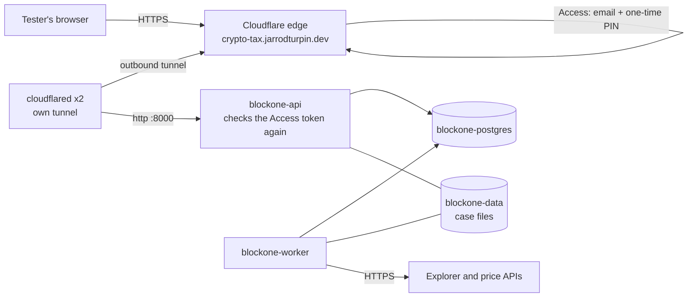

# BlockOne Crypto Tax tester app

Status: **built, not yet live** (2026-11-11). The manifests are on branch `feat/blockone-crypto-tax`. They go live once the image is built, the Secrets are added, Cloudflare Access is set up and the pull request is merged. **Don't merge before the checklist below is done:** until then the pods can't pull the image or start.

AI-assisted: the manifests, the app's Dockerfile and image workflow, and this page were written with Claude Code. I set the requirements (private app, only two testers, no open ports, secrets encrypted, both architectures) and review and run each step.

## What it is

The web app for BlockOne Global Solutions' crypto tax reports (private repo `turpinator-x/blockone-crypto-tax`, `src/nftcb/web/`): a FastAPI API and a job worker that wrap the cost-basis engine, with PostgreSQL for accounts, taxpayers and jobs, and a volume for each taxpayer's case files. This deployment is for two testers. It is public on the internet only behind Cloudflare Access.



## How it's built

| Piece | Where | Notes |
|---|---|---|
| Namespace | `apps/base/blockone-crypto-tax/namespace.yaml` | Pod Security **restricted** enforced; not pruned (keeps data) |
| API | `api.yaml` | `uvicorn` on 8000, `/healthz` probes, trusts `X-Forwarded-*` only from the pod network |
| Worker | `worker.yaml` | polls for jobs; the only pod with the explorer API keys; 300 s to finish a job on shutdown |
| Migrations | initContainer `migrate` in both | see "Why an initContainer" |
| PostgreSQL 18 | `postgres.yaml` | StatefulSet, one replica, uid 999, read-only root, 2 Gi `local-path-retain` volume |
| Case files | `storage.yaml` | 5 Gi `local-path-retain`, shared by API and worker |
| NetworkPolicies | `networkpolicy.yaml`, overlay `cloudflare.yaml` | default deny, then per pod (below) |
| Tunnel | `apps/staging/blockone-crypto-tax/cloudflare.yaml` | own tunnel `blockone-crypto-tax`, 2 replicas, like Linkding's |
| Image pin | overlay `kustomization.yaml` (`images:`) | tag `sha-<commit>` plus digest; **placeholder until the first build** |
| Secrets | overlay `*-secret.yaml.example` | templates only; real ones are SOPS-encrypted (checklist step 4) |
| Flux | `clusters/staging/blockone-crypto-tax.yaml` | its own Kustomization, not part of `apps` |

- **One image, three commands.** The app repo's `Dockerfile` builds one image (`python:3.12.16-slim-trixie` pinned by digest, uid 10001, no secrets inside) whose entrypoint runs `api`, `worker` or `migrate`. Its `image` workflow builds linux/amd64 and linux/arm64 on pushes to `main` and `v*.*.*` tags and pushes `ghcr.io/turpinator-x/blockone-crypto-tax:sha-<commit>` (plus the version on tags). Actions are pinned by commit SHA; the job has `contents: read` and `packages: write` only.
- **All pods on minisrv01.** `local-path` volumes live on one node, and the API and worker share the case-files volume, so they and PostgreSQL are pinned to minisrv01 with a `nodeSelector` (as Audiobookshelf is). The image is still multi-arch, so moving them later is a manifest change.
- **Read-only root filesystems everywhere**, all capabilities dropped, no service account token, `RuntimeDefault` seccomp. Writable places are the volumes and size-limited `emptyDir`s for `/tmp`.
- **Database password once.** PostgreSQL reads it from Secret `blockone-db`; the app builds `BLOCKONE_WEB_DATABASE_URL` from the same key with Kubernetes' `$(VAR)` substitution. The variable is named `BLOCKONE_WEB_DB_PASSWORD` on purpose: the worker strips every `BLOCKONE_WEB_*` variable before starting the engine's child processes, so they never see it.
- **Two sign-in checks.** Cloudflare Access lets only the two allowed emails through (one-time PIN). The app (`BLOCKONE_WEB_AUTH_MODE=cloudflare`) then verifies the `Cf-Access-Jwt-Assertion` token against the team's signing keys and the application's AUD tag, and checks the email against `BLOCKONE_WEB_ALLOWED_EMAILS`. Someone reaching the Service from inside the cluster without a valid token gets 401.

### Why an initContainer for migrations, not a Job

A Flux-managed Job is immutable: a new image tag means Flux must delete and re-create it (`force`), and the API would still need a way to wait for it. An initContainer runs `python -m nftcb.web.migrate` before every API or worker start, which is idempotent (Alembic does nothing at head), needs no ordering between objects, and guarantees neither process runs against an older schema. If the API and worker migrate at the same moment, PostgreSQL's transactional DDL makes the second one fail cleanly, and Kubernetes restarts it.

### Why its own PostgreSQL

The cluster runs no shared database or operator (checked 2026-11-11). One small StatefulSet is the least to run for two testers. CloudNativePG (used in the AKS project) becomes worth it once backups and point-in-time restore matter: see "Open items".

### Why its own Flux Kustomization

The app's Secrets and image are added after the manifests. As part of `apps`, a missing Secret file or a bad manifest would fail the whole `apps` build and stop Linkding, Audiobookshelf and the dashboard from reconciling. On its own (like `arc`), a problem here only shows on `flux get kustomization blockone-crypto-tax`. Missing Secrets don't fail the apply at all: the pods wait in `CreateContainerConfigError` until the Secret exists.

## Network policy, and what it can't do

| Pod | In | Out |
|---|---|---|
| everything | denied by `default-deny` unless listed | denied unless listed |
| cloudflared | nothing | DNS; the API on 8000; public addresses on 7844 (TCP/UDP) and 443 |
| blockone-api | cloudflared on 8000 | DNS; PostgreSQL; public addresses on 443 (Access signing keys) |
| blockone-worker | nothing | DNS; PostgreSQL; public addresses on 443 and 51234 (Ripple's XRPL node) |
| blockone-postgres | pods labelled `blockone-db-client: "true"` (API, worker) on 5432 | nothing |

"Public addresses" means everything except the private ranges, so no pod here can reach the home network or other apps. **NetworkPolicy can't filter by hostname**: the worker may reach any public HTTPS server, not only the explorers it uses (Etherscan, Routescan, Alchemy, Helius, Solana, Flare/Songbird, XRPL, AlgoNode, Blockfrost, CryptoCompare, CoinGecko, GoPlus, mempool.space, Pi Network). Options, from least to most work:

1. **As built:** port and private-range limits. Stops lateral movement, not data leaving to an arbitrary public host.
2. **An egress proxy** (e.g. Squid or tinyproxy in this namespace) with a domain allowlist, the worker's `HTTPS_PROXY` pointed at it (the engine uses httpx, which honours it), and the worker's policy allowing only the proxy. Recommended next step if this goes past testing.
3. **An FQDN-aware CNI:** Cilium's `toFQDNs` policies. Planned with the Talos rebuild, not on k3s's Flannel.

The API's 443 egress is only for Cloudflare's signing keys (`<team>.cloudflareaccess.com/cdn-cgi/access/certs`); the same limitation applies.

## Owner checklist

Do these on the branch, in order, then merge. Values below in `<angle brackets>` are yours to fill in; none of them go into Git unencrypted.

### 1. Build the first image (app repo)

1. Merge the app repo's `feat/container-image` pull request **after** the Cloudflare auth mode and tester pages are on `main` (the image must include `BLOCKONE_WEB_AUTH_MODE=cloudflare`).
2. The `image` workflow runs on the push to `main`. Its run summary prints the tag (`sha-<commit>`) and the digest (`sha256:...`).
3. Check both architectures: `docker buildx imagetools inspect ghcr.io/turpinator-x/blockone-crypto-tax:sha-<commit>` lists linux/amd64 and linux/arm64.
4. Put the tag and digest into `apps/staging/blockone-crypto-tax/kustomization.yaml` under `images:` (replacing both PLACEHOLDER lines).

### 2. Let the cluster pull the private image

The package is private like its repo. Either:

- **Keep it private (recommended):** GitHub, Settings, Developer settings, Personal access tokens, **Tokens (classic)**, new token with only `read:packages`, 1-year expiry, note "homelab ghcr pull". (GHCR doesn't accept fine-grained tokens for pulls.) It becomes Secret `ghcr-pull` in step 4.
- **Or make the package public** (Package settings, Change visibility). The image holds no secrets or client data, but it does hold the app's source. Then drop `imagePullSecrets` from `api.yaml` and `worker.yaml` and skip `ghcr-pull`.

Also check the package page lists the repo under "Repository access" (the `org.opencontainers.image.source` label links it on the first push).

### 3. Tunnel and Cloudflare Access

Tunnel, from the workstation (as for the other apps):

```bash
cloudflared tunnel create blockone-crypto-tax          # writes ~/.cloudflared/<tunnel-id>.json
cloudflared tunnel route dns blockone-crypto-tax crypto-tax.jarrodturpin.dev
```

Access, in Cloudflare Zero Trust (one.dash.cloudflare.com):

1. **Settings, Authentication:** make sure **One-time PIN** is an enabled login method.
2. **Access, Applications, Add an application, Self-hosted.** Name `BlockOne Crypto Tax (tester)`, session duration 24 hours, public hostname `crypto-tax.jarrodturpin.dev` (path empty, so the whole host is covered).
3. **Policy:** name `testers`, action **Allow**, include rule **Emails**: the two tester addresses. No "Everyone" rule. Under login methods, allow One-time PIN (and turn off "instant auth" for other providers if they're listed).
4. Save, then open the application's **Overview** (or Basic information) and copy the **Application Audience (AUD) Tag** (64 hex characters).
5. **Settings, Custom Pages** (or Team and resources) shows the **team domain**, `<team>.cloudflareaccess.com`. The app accepts `<team>` or the full domain.
6. Check from a private window: `https://crypto-tax.jarrodturpin.dev` should show Cloudflare's sign-in page before anything from the cluster. An email not on the list gets no PIN.

### 4. Create the Secrets (SOPS)

Work in `apps/staging/blockone-crypto-tax/`. Each `.example` shows the shape; the commands below write the real files so values never sit in an editor buffer or Git unencrypted. `kubectl create ... --dry-run=client` doesn't talk to the cluster. After each file: `sops -e -i <file>` and check it shows `ENC[` for every value.

```bash
cd apps/staging/blockone-crypto-tax

# Tunnel credentials (the file from step 3), then delete the local copy if you don't keep tunnels' files
kubectl create secret generic tunnel-credentials \
  --from-file=credentials.json="$HOME/.cloudflared/<tunnel-id>.json" \
  --dry-run=client -o yaml > tunnel-credentials-secret.yaml
sops -e -i tunnel-credentials-secret.yaml

# PostgreSQL password: hex only, so the database URL needs no escaping
kubectl create secret generic blockone-db \
  --from-literal=password="$(openssl rand -hex 32)" \
  --dry-run=client -o yaml > blockone-db-secret.yaml
sops -e -i blockone-db-secret.yaml

# App settings. The tax id key is a Fernet key (32 random bytes, URL-safe base64), the same as
# cryptography's Fernet.generate_key(). Save it in the password manager too: without it, the stored
# SSNs/EINs can't be read back.
umask 077; envfile=$(mktemp)
{
  printf 'BLOCKONE_WEB_TAX_ID_KEYS=%s\n' "$(python3 -c 'import base64,os;print(base64.urlsafe_b64encode(os.urandom(32)).decode())')"
  printf 'BLOCKONE_WEB_CF_TEAM_DOMAIN=%s\n' '<team>'
  printf 'BLOCKONE_WEB_CF_AUD=%s\n' '<aud tag from step 3>'
  printf 'BLOCKONE_WEB_ALLOWED_EMAILS=%s\n' '<first email>,<second email>'
} > "$envfile"
kubectl create secret generic blockone-app --from-env-file="$envfile" \
  --dry-run=client -o yaml > blockone-app-secret.yaml
shred -u "$envfile"
sops -e -i blockone-app-secret.yaml

# Explorer and price API keys: new keys made for this deployment, not the laptop's. Leave out any you don't have.
umask 077; envfile=$(mktemp)
"${EDITOR:-vi}" "$envfile"   # ETHERSCAN_API_KEY=..., ALCHEMY_API_KEY=..., HELIUS_API_KEY=..., BLOCKFROST_PROJECT_ID=..., CRYPTOCOMPARE_API_KEY=...
kubectl create secret generic blockone-explorer-keys --from-env-file="$envfile" \
  --dry-run=client -o yaml > blockone-explorer-keys-secret.yaml
shred -u "$envfile"
sops -e -i blockone-explorer-keys-secret.yaml

# GHCR pull secret (skip if the package is public). read -s keeps the token out of shell history.
read -rsp 'GHCR token: ' GHCR_TOKEN; echo
kubectl create secret docker-registry ghcr-pull --docker-server=ghcr.io \
  --docker-username=turpinator-x --docker-password="$GHCR_TOKEN" \
  --dry-run=client -o yaml > ghcr-pull-secret.yaml
unset GHCR_TOKEN
sops -e -i ghcr-pull-secret.yaml
```

Then uncomment the five Secret lines in `kustomization.yaml`, run `./scripts/validate.sh`, and commit. The pre-commit hook refuses any of these files if it isn't encrypted.

To rotate the tax id key later: put the new key first, keep the old one after a comma (`new,old`), deploy; old records still decrypt.

### 5. Merge and let Flux apply it

Review the PR, merge, and Flux picks it up within a minute.

### 6. Verify (read-only)

```bash
flux get kustomizations blockone-crypto-tax            # Ready, with the merge commit's revision
kubectl -n blockone-crypto-tax get pods -o wide        # api, worker, postgres-0, 2x cloudflared: Running, on minisrv01 (cloudflared anywhere)
kubectl -n blockone-crypto-tax logs deploy/blockone-api -c migrate      # Alembic ran (or had nothing to do)
kubectl -n blockone-crypto-tax logs deploy/blockone-worker -c worker | head   # "worker ... started"
kubectl -n blockone-crypto-tax logs deploy/cloudflared | grep "Registered tunnel connection"
kubectl -n blockone-crypto-tax get networkpolicy        # default-deny, blockone-api, -worker, -postgres, cloudflared
cloudflared tunnel info blockone-crypto-tax
```

Then in a browser: `https://crypto-tax.jarrodturpin.dev` asks for an email and PIN; a listed tester gets in; any other address is refused by Access. Failure paths worth one check each: an unlisted email gets no PIN; `curl -s -o /dev/null -w '%{http_code}' https://crypto-tax.jarrodturpin.dev/healthz` without signing in returns Cloudflare's redirect (302), not the app's JSON.

When something's wrong: `kubectl -n blockone-crypto-tax describe pod <pod>` shows `ImagePullBackOff` (digest or pull secret), `CreateContainerConfigError` (a Secret is missing or a key misnamed), or an initContainer still waiting for PostgreSQL. `worker not started: web settings invalid: ...` in the worker log names the setting that's wrong, never its value.

## Open items

- **Backups.** PostgreSQL and the case files sit on minisrv01's disk only (`Retain` keeps them if the PVC goes, not if the disk dies). Before real client data: a nightly `pg_dump` CronJob and a copy of `blockone-data` off the node, or CloudNativePG with object-storage backups.
- **Egress by hostname** (egress proxy or Cilium, above).
- **Image updates.** Renovate's kustomize manager can follow `images:` digests, but a new `sha-<commit>` tag isn't a version it can order. For now the tag and digest are bumped by hand after each app release; tagging the app repo with `v*.*.*` versions would let Renovate open those PRs.
- **CI minutes.** The image workflow uses GitHub's hosted runner (arm64 under QEMU) on each push to `main`. If minutes run short, add the repo to the self-hosted runners (`docs/github-runners.md`) or build arm64 natively.
