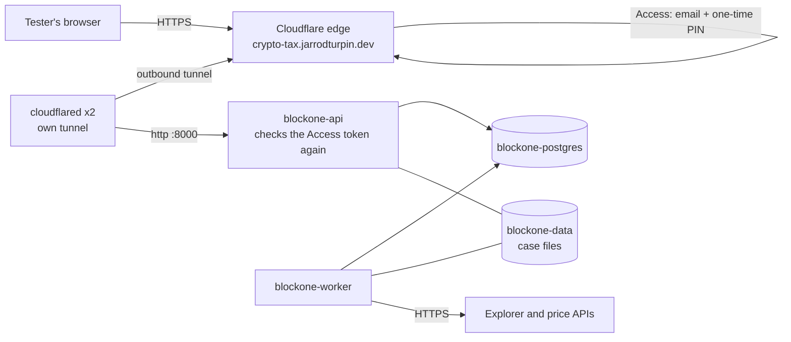
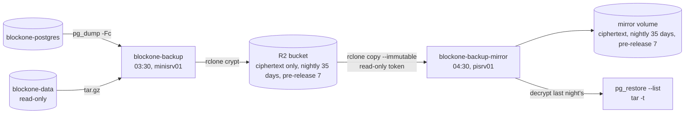

# BlockOne Crypto Tax tester app

Status: **deployed** 2026-11-11 (PR #32; Flux applied `main@2af851a`, pods Running on minisrv01). The owner checklist below is how it went live. Nightly backups are on branch `feat/blockone-backups`: see "Backups and restore".

AI-assisted: the manifests, the app's Dockerfile and image workflow, and this page were written with Claude Code. I set the requirements (private app, only two testers, no open ports, secrets encrypted, both architectures) and review and run each step.

## What it is

The web app for BlockOne Global Solutions' crypto tax reports (private repo `turpinator-x/blockone-crypto-tax`, `src/nftcb/web/`): a FastAPI API and a job worker that wrap the cost-basis engine, with PostgreSQL for accounts, taxpayers and jobs, and a volume for each taxpayer's case files. This deployment is for two testers. It is public on the internet only behind Cloudflare Access.



## How it's built

| Piece | Where | Notes |
|---|---|---|
| Namespace | `apps/base/blockone-crypto-tax/namespace.yaml` | Pod Security **restricted** enforced; not pruned (keeps data) |
| API | `api.yaml` | `uvicorn` on 8000, `/healthz` probes, trusts `X-Forwarded-*` only from the pod network |
| Worker | `worker.yaml` | polls for jobs; the only pod with the explorer API keys; 300 s to finish a job on shutdown |
| Migrations | initContainer `migrate` in both | see "Why an initContainer" |
| PostgreSQL 18 | `postgres.yaml` | StatefulSet, one replica, uid 999, read-only root, 2 Gi `local-path-retain` volume |
| Case files | `storage.yaml` | 5 Gi `local-path-retain`, shared by API and worker |
| NetworkPolicies | `networkpolicy.yaml`, overlay `cloudflare.yaml` | default deny, then per pod (below) |
| Tunnel | `apps/staging/blockone-crypto-tax/cloudflare.yaml` | own tunnel `blockone-crypto-tax`, 2 replicas, like Linkding's; hostnames in "blockproof.tax hostnames" |
| Holding page | overlay `holding-page.yaml` | static page for `blockproof.tax`, behind the same Access application |
| Image pin | overlay `kustomization.yaml` (`images:`) | tag `sha-<commit>` plus digest; **placeholder until the first build** |
| Secrets | overlay `*-secret.yaml.example` | templates only; real ones are SOPS-encrypted (checklist step 4) |
| Flux | `clusters/staging/blockone-crypto-tax.yaml` | its own Kustomization, not part of `apps` |
| Backups | `backup.yaml`, `backup-alerts.yaml`, overlay `restore.yaml` | nightly, encrypted, to R2 and pisrv01; see "Backups and restore" |
| Storage report | `storage-report.yaml`, `storage-report.sh`, `storage-report-alerts.yaml` | weekly read-only report of where the space is and what grew, digest to Telegram; see "Weekly storage report" |

- **One image, three commands.** The app repo's `Dockerfile` builds one image (`python:3.12.16-slim-trixie` pinned by digest, uid 10001, no secrets inside) whose entrypoint runs `api`, `worker` or `migrate`. Its `image` workflow builds linux/amd64 and linux/arm64 on pushes to `main` and `v*.*.*` tags and pushes `ghcr.io/turpinator-x/blockone-crypto-tax:sha-<commit>` (plus the version on tags). Actions are pinned by commit SHA; the job has `contents: read` and `packages: write` only.
- **All pods on minisrv01.** `local-path` volumes live on one node, and the API and worker share the case-files volume, so they and PostgreSQL are pinned to minisrv01 with a `nodeSelector` (as Audiobookshelf is). The image is still multi-arch, so moving them later is a manifest change.
- **Read-only root filesystems everywhere**, all capabilities dropped, no service account token, `RuntimeDefault` seccomp. Writable places are the volumes and size-limited `emptyDir`s for `/tmp`.
- **Database password once.** PostgreSQL reads it from Secret `blockone-db`; the app builds `BLOCKONE_WEB_DATABASE_URL` from the same key with Kubernetes' `$(VAR)` substitution. The variable is named `BLOCKONE_WEB_DB_PASSWORD` on purpose: the worker strips every `BLOCKONE_WEB_*` variable before starting the engine's child processes, so they never see it.
- **Two sign-in checks.** Cloudflare Access lets only the two allowed emails through (one-time PIN). The app (`BLOCKONE_WEB_AUTH_MODE=cloudflare`) then verifies the `Cf-Access-Jwt-Assertion` token against the team's signing keys and the application's AUD tag, and checks the email against `BLOCKONE_WEB_ALLOWED_EMAILS`. Someone reaching the Service from inside the cluster without a valid token gets 401.

### Why an initContainer for migrations, not a Job

A Flux-managed Job is immutable: a new image tag means Flux must delete and re-create it (`force`), and the API would still need a way to wait for it. An initContainer runs `python -m nftcb.web.migrate` before every API or worker start, which is idempotent (Alembic does nothing at head), needs no ordering between objects, and guarantees neither process runs against an older schema. If the API and worker migrate at the same moment, PostgreSQL's transactional DDL makes the second one fail cleanly, and Kubernetes restarts it.

### Why its own PostgreSQL

The cluster runs no shared database or operator (checked 2026-11-11). One small StatefulSet is the least to run for two testers. Backups are nightly dumps ("Backups and restore"); CloudNativePG (used in the AKS project) becomes worth it once point-in-time restore matters: see "Open items".

### Why its own Flux Kustomization

The app's Secrets and image are added after the manifests. As part of `apps`, a missing Secret file or a bad manifest would fail the whole `apps` build and stop Linkding, Audiobookshelf and the dashboard from reconciling. On its own (like `arc`), a problem here only shows on `flux get kustomization blockone-crypto-tax`. Missing Secrets don't fail the apply at all: the pods wait in `CreateContainerConfigError` until the Secret exists.

## Network policy, and what it can't do

| Pod | In | Out |
|---|---|---|
| everything | denied by `default-deny` unless listed | denied unless listed |
| cloudflared | nothing | DNS; the API on 8000; public addresses on 7844 (TCP/UDP) and 443 |
| blockone-api | cloudflared on 8000 | DNS; PostgreSQL; public addresses on 443 (Access signing keys) |
| blockone-worker | nothing | DNS; PostgreSQL; public addresses on 443 and 51234 (Ripple's XRPL node) |
| blockone-postgres | pods labelled `blockone-db-client: "true"` (API, worker) or `app: blockone-backup` (nightly backup, restore Job) on 5432 | nothing |
| blockone-backup | nothing | DNS; PostgreSQL; public addresses on 443 (R2) |
| blockone-backup-mirror | nothing | DNS; public addresses on 443 (R2) |

"Public addresses" means everything except the private ranges, so no pod here can reach the home network or other apps. **NetworkPolicy can't filter by hostname**: the worker may reach any public HTTPS server, not only the explorers it uses (Etherscan, Routescan, Alchemy, Helius, Solana, Flare/Songbird, XRPL, AlgoNode, Blockfrost, CryptoCompare, CoinGecko, GoPlus, mempool.space, Pi Network). Options, from least to most work:

1. **As built:** port and private-range limits. Stops lateral movement, not data leaving to an arbitrary public host.
2. **An egress proxy** (e.g. Squid or tinyproxy in this namespace) with a domain allowlist, the worker's `HTTPS_PROXY` pointed at it (the engine uses httpx, which honours it), and the worker's policy allowing only the proxy. Recommended next step if this goes past testing.
3. **An FQDN-aware CNI:** Cilium's `toFQDNs` policies. Planned with the Talos rebuild, not on k3s's Flannel.

The API's 443 egress is only for Cloudflare's signing keys (`<team>.cloudflareaccess.com/cdn-cgi/access/certs`); the same limitation applies.

## Backups and restore

Nightly, encrypted, in two places: a Cloudflare R2 bucket (off site) and pisrv01's disk (the other node). Built on branch `feat/blockone-backups`; it starts once the owner steps below are done. AI-assisted, like the rest of this page.



| Piece | Where | Notes |
|---|---|---|
| Backup | `backup.yaml`, CronJob `blockone-backup` | 03:30 America/Los_Angeles on minisrv01. initContainers `dump` (`pg_dump -Fc` over the Service, checked with `pg_restore --list`) and `archive` (tar of the whole volume, read-only), then `upload` (rclone: encrypt, upload to `YYYY/MM/DD/` in UTC, `cryptcheck` against the local files; the nightly run then prunes with `backup-prune.sh`: see "Retention") |
| Mirror | `backup.yaml`, CronJob `blockone-backup-mirror`, PVC `blockone-backup-mirror` (10 Gi nominal; size budget 120 Gi, see Storage) | 04:30 on pisrv01. Copies the encrypted objects as they are, prunes with the same script, then decrypts last night's pair from its own copy and checks them: `pg_restore --list` must list table data; the case-files archive is streamed (`rclone cat | tar -tz`, `pipefail`), never stored, so its size cannot fill the 2 Gi memory volume (only the dump lands there). Fails if there's no dump newer than 30 hours |
| Alerts | `backup-alerts.yaml` | `BlockOneBackupStale` (more than 26 h since either CronJob last succeeded), `BlockOneBackupNeverSucceeded` (same, before a first success, when the metric doesn't exist yet), `BlockOneBackupJobFailed` (a run failed after its retry; shown for 24 h) |
| App metrics and alerts | `servicemonitor.yaml`, `app-alerts.yaml`, `tests/app-alerts.test.yaml`, API container/Service port `metrics` (9464) | The API's own `/metrics` (aggregate counts, no user data) is scraped every 30 s by Prometheus; `BLOCKONE_WEB_METRICS_PORT=9464` is in `blockone-settings`. The port is on the pod network only: the tunnel's ingress rules name port 8000, and the API NetworkPolicy admits namespace `monitoring` to the `metrics` port besides cloudflared to `http`. The worker serves no metrics. Alerts (production namespace only; the staging overlay deletes the rule): `BlockOneMetricsDown`, `BlockOnePodNotReady`, `BlockOnePodCrashLooping` (critical); `BlockOnePodRestarting`, `BlockOneContainerOOMKilled`, `BlockOneMemoryNearLimit`, `BlockOneAPIErrors`, `BlockOneJobsGaveUp`, `BlockOneJobRetriesPending`, `BlockOneHealthAlert` (warning); `BlockOneAPIErrorRateHigh` (critical); `BlockOneCPUHigh` (info: there are no CPU limits to be near, so it never notifies). Warning and critical go to Telegram (`docs/monitoring.md`). Tests: `scripts/test-blockone-alerts.sh` (promtool, also run by `validate.sh`) |
| Secrets | overlay `blockone-backup-secret.yaml.example`, `blockone-backup-mirror-secret.yaml.example` | R2 endpoint, bucket, token and the obscured crypt passwords; SOPS-encrypted once filled in |
| Restore | overlay `restore.yaml` (a Job) and a commented scale-to-zero patch in `kustomization.yaml` | run through Git, below |

- **Checking the app metrics after a change (read-only):** `kubectl --context homelab -n monitoring port-forward svc/kube-prometheus-stack-prometheus 9090`, then in the Prometheus UI: Status -> Targets shows `serviceMonitor/blockone-crypto-tax/blockone-api` up; `up{job="blockone-api"}` is 1; Status -> Rules lists `blockone-app`; the Alerts page shows none of its rules firing. `/metrics` must not answer on the public hostname (`curl -sI https://app.blockproof.tax/metrics` is the app's own 404/Access response, not a metrics page).

- **Encryption: rclone's `crypt` remote**, layered on an S3 remote for R2, configured only by environment variables (`RCLONE_CONFIG_<REMOTE>_<OPTION>`), so there is no config file to mount or leak. File names, folder names and contents are encrypted (XSalsa20-Poly1305: a changed byte fails to decrypt, it can't restore wrong data). R2 and pisrv01 only ever hold ciphertext. The two crypt passwords are the only way back in: they live in the password manager as well as in the SOPS Secrets.
- **Two R2 tokens.** The nightly upload has Object Read & Write on the one bucket; the mirror and the restore Job use a second token with Object Read only.
- **Copy, not sync, to pisrv01.** If the bucket is emptied (a leaked key, a mistake), a sync would empty the second copy too. The mirror uses `rclone copy --immutable`: new objects come down, nothing is deleted because R2 deleted it, and an object that changed in R2 (tampering, corruption) fails the run instead of overwriting the good copy. Retention on pisrv01 is by age on its own.
- **Retention by `rclone delete --min-age 35d`, not an R2 lifecycle rule.** It's in Git and was tested, and it only runs after that night's upload succeeded, so backups that stop don't quietly age out. (A lifecycle rule would delete old backups even while new ones fail.)
- **Everything in the case-files volume is backed up**, including the per-case caches: the engine's "cached answers only" steps read them, so they are part of a reproducible result. Only a restore's set-aside copies (`.pre-restore-*`, `.restoring-*`) are skipped. The engine's SQLite files are read while the app runs; GNU tar fails the run if any file changes while it is read, so a job running at 03:30 shows up as a failed backup (and an alert), not a torn copy.
- **Same security settings as the app:** uid 10001 (the app's, so every case file is readable), read-only root filesystems, all capabilities dropped, `RuntimeDefault` seccomp, no service account token, `emptyDir`s for `/tmp` and the work files. Images: the app's `postgres:18.6-trixie` and `rclone/rclone:1.76.0`, both pinned by tag and digest, both amd64 and arm64.
- **Network:** the backup pod reaches PostgreSQL, DNS and HTTPS on public addresses; the mirror only DNS and HTTPS. PostgreSQL accepts the backup pod's label (`app: blockone-backup`) as well as `blockone-db-client`.
- **Time zone:** the CronJobs run on Los Angeles time; folder and file names use UTC (`2026/11/12/blockone-db-20261112T113000Z.dump`).

### Owner steps (once)

1. **R2 bucket** (Cloudflare dashboard, R2 Object Storage): create bucket `blockone-backups` (any name; location Automatic, Standard storage class). Leave public access off.
2. **Two API tokens** (R2, Manage API tokens, Create API token), each "Apply to specific buckets only" → the bucket:
   - `blockone-backup-rw`: **Object Read & Write**.
   - `blockone-backup-ro`: **Object Read only**.
   Copy each token's **Access Key ID** and **Secret Access Key** (shown once), and the S3 endpoint `https://<account id>.r2.cloudflarestorage.com`.
3. *Optional, recommended:* R2 bucket settings, **Bucket lock rules**: a rule on prefix `blockone/` keeping objects for **6 days or less** (not 30). Pre-release sets are deleted at 7 days, and a lock counts from upload, so 6 leaves a day of margin and 7 could race. The nightly 35-day sets are protected by the pisrv01 mirror (copy-only, separate read-only credentials), not by the lock. A 30-day lock needs the pre-release sets under a different prefix, which changes the app's `promote.sh`, the restore and the mirror: future work. Owner decision OD-19 (beta readiness plan) is resolved as "lock 6 days or less now".
4. **Crypt passwords and the Secrets.** From the repo root, with `sops` and `docker` (or a local `rclone`). Values go straight from variables into the SOPS-encrypted files:

   ```bash
   cd apps/staging/blockone-crypto-tax
   umask 077
   # Two random passwords. Save BOTH in the password manager now, as "BlockOne backups: crypt password" and
   # "BlockOne backups: crypt salt". Without them, no backup can ever be decrypted.
   CRYPT_PW=$(openssl rand -base64 48 | tr -d '\n'); CRYPT_SALT=$(openssl rand -base64 48 | tr -d '\n')
   printf '%s\n%s\n' "$CRYPT_PW" "$CRYPT_SALT"     # copy into the password manager, then clear the screen
   obscure() { printf '%s' "$1" | docker run --rm -i rclone/rclone:1.76.0 obscure -; }   # stdin, not argv
   O1=$(obscure "$CRYPT_PW"); O2=$(obscure "$CRYPT_SALT")

   read -rp 'R2 account id: ' R2_ACCOUNT; read -rp 'Bucket: ' R2_BUCKET
   read -rp 'RW Access Key ID: ' RW_ID; read -rsp 'RW Secret Access Key: ' RW_SECRET; echo
   read -rp 'RO Access Key ID: ' RO_ID; read -rsp 'RO Secret Access Key: ' RO_SECRET; echo
   mk() {  # <secret name> <key id> <secret key> <file>
     local envfile; envfile=$(mktemp)
     {
       printf 'R2_ENDPOINT=https://%s.r2.cloudflarestorage.com\n' "$R2_ACCOUNT"
       printf 'R2_BUCKET=%s\n' "$R2_BUCKET"
       printf 'R2_ACCESS_KEY_ID=%s\n' "$2"
       printf 'R2_SECRET_ACCESS_KEY=%s\n' "$3"
       printf 'RCLONE_CRYPT_PASSWORD=%s\n' "$O1"
       printf 'RCLONE_CRYPT_PASSWORD2=%s\n' "$O2"
     } > "$envfile"
     kubectl create secret generic "$1" --from-env-file="$envfile" --dry-run=client -o yaml > "$4"
     shred -u "$envfile"
     sops -e -i "$4"
   }
   mk blockone-backup "$RW_ID" "$RW_SECRET" blockone-backup-secret.yaml
   mk blockone-backup-mirror "$RO_ID" "$RO_SECRET" blockone-backup-mirror-secret.yaml
   unset CRYPT_PW CRYPT_SALT O1 O2 RW_SECRET RO_SECRET
   grep -c 'ENC\[' blockone-backup-secret.yaml blockone-backup-mirror-secret.yaml   # 7 each: 6 values + the MAC
   ```

5. Uncomment the two `blockone-backup*-secret.yaml` lines in `kustomization.yaml`, run `./scripts/validate.sh`, commit, and merge the branch.
6. **First run, without waiting for the night** (read-only checks plus one Job created from the CronJob; this is a one-off exception to "change Git, not the cluster", or simply wait until 04:30):

   ```bash
   kubectl --context homelab -n blockone-crypto-tax create job --from=cronjob/blockone-backup backup-first
   kubectl --context homelab -n blockone-crypto-tax logs -f job/backup-first --all-containers
   kubectl --context homelab -n blockone-crypto-tax create job --from=cronjob/blockone-backup-mirror mirror-first
   kubectl --context homelab -n blockone-crypto-tax logs -f job/mirror-first -c verify   # "OK: database dump lists ..."
   ```

   In the R2 dashboard the bucket should show only `blockone/<random>/<random>/...` names.

Until steps 4–5 are done, the backup pods can't start (`CreateContainerConfigError`), each run fails at its 45-minute deadline, and the alerts fire after 26 hours. Alerts go to the owner's Telegram (`docs/monitoring.md`, "Alerting").

### Restore

Everything here also works from the workstation, which is the way in if the cluster itself is gone. Install rclone 1.76 (`mise use -g rclone@1.76.0`, or the distribution's package) and a PostgreSQL 18 client (or use `docker run --rm -i postgres:18.6-trixie pg_restore --list < file`) and set the remotes from the password manager, in a shell that writes nothing to disk:

```bash
export RCLONE_CONFIG=/dev/null   # env-only configuration, like the CronJobs
export RCLONE_CONFIG_R2_TYPE=s3 RCLONE_CONFIG_R2_PROVIDER=Cloudflare RCLONE_CONFIG_R2_NO_CHECK_BUCKET=true
export RCLONE_CONFIG_R2_ENDPOINT=https://<account id>.r2.cloudflarestorage.com
read -rp 'RO Access Key ID: ' RCLONE_CONFIG_R2_ACCESS_KEY_ID; export RCLONE_CONFIG_R2_ACCESS_KEY_ID
read -rsp 'RO Secret Access Key: ' RCLONE_CONFIG_R2_SECRET_ACCESS_KEY; echo; export RCLONE_CONFIG_R2_SECRET_ACCESS_KEY
export RCLONE_CONFIG_BACKUP_TYPE=crypt RCLONE_CONFIG_BACKUP_REMOTE=r2:<bucket>/blockone
export RCLONE_CONFIG_BACKUP_FILENAME_ENCRYPTION=standard RCLONE_CONFIG_BACKUP_DIRECTORY_NAME_ENCRYPTION=true
read -rsp 'Crypt password: ' p; echo; RCLONE_CONFIG_BACKUP_PASSWORD=$(printf '%s' "$p" | rclone obscure -)
read -rsp 'Crypt salt: ' p; echo; RCLONE_CONFIG_BACKUP_PASSWORD2=$(printf '%s' "$p" | rclone obscure -); unset p
export RCLONE_CONFIG_BACKUP_PASSWORD RCLONE_CONFIG_BACKUP_PASSWORD2

rclone lsl backup:                                   # every backup, with decrypted names
mkdir -m 700 ~/blockone-restore
rclone copy backup:2026/11/12 ~/blockone-restore --include '*20261112T113000Z*'
pg_restore --list ~/blockone-restore/blockone-db-20261112T113000Z.dump | grep 'TABLE DATA'
tar -tzvf ~/blockone-restore/blockone-data-20261112T113000Z.tar.gz | head
```

If R2 is lost too, the same ciphertext is on pisrv01 under `/var/lib/rancher/k3s/storage/<pv>_blockone-crypto-tax_blockone-backup-mirror/blockone`: copy that folder to the workstation and set `RCLONE_CONFIG_BACKUP_REMOTE=/path/to/that/blockone` instead of `r2:...` (and `rclone copy` it back into a bucket for the restore Job). Delete `~/blockone-restore` when done: it is client data in plain form.

**Putting a backup back (through Git).** The Job `restore.yaml` downloads and decrypts one backup with the read-only token, checks both files, restores the database with `pg_restore --clean --if-exists --single-transaction` (all or nothing), unpacks the case files next to the live ones and then swaps them in, keeping the old ones in `/data/.pre-restore-<time>`.

1. **Stop the app.** On a branch, uncomment the `patches:` block (replicas 0 for `blockone-api` and `blockone-worker`) in `apps/staging/blockone-crypto-tax/kustomization.yaml`; validate, commit, merge. Wait until `kubectl --context homelab -n blockone-crypto-tax get pods` shows neither (the worker may take up to 5 minutes to finish a job).
2. **Run the restore.** Set `BACKUP` in `restore.yaml` to the stamp from the file names (e.g. `20261112T113000Z`), uncomment `- restore.yaml`, commit, merge. Follow it with `kubectl --context homelab -n blockone-crypto-tax logs -f job/blockone-restore --all-containers`: "database restored", then "case files restored; the previous ones are in ...". If it fails, nothing is half-done: the files are checked first, the database restore is one transaction, and the case files are swapped only after they unpacked.
3. **Check** (read-only): `kubectl --context homelab -n blockone-crypto-tax exec blockone-postgres-0 -- psql -U blockone -d blockone -c '\dt+'` and the row counts you expect.
4. **Start the app again.** Comment out `- restore.yaml` and the `patches:` block, commit, merge. Flux prunes the Job and scales the API and worker back to 1; their `migrate` initContainers bring the schema up to date if the backup is from an older release. Sign in and open a case.
5. Once satisfied, remove the set-aside files: `kubectl --context homelab -n blockone-crypto-tax exec deploy/blockone-worker -- rm -rf /data/.pre-restore-<time>`.

If minisrv01's disk is lost, the PVCs point at volumes that no longer exist. Deleting them (and their PVs) so Flux and the StatefulSet create new ones is a cluster change outside Git: ask first. Then follow the steps above. Completed backup pods keep `blockone-data` in use (`kubernetes.io/pvc-protection`), so delete the finished backup Jobs before deleting that PVC.

### How it was tested

Drilled on 2026-11-11 in a throwaway kind cluster (Kubernetes 1.37, three nodes; kind's node names patched in for minisrv01 and pisrv01; MinIO, the `pgsty/minio` build, standing in for R2 over plain HTTP; the namespace's restricted Pod Security level and NetworkPolicies enforced), with the manifests from this branch. The cluster was deleted afterwards. Not yet tried against real R2 or on the homelab.

| Check | Result |
|---|---|
| Backup Job from the CronJob, PostgreSQL with 500 rows, case files owned by uid 10001 with mode 0600 | passed; dump checked, archive checked, `cryptcheck` 0 differences |
| Objects in the bucket | names like `blockone/svgaaq.../7me37l...`, every object starts with rclone's `RCLONE\0\0` header; no table names, markers, `PGDMP` or gzip signature found in the raw bytes |
| Mirror Job (other node) | copied, decrypted, `pg_restore --list` 2 tables with data, archive 12 entries |
| Changed byte in an R2 object, decrypted (run before `--immutable` was added; the same check covers an object the mirror downloads for the first time) | decrypt failed: "failed to authenticate decrypted block"; Job Failed |
| Changed byte in R2 after the mirror had a good copy | `immutable file modified`; Job Failed, good local copy kept |
| Valid encryption, garbage dump inside | `pg_restore: error: input file does not appear to be a valid tar archive`; Job Failed |
| Bucket emptied | mirror run still succeeded from its own copy; nothing deleted on pisrv01 |
| Object older than 35 days | deleted by the mirror (local) and by the backup (R2) |
| PostgreSQL down | `pg_dump` failed, Job Failed, nothing uploaded |
| Pod with the mirror's label to PostgreSQL | refused; the backup's label accepted |
| Full restore: database and case-files volumes deleted, fresh ones created, `restore.yaml` run | 500 rows, same `sum(id)` and `md5` of every row as before; every case file the same SHA-256, owner and mode |
| Workstation download + decrypt with the env-only config above | passed (dump and archive listed) |
| Alert rules | `promtool test rules`: each alert fires when it should (26 h, never succeeded, failed job) and not before; a failed Renovate job doesn't trigger it |

The first restore attempt found a bug, fixed before the passing run: tar can't change the mode of the volume's root (owned by root), so unpacking straight into `/data` failed after the files had already been moved aside. The Job now unpacks into a folder first and swaps afterwards.

### Retention

`apps/base/blockone-crypto-tax/backup-prune.sh` (a ConfigMap, mounted at `/scripts`; tested by `scripts/test-backup-prune.sh`) decides what goes, on R2 (the `blockone-backup` nightly run) and on the mirror volume (the `blockone-backup-mirror` nightly run).

- A **set** is the files that share a stamp, as paths `YYYY/MM/DD/blockone-db-<stamp>.dump`, `.../blockone-data-<stamp>.tar.gz` and, for a pre-release set, `.../blockone-predeploy-<stamp>.marker`. Nothing else is a member (`.partial` files, files in other folders, `copy-blockone-...` names are never counted or deleted). The backup pod writes the marker only when its Job name is `bk-predeploy-*` (what `promote.sh` creates). **`bk-prerollback-*` sets are not marked**: the app tells the owner a pre-rollback backup is the only copy of dropped agreement signatures and is kept 35 days, so they stay on the nightly 35-day rule. Any other Job name also makes a nightly set, so a surprise keeps data longer, never shorter.
- Pre-release sets are deleted after 7 days (strictly older: a set exactly 7 days old stays), nightly sets after 35. Never deleted whatever their age: the newest 3 complete nightly sets, the newest 5 complete pre-release sets (the one a rollback needs is the newest), the newest complete set of any kind, and files it doesn't recognise. Consequence: `rollback.sh data` to a promotion older than 7 days that is outside the newest five pre-release sets will fail at the restore step, because its set is gone (app-repo follow-up: `rollback.sh` should refuse up front).
- It refuses (exit 1, nothing deleted) on an empty or failed (or half-printed) listing, a clock before 2026 or 2 days behind the newest set, no complete set, more than 60 sets in one run, or settings that are not whole numbers or go below the minimum lives (7 and 35) or keep counts (1).
- **Any failed delete is loud.** `backup-prune.sh` prints rclone's own error text (`prune: rclone said: ...`) and `prune: FAILED to delete <path>`, and exits 1; nothing is swallowed. In particular a **bucket lock longer than 6 days makes the nightly prune fail by design**: once the first marked pre-release set passes 7 days, its delete is refused. Symptoms: the nightly `blockone-backup` Job fails (`BlockOneBackupJobFailed`, warning) after a good upload, with the refused path and rclone's error in the `upload` container's log (`prune: rclone said: ...`), no second upload (exit 17, below), and the R2 bucket slowly growing. Fix: shorten the lock rule to 6 days or less in the Cloudflare dashboard (the next nightly run then deletes what is due), or put pre-release sets under a separate prefix (app change, future work).
- **A prune or size failure never repeats the upload.** In the nightly upload container the prune and size steps run after the verified upload; if either fails, the size line and final listing still print (a failing final listing also ends in 17, never masking a prune failure), then the container exits 17, which the Job's `podFailurePolicy` turns into a failed Job *without* the retry (any other failure is retried once, as before). It shows as `BlockOneBackupJobFailed`. In the mirror the failure is recorded and the verify container fails the Job after it has printed its `OK:` line. Only the nightly runs prune: `bk-predeploy-*` and `bkv-*` Jobs skip it, so a retention fault can never stop a release.
- The marker is a separate small file in the same `YYYY/MM/DD` folder, so the log lines `promote.sh` reads and the `cryptcheck` of exactly the dump and archive are unchanged. Sets written before this change have no marker and age out at 35 days (late December for the last of them). Freeing R2 sooner would be a one-off, reviewed deletion of the old release-day sets (not done here).
- **Runtime risk and first-week canary.** The prune tests run under bash and GNU tools and, with `BUSYBOX=/usr/lib/initcpio/busybox`, under busybox `ash` and its applets (the rclone image runs the script under busybox); a run in the real image is still the first nightly. The script avoids pipelines whose failure would go unseen and checks each step explicitly instead of relying on `set -o pipefail`, which busybox's `ash` may not support. Plan: the first nightly runs after merge (and any `blockone-backup-<anything>` Job, which also prunes) print one `keep`/`delete` line per set, and nothing is deleted until the first marked set is 7 days old. Read the `prune:` lines each morning for the first week; the first real deletion (about 8 days after the first marked release) is the real test, so check R2 and the mirror right after it.

### Storage and alerts

`storage-alerts.yaml` (rule `blockone-storage`): `BlockOneNodeDiskWarning` (75%) and `BlockOneNodeDiskCritical` (90%) on `/` of each node (minisrv01's NVMe under the case files and PostgreSQL; pisrv01's SD card, which holds the mirror volume). **These node alerts are the reliable ones.** There are no PVC-fill alerts: the live Prometheus has no `kubelet_volume_stats_*` series for any production volume (only staging's), so such a rule could never fire; and with local-path, node disk fill is volume fill. The mirror's 120 Gi budget (the PVC says 10 Gi, but local-path does not enforce it), R2's 10 GB free allowance and the backup work volume's fill have no metric. Each nightly run logs `size: OK|WARNING|CRITICAL <store> holds N bytes, P% of its budget` (WARNING from 75%) and each backup/mirror run logs `work: ok|WARNING used X of Y MiB (P%)` (WARNING from 70%), so growth is visible before the work volume fills. These are manual log checks:

```
kubectl --context homelab -n blockone-crypto-tax logs job/$(kubectl --context homelab -n blockone-crypto-tax get jobs -o name | grep -o 'blockone-backup-[0-9]*$' | sort | tail -n 1) --all-containers | grep -E '^(size|prune|keep|delete|work)'
kubectl --context homelab -n blockone-crypto-tax logs job/$(kubectl --context homelab -n blockone-crypto-tax get jobs -o name | grep -o 'blockone-backup-mirror-[0-9]*$' | sort | tail -n 1) --all-containers | grep -E '^(size|prune|work)'
```

**Why the work volume is 3Gi.** The case-files archive was 76 MiB through 2026-11-15 and 430 MiB on 11-19. It grew in four discrete steps of about 88 MiB (11-16, 11-17, 11-18, 11-19; roughly 1,500 to 2,000 files each), not per promotion and not from pre-release copies: **cause unknown**. Owner check from the API pod: `du -sk /data/cases/*` (likely a new case-sized folder per event). The archive is `tar` of the whole case-files volume (only `.pre-restore-*` and `.restoring-*` are skipped); the 7-day prune trims backups, not the archive's source. 3Gi is a cap (the mirror streams the archive, so its 2Gi now only holds the dump), not predictions: watch the `work:` lines and find the cause rather than raising limits.

The R2 bucket's size is also under the bucket's Metrics tab in the Cloudflare dashboard.

### Weekly storage report

AI-assisted (Claude Code wrote it; I set the requirements and review it). `storage-report.yaml` is a CronJob, **`blockone-storage-report`, Sundays 03:00 America/Los_Angeles** (before the 03:30 backup), that measures the case-files volume and tells me where the space is and what grew. It exists because the nightly case-files archive grew from 76 MiB to 430 MiB in four steps of about 88 MiB (11-16 to 11-19) with the cause unknown: the report makes that growth visible and says which folder it is in.

**What it prints** (plain text in the Job log, headings and aligned columns, no colour or symbols):

1. Summary: `/data` in use, against the volume's nominal 5Gi (local-path does not enforce it) and the node filesystem's fill, change since the last report, and whether a growth limit was crossed.
2. Size and file count of each top-level folder of `/data`, and of `/data/cases` (the app's own folders by name).
3. The 10 largest taxpayer folders. The app stores a workspace at `cases/<account id>/<taxpayer id>/` (a flat `cases/<id>/` works too), so each is shown as **rank, the first 6 hex characters of the SHA-256 of the account folder's name, and the same for the taxpayer folder's name**, with size, files and change since last time. Ranking is across all accounts.
4. Inside the largest taxpayer folder, down to 7 levels (`data/work/cache/alchemy/<network>` is 5): size, files, newest file's date and change, for **app-created folder names only** (an allow-list of what the app's code and docs create: `data`, `raw`, `work`, `cache`, `reports`, `proof_A`, `proof_B`, `locked`, `seed_adjustments`, `direct`, `config`, `decisions`, `packages`, `tmp`, the provider cache folders, the per-year report folders, and so on: the list is `label_of()` in `storage-report.sh`). Any other name is counted in an `<other>` bucket for its level. A name that merely starts with an allow-listed word (`data-...`) is `<other>`; a year folder prints only under `reports`, `locked`, `packages` and similar parents.
5. The 10 most recently changed app folders, and 6. the largest growers since the last report.
7. The last 8 reports' totals (from the state volume), and 8. a pointer for the backup archive size (below).

**Unreadable folders.** One folder `du`/`find` cannot read (exit 1 with partial output) does not fail the run: the log says `UNREADABLE: N measurement(s)...` with reasons from a fixed list and no names, and the sizes there are lower bounds. A timeout, exit 2, or no output at all still fails the Job.

**Privacy.** No case folder name, file name, taxpayer name or ID is printed, logged, sent or stored: case folders are hashed, file names are only counted, names outside the allow-list become `<other>`, the stderr of `du`/`find` (which contains paths) is withheld and summarised from a fixed list of reasons, and the digest passes a character whitelist. `scripts/test-storage-report.sh` proves it against folders named with spaces, newlines, leading dashes and shell metacharacters.

**Read-only and gentle.** The data PVC is mounted read-only (same-node RWO sharing, like the backup). The pod has no ServiceAccount token, no Secret, a NetworkPolicy allowing only DNS and Alertmanager's port, runs as uid 10001 non-root with a read-only root filesystem, 128Mi memory limit, `backoffLimit: 0`, `activeDeadlineSeconds: 300`, `successfulJobsHistoryLimit: 3`. `du`/`find` run at `nice 19` and idle I/O class, never follow symlinks, never leave the volume (`-x`), each under a 120 s timeout (one retry for a file removed mid-scan). The image is the pinned `curlimages/curl` already used for the llm pods (it has busybox `du`, `find`, `nice`, `timeout`, `sha256sum` and `curl`).

**The digest** goes to Telegram through the existing route: the job posts a synthetic alert `BlockOneStorageReport` to Alertmanager (`kube-prometheus-stack-alertmanager.monitoring.svc:9093/api/v2/alerts`), which the `BlockOne.+` route (warning and critical) sends to Telegram. `summary` and `description` carry the digest (totals, change, the three biggest growers, a log command). The alert is active for 15 minutes, so Telegram also shows a "resolved" message afterwards (the receiver has resolved notices on): expected, not a second problem. Alertmanager's side needs no NetworkPolicy change: the `monitoring` namespace has none (checked 2026-11-20), so the egress rule in `storage-report.yaml` is the only opening.

**Growth alert.** Compared with the previous report: if `/data` grew more than **20 percent or 500 MiB**, or **any single folder** (an app folder at any level, an `<other>` bucket, a case folder, a top-level folder) grew more than **250 MiB**, the digest is sent as **severity critical with a `GROWTH:` prefix** and names the reasons. Otherwise it is a warning (the weekly digest). A folder's parents grow with it, so one 300 MiB folder also trips `data` and `data/work`. The first report is a baseline (no comparison). **The first comparison is a week after the baseline** unless you run it manually twice. Each finding names only the deepest folder that grew (one 30 MiB file is one line, not one per ancestor). **Expect a critical `GROWTH:` digest every week until the Alchemy BSC cache growth (about 1,500 files and 650 MB a day) is fixed:** that is a separate investigation, and the report is how you see it is the cause. Do not raise the limits to silence it. The largest case folder's own sub-folders are compared only when it is the same case folder as last time.

**Where the previous numbers live.** On a 16Mi `blockone-storage-report-state` PVC that only this job mounts (read-write), not in a ConfigMap. A ConfigMap the job patches would need a ServiceAccount token in the pod that reads private data, a Role and RoleBinding, and an egress rule to the Kubernetes API server (its address is inside the private range every other policy here excludes), and Flux would own an object the job also writes. The volume needs none of that. It holds `last.tsv` (hashes, allow-listed names and sizes only) and a 60-line `history.tsv`. State is saved only after Alertmanager accepted the digest, so a failed delivery never hides a week's growth.

**Limits you should know.** Alertmanager is unauthenticated: the egress rule to port 9093 lets this pod reach its silences API as well as the alerts API (the job only posts alerts; a compromised job image could do more). App-created names, such as an exchange folder `kraken` under `data/raw`, can appear in Telegram, tied to a hash only. A new, empty taxpayer folder without `data`, `reports` or `config` is not recognised as a workspace in the flat layout.

**Tools and the decisive check.** The script needs `du find df stat awk sort sed cut tr wc sha256sum date mktemp grep head tail cat sleep mv rm cp tee` (it fails loudly if one is missing) and uses `nice`, `ionice` and `timeout` when present; if one is missing the log header lists the tools found and missing and prints a `WARNING` line, and it runs without that wrapper (the Job's 300 s deadline still applies). The workstation tests could not exercise the image's busybox, so the decisive check is the image itself. The llm pods use the same `curlimages/curl` image, but there it runs only as an init container (`fetch-model`), which has exited, so `kubectl exec` into it does not work. The first manual run is the check instead: it prints `Tools found:` and `Tools missing:` as the first lines of the log and stops before measuring anything if a required tool is missing, so a bad image costs one failed read-only Job. If you want the check without a Job, run this in any running pod of that image (the line is the one to use):

```
for c in du find df stat awk sort sed cut tr wc sha256sum date mktemp timeout nice ionice tee; do command -v $c >/dev/null || echo MISSING $c; done; echo checked
```

**If it fails** (`du` fails or times out, the data volume or state volume is missing, Alertmanager is unreachable or refuses): the Job fails with a one-line reason on stderr, and `BlockOneStorageReportJobFailed` (warning, `storage-report-alerts.yaml`) fires; `BlockOneStorageReportStale` fires after 8 days without a success. Name a manual run `blockone-storage-report-...` (below) so a failure alerts.

**Run it now and read it** (creating the Job is the only cluster write; it also sends the Telegram digest):

```
job=blockone-storage-report-manual-$(date +%Y%m%d%H%M)
kubectl --context homelab -n blockone-crypto-tax create job --from=cronjob/blockone-storage-report "$job"
kubectl --context homelab -n blockone-crypto-tax wait --for=condition=complete --timeout=300s "job/$job"
kubectl --context homelab -n blockone-crypto-tax logs "job/$job"
```

If `wait` times out or the Job failed, the same `logs` command shows why. Read the last scheduled report:

```
kubectl --context homelab -n blockone-crypto-tax logs job/$(kubectl --context homelab -n blockone-crypto-tax get jobs -o name | grep -o 'blockone-storage-report-[0-9]*$' | sort | tail -n 1)
```

**The backup archive's size** is not in the report: the archive is built in the backup job's own scratch volume and uploaded to R2, and reading either needs R2 keys or Kubernetes API access, neither of which this job has. Read it from the backup job's log (the `archive` step lists the file, the upload step logs the `size:` line):

```
kubectl --context homelab -n blockone-crypto-tax logs job/$(kubectl --context homelab -n blockone-crypto-tax get jobs -o name | grep -o 'blockone-backup-[0-9]*$' | sort | tail -n 1) --all-containers | grep -E 'tar\.gz|^size'
```

Compare it with section 1: the archive is the compressed volume, so a step in one should show in the other. Staging gets none of this (its overlay deletes the CronJob, volume, policy, rule and script).

**What the tests prove** (`scripts/test-storage-report.sh`, `scripts/test-storage-report-manifest.sh`, both in `validate.sh`): no raw name leaks (hostile names), allow-list behaviour, hash labels equal `sha256sum`, symlinks and loops are not followed, 30,000 files counted exactly, each growth limit (and the quiet cases), the alert's JSON shape and that the `BlockOne.+` route matches it, and the failure paths (Alertmanager refusing leaves the state untouched; an unreadable folder, a hanging `du`, a missing volume, a missing tool, an unwritable state volume and a damaged state file). The script also runs under busybox `ash` with busybox `du`, `df`, `stat`, `awk`, `sed`, `sort` and `sha256sum` and gives the same results as GNU. **Not testable before it runs in the cluster:** busybox `find`, `nice`, `timeout` and `date` of the curl image (the workstation's busybox has none of them, so the tests use GNU for those four; the script uses only options both have), `ionice` in the container, Alertmanager's real response, the NetworkPolicy allowing the pod to reach it, and the first-run behaviour on the 3.75 GiB case folder. The first manual run after the merge is that check.

### Worker `.case-tmp` (memory-backed) after the change

The worker mounts a memory volume over `/data/cases/.case-tmp`, hiding whatever that folder holds on the persistent volume. Merge when no job is running (a running job's case file would vanish with the pod). Afterwards inspect the real folder from the **API pod**, which has no memory mount: `kubectl --context homelab -n blockone-crypto-tax exec deploy/blockone-api -- ls -la /data/cases/.case-tmp`, and delete leftover `nftcb-case-*` folders by hand (each may hold a tax ID); the worker's startup cleanup can no longer reach them.

## Releases: staging, promotion, rollback

Since 2026-11-12 an app change reaches this deployment only through staging (`docs/blockone-crypto-tax-staging.md`) and the owner's approval. The scripts are in the app repo (`scripts/release/`, AI-assisted), the process in its `docs/release_process.md`. What they do here:

- **`stage.sh <app PR>`** changes nothing in this namespace. It reads production's schema revision (a SELECT on `alembic_version`) to report which migrations the change brings.
- **`promote.sh <sha>`** refuses a commit without a passing `staging/e2e` status, or whose GHCR digest differs from the one that passed. Then, before the image bump: a backup Job from `cronjob/blockone-backup` (`bk-predeploy-<sha>-<time>`), which must finish with `cryptcheck` matching both files, and a mirror Job from `cronjob/blockone-backup-mirror` (`bkv-...`), which must fetch that same backup from R2, decrypt it and read it (tables with data, archive entries). Either failing stops the promotion before anything is deployed. The backup stamp, both digests and both schema revisions go into the promotion record (workstation, `~/.local/state/blockone-release/releases.jsonl`) and into the homelab commit message. Then the usual image-bump PR and the checks (rollout, migrate Completed, schema equal to staging's, no API log errors, 302 from Access).
- **`rollback.sh`** (app repo, `docs/release_process.md`, "Rollback") changes this overlay only through PRs labelled **`production-change`**, after the owner typed the current taxpayer count (and the backup stamp). The order: **app, schema unchanged:** verified backup, image PR. **App, schema moved:** stop PR (the scale-to-zero patch), verified backup with the app stopped, a PR listing `migrate-downgrade.yaml` (a Job running the **current** image's `migrate downgrade <revision>` under a name of its own), then a PR unlisting it, removing the patch and pinning the previous image. **Data / undo:** stop PR pinning the target image, verified backup with the app stopped, a PR listing `restore.yaml` with the backup's stamp under a name of its own (`blockone-restore-<stamp>`), then a PR unlisting it and removing the patch. A failed step stops the script with the app still stopped; both Jobs change the database in one transaction, so a failure leaves it as it was. Every overlay edit is idempotent and every Job gets a new name, so a rerun resumes the unfinished rollback (it unlists what the failed run left listed first) and `undo` works after a failure too.

**Change to the production restore Job (2026-11-12, needs the owner's review):** `restore.yaml`'s database step no longer uses `pg_restore --clean --if-exists --single-transaction`. That drops only what the dump has, so a backup from before a migration that added a table with a foreign key on `taxpayers` (0008's `wallet_kinds`) failed and rolled back, leaving the app stopped; a new table without a foreign key would have survived and broken the next migrate. It now writes the dump out as SQL first (an unreadable dump never reaches the database), then runs `DROP SCHEMA public CASCADE; CREATE SCHEMA public; ALTER SCHEMA public OWNER TO pg_database_owner; GRANT USAGE ON SCHEMA public TO PUBLIC;` (the schema as a new database has it) and the SQL with `psql --single-transaction -v ON_ERROR_STOP=1`. The `work` volume is writable in that step for the SQL file, which a trap removes however the step ends. The app repo's CI replays exactly these commands on PostgreSQL 18 (an N-1 dump over an N schema, and a failing restore that must change nothing). The Job is applied only when listed, so production's render is unchanged.

The backup Jobs these create follow the CronJobs' settings and land in the same R2 folders, tagged as pre-release sets (see "Retention"): they are kept 7 days, not 35. A pre-deploy backup fails (and stops the promotion) if a job writes case files while tar reads them: promote when nothing is running.

### Restore drill

`scripts/blockone-restore-drill.sh [--fresh] [--backup <stamp>]` (AI-assisted) proves a backup restores, away from production and staging:

1. `--fresh` takes a backup first, so the comparison is exact.
2. A throwaway namespace `blockone-drill-<time>`: restricted Pod Security, default-deny, the drill pod may reach only DNS and HTTPS on public addresses. No Service, no ingress, no tunnel. Only the mirror's read-only Secret is copied in (piped, never printed).
3. One Job pod on **pisrv01** (not the node with production's volumes, so a drill can't starve production; memory requests close to the limits): fetch + decrypt (read-only token), restore into a PostgreSQL that lives inside the pod (bound to 127.0.0.1), unpack the case files, print every table's row count and every file's SHA-256. All its volumes are memory-backed (tmpfs): the decrypted data never touches a disk and goes with the pod.
4. Production's side, read-only: the same row-count query on `blockone-postgres-0` in a read-only session (`default_transaction_read_only`), and SHA-256 of every case file through `kubectl exec deploy/blockone-worker`.
5. Any difference fails the drill; the namespace is deleted whatever happens (trap), and a namespace that can't be confirmed gone fails the run.

It creates and deletes cluster objects directly (a namespace and its contents), an exception to "change Git, not the cluster" like the backups' first run: run it on purpose. **Suggested rhythm: monthly, and after any change to the backup or restore manifests.**

A scheduled version is proposed, **not enabled**: `apps/staging/blockone-crypto-tax/restore-drill.yaml`, a monthly CronJob (03:50 on the 1st, after that night's backup) that runs the same pod in this namespace instead of a throwaway one (a CronJob creating namespaces would need a ServiceAccount allowed to create namespaces and Secrets, more power than a drill should hold). It runs on minisrv01 (it mounts the case-files volume read-only), with its own label `app: blockone-backup-drill` and NetworkPolicies, and compares against production's database in a read-only session. Before enabling it, give it a read-only role (`CREATE ROLE blockone_drill LOGIN ...; GRANT pg_read_all_data TO blockone_drill;`, its password in a SOPS Secret) instead of the owner's password. Its Jobs are named `blockone-backup-drill-*`, so `BlockOneBackupJobFailed` reports a failed drill. To enable it: add `- restore-drill.yaml` to `kustomization.yaml`, with the owner's approval.

Tested on 2026-11-12 with a stand-in `kubectl` (not on the cluster): the generated manifests pass kubeconform strict; the comparison passes on matching data and fails, listing the table, on a changed row count; the namespace cleanup runs on success and failure. The row-count query was run on PostgreSQL 18. **Not yet run on the homelab.**

### Backup security review (2026-11-12)

| Question | Answer |
|---|---|
| Encrypted at rest? | Yes in R2 and on pisrv01: rclone crypt (XSalsa20-Poly1305, names and contents), checked in the drill above (2026-11-11). The plaintext dump and archive exist only in memory-backed `emptyDir`s while the Jobs run (minisrv01 for the backup, pisrv01 for the mirror's check), and the case file for a yearly run is held in a memory-backed volume too (R42 G7). The live database and case files sit on minisrv01's local-path volumes: encrypted only if minisrv01's disk is (not checked here) |
| Off site? | R2 (Cloudflare), plus a second copy on pisrv01 (copy, never sync; `--immutable`) |
| Retention | Nightly sets 35 days, pre-release sets 7 days, in both places, by `backup-prune.sh` after a successful nightly run (see "Retention") |
| Who/what can read a backup | Anyone holding both crypt passwords (password manager; the SOPS Secrets). Anyone with the repo's age private key, which decrypts those Secrets (the workstation has it). Anyone who can read Secrets in `blockone-crypto-tax` (cluster admin: the `homelab` kubeconfig). Pods: the backup and mirror Jobs, the restore Job, and (temporarily) the drill pod. R2 tokens and the Cloudflare account, and root on pisrv01, give ciphertext only |
| Who can delete a backup | The read-and-write R2 token (the nightly job), any Cloudflare account admin, root on pisrv01 for the mirror copy |

Gaps found (none changed here; proposals for the owner):

0. **Alert receiver: done (2026-11-12).** Alertmanager sends every `BlockOneBackup*` alert (and any other `severity=critical` alert) to the owner's Telegram bot; see `docs/monitoring.md`, "Alerting". Not covered: a failed pre-deploy backup (`bk-predeploy-*`/`bkv-*`) stops `promote.sh` in the terminal instead, and the job-name pattern doesn't match it.
1. **Plaintext on disk during the backup: closed for backups.** The `work` volume (backup), the `verify` and `tmp` volumes (mirror) and the worker's `.case-tmp` folder are `medium: Memory` with size limits, and the containers that write them have memory limits that cover them. **Still open: a restore.** The `restore.yaml` overlay's `work` volume (8Gi) is disk-backed, so a restore writes the decrypted dump and archive to minisrv01's disk until the pod is cleaned up. Sizing: the backup `work` volume is 3Gi (limit 3584Mi; the pages of a memory-backed volume are charged to the container that wrote them) and the mirror's `verify` volume 2Gi (limit 2560Mi, because pisrv01 has about 5.2 GB available at the 7-day minimum). A set that outgrows a volume fails the run loudly (`tar: No space left on device`); raise `sizeLimit` and the limit together.
2. **Bucket lock not confirmed.** Owner step 3 above (an R2 bucket lock rule on `blockone/`, **6 days or less**; see there for why not 30) is optional; without it, the read-and-write token alone can empty the bucket (the pisrv01 copy survives). A lock longer than 6 days makes the nightly prune fail loudly by design (see "Retention"). Proposal: set it and record that it's on.
3. **One key opens everything.** The age private key decrypts the crypt passwords and both R2 tokens. Proposal: keep the age key and the crypt passwords offline as well (password manager), and consider a second age recipient held offline so a lost workstation isn't a lost key.
4. **Both off-site copies depend on one provider account for R2**, and the same account runs Access and the tunnels. Proposal (later, with more clients): a second off-site target outside Cloudflare.
5. **Node disk encryption unknown.** Check whether minisrv01 and pisrv01 use full-disk encryption; if not, the live volumes and staging's data are readable from a stolen disk.

## blockproof.tax hostnames (2026-11-16)

The product is now called BlockProof, on its own domain, kept private while it's tested. Both tunnels carry the
new hostnames next to the old ones; nothing is removed until the owner switches over.

| Hostname | Tunnel | Goes to | Cloudflare Access application |
|---|---|---|---|
| `crypto-tax.jarrodturpin.dev` (old) | `blockone-crypto-tax` | `blockone-api` | `BlockOne Crypto Tax (tester)` |
| `app.blockproof.tax` | `blockone-crypto-tax` | `blockone-api` | the same one, a second public hostname |
| `blockproof.tax` | `blockone-crypto-tax` | `blockproof-holding` (static page) | the same one, a third public hostname |
| `crypto-tax-staging.jarrodturpin.dev` (old) | `blockone-staging` | staging's `blockone-api` | `BlockOne Crypto Tax (STAGING)` |
| `staging.blockproof.tax` | `blockone-staging` | staging's `blockone-api` | the same one, a second public hostname |

- **Access: new hostnames on the existing applications, not a new application.** An Access application's AUD tag
  is the same for all of its hostnames, so the app's `BLOCKONE_WEB_CF_AUD` and the Secrets don't change, and
  staging keeps its own invite group and the only Service Auth policy for the smoke-test token (a single
  application over production and staging would let that token, and staging's testers, past Access on
  production too).
- **The app needs no setting for a second hostname.** `BLOCKONE_WEB_PUBLIC_ORIGIN` isn't set here, so the
  cross-site check compares a form's `Origin` with the request's `Host`, which cloudflared passes through
  unchanged; cookies are host-only (`__Host-` prefix, Access's own per hostname), so each hostname signs in on
  its own; `BLOCKONE_WEB_CORS_ORIGINS` is empty (no cross-origin callers). A form posted from one BlockProof
  hostname to another is "same-site" to the browser, which the check refuses, as before.
- **The holding page** (`holding-page.yaml`, files in `holding-page/`): nginx-unprivileged, read-only, one
  replica, reachable only from cloudflared and able to reach nothing. It shows "BlockProof, private beta" and a
  link to `app.blockproof.tax`, sends `noindex` and `no-store`, and holds no data. Its ConfigMap name carries a
  content hash, so editing the page rolls the pod.
- **DNS** is the owner's (the tunnels are locally managed, so cloudflared doesn't create records): proxied CNAMEs
  to `<tunnel id>.cfargotunnel.com` in the `blockproof.tax` zone, made in the dashboard.
  `cloudflared tunnel route dns` would put the record in the zone of the workstation's `cert.pem`
  (`jarrodturpin.dev`), so it isn't used for this zone.
- **Release scripts** (app repo `scripts/release/lib.sh`) keep checking the old hostnames until the switch.
- **Switching over later:** point the release scripts at the new hostnames, then remove the old hostnames from
  the tunnels' ingress and the Access applications, and delete their DNS records. Not part of this change.

## Owner checklist

Do these on the branch, in order, then merge. Values below in `<angle brackets>` are yours to fill in; none of them go into Git unencrypted.

### 1. Build the first image (app repo)

1. Merge the app repo's `feat/container-image` pull request **after** the Cloudflare auth mode and tester pages are on `main` (the image must include `BLOCKONE_WEB_AUTH_MODE=cloudflare`).
2. The `image` workflow runs on the push to `main`. Its run summary prints the tag (`sha-<commit>`) and the digest (`sha256:...`).
3. Check both architectures: `docker buildx imagetools inspect ghcr.io/turpinator-x/blockone-crypto-tax:sha-<commit>` lists linux/amd64 and linux/arm64.
4. Put the tag and digest into `apps/staging/blockone-crypto-tax/kustomization.yaml` under `images:` (replacing both PLACEHOLDER lines).

### 2. Let the cluster pull the private image

The package is private like its repo. Either:

- **Keep it private (recommended):** GitHub, Settings, Developer settings, Personal access tokens, **Tokens (classic)**, new token with only `read:packages`, 1-year expiry, note "homelab ghcr pull". (GHCR doesn't accept fine-grained tokens for pulls.) It becomes Secret `ghcr-pull` in step 4.
- **Or make the package public** (Package settings, Change visibility). The image holds no secrets or client data, but it does hold the app's source. Then drop `imagePullSecrets` from `api.yaml` and `worker.yaml` and skip `ghcr-pull`.

Also check the package page lists the repo under "Repository access" (the `org.opencontainers.image.source` label links it on the first push).

### 3. Tunnel and Cloudflare Access

Tunnel, from the workstation (as for the other apps):

```bash
cloudflared tunnel create blockone-crypto-tax          # writes ~/.cloudflared/<tunnel-id>.json
cloudflared tunnel route dns blockone-crypto-tax crypto-tax.jarrodturpin.dev
```

Access, in Cloudflare Zero Trust (one.dash.cloudflare.com):

1. **Settings, Authentication:** make sure **One-time PIN** is an enabled login method.
2. **Access, Applications, Add an application, Self-hosted.** Name `BlockOne Crypto Tax (tester)`, session duration 24 hours, public hostname `crypto-tax.jarrodturpin.dev` (path empty, so the whole host is covered).
3. **Policy:** name `testers`, action **Allow**, include rule **Emails**: the two tester addresses. No "Everyone" rule. Under login methods, allow One-time PIN (and turn off "instant auth" for other providers if they're listed).
4. Save, then open the application's **Overview** (or Basic information) and copy the **Application Audience (AUD) Tag** (64 hex characters).
5. **Settings, Custom Pages** (or Team and resources) shows the **team domain**, `<team>.cloudflareaccess.com`. The app accepts `<team>` or the full domain.
6. Check from a private window: `https://crypto-tax.jarrodturpin.dev` should show Cloudflare's sign-in page before anything from the cluster. An email not on the list gets no PIN.

### 4. Create the Secrets (SOPS)

Work in `apps/staging/blockone-crypto-tax/`. Each `.example` shows the shape; the commands below write the real files so values never sit in an editor buffer or Git unencrypted. `kubectl create ... --dry-run=client` doesn't talk to the cluster. After each file: `sops -e -i <file>` and check it shows `ENC[` for every value.

```bash
cd apps/staging/blockone-crypto-tax

# Tunnel credentials (the file from step 3), then delete the local copy if you don't keep tunnels' files
kubectl create secret generic tunnel-credentials \
  --from-file=credentials.json="$HOME/.cloudflared/<tunnel-id>.json" \
  --dry-run=client -o yaml > tunnel-credentials-secret.yaml
sops -e -i tunnel-credentials-secret.yaml

# PostgreSQL password: hex only, so the database URL needs no escaping
kubectl create secret generic blockone-db \
  --from-literal=password="$(openssl rand -hex 32)" \
  --dry-run=client -o yaml > blockone-db-secret.yaml
sops -e -i blockone-db-secret.yaml

# App settings. The tax id key is a Fernet key (32 random bytes, URL-safe base64), the same as
# cryptography's Fernet.generate_key(). Save it in the password manager too: without it, the stored
# SSNs/EINs can't be read back.
umask 077; envfile=$(mktemp)
{
  printf 'BLOCKONE_WEB_TAX_ID_KEYS=%s\n' "$(python3 -c 'import base64,os;print(base64.urlsafe_b64encode(os.urandom(32)).decode())')"
  printf 'BLOCKONE_WEB_CF_TEAM_DOMAIN=%s\n' '<team>'
  printf 'BLOCKONE_WEB_CF_AUD=%s\n' '<aud tag from step 3>'
  printf 'BLOCKONE_WEB_ALLOWED_EMAILS=%s\n' '<first email>,<second email>'
} > "$envfile"
kubectl create secret generic blockone-app --from-env-file="$envfile" \
  --dry-run=client -o yaml > blockone-app-secret.yaml
shred -u "$envfile"
sops -e -i blockone-app-secret.yaml

# Explorer and price API keys: new keys made for this deployment, not the laptop's. Leave out any you don't have.
umask 077; envfile=$(mktemp)
"${EDITOR:-vi}" "$envfile"   # ETHERSCAN_API_KEY=..., ALCHEMY_API_KEY=..., HELIUS_API_KEY=..., BLOCKFROST_PROJECT_ID=..., CRYPTOCOMPARE_API_KEY=...
kubectl create secret generic blockone-explorer-keys --from-env-file="$envfile" \
  --dry-run=client -o yaml > blockone-explorer-keys-secret.yaml
shred -u "$envfile"
sops -e -i blockone-explorer-keys-secret.yaml

# GHCR pull secret (skip if the package is public). read -s keeps the token out of shell history.
read -rsp 'GHCR token: ' GHCR_TOKEN; echo
kubectl create secret docker-registry ghcr-pull --docker-server=ghcr.io \
  --docker-username=turpinator-x --docker-password="$GHCR_TOKEN" \
  --dry-run=client -o yaml > ghcr-pull-secret.yaml
unset GHCR_TOKEN
sops -e -i ghcr-pull-secret.yaml
```

Then uncomment the five Secret lines in `kustomization.yaml`, run `./scripts/validate.sh`, and commit. The pre-commit hook refuses any of these files if it isn't encrypted.

To rotate the tax id key later: put the new key first, keep the old one after a comma (`new,old`), deploy; old records still decrypt.

### 5. Merge and let Flux apply it

Review the PR, merge, and Flux picks it up within a minute.

### 6. Verify (read-only)

```bash
flux get kustomizations blockone-crypto-tax            # Ready, with the merge commit's revision
kubectl -n blockone-crypto-tax get pods -o wide        # api, worker, postgres-0, 2x cloudflared: Running, on minisrv01 (cloudflared anywhere)
kubectl -n blockone-crypto-tax logs deploy/blockone-api -c migrate      # Alembic ran (or had nothing to do)
kubectl -n blockone-crypto-tax logs deploy/blockone-worker -c worker | head   # "worker ... started"
kubectl -n blockone-crypto-tax logs deploy/cloudflared | grep "Registered tunnel connection"
kubectl -n blockone-crypto-tax get networkpolicy        # default-deny, blockone-api, -worker, -postgres, cloudflared, blockproof-holding
cloudflared tunnel info blockone-crypto-tax
```

Then in a browser: `https://crypto-tax.jarrodturpin.dev` asks for an email and PIN; a listed tester gets in; any other address is refused by Access. Failure paths worth one check each: an unlisted email gets no PIN; `curl -s -o /dev/null -w '%{http_code}' https://crypto-tax.jarrodturpin.dev/healthz` without signing in returns Cloudflare's redirect (302), not the app's JSON.

When something's wrong: `kubectl -n blockone-crypto-tax describe pod <pod>` shows `ImagePullBackOff` (digest or pull secret), `CreateContainerConfigError` (a Secret is missing or a key misnamed), or an initContainer still waiting for PostgreSQL. `worker not started: web settings invalid: ...` in the worker log names the setting that's wrong, never its value.

## Open items

- **Backups** run nightly ("Backups and restore"): logical dumps, so up to a day of data can be lost (less around a release: `promote.sh` takes one just before). Point-in-time restore would need WAL archiving (CloudNativePG with object storage, or pgBackRest); revisit with more clients. A first restore drill on the homelab (`scripts/blockone-restore-drill.sh --fresh`) is still to do; the gaps in "Backup security review" are open.
- **Egress by hostname** (egress proxy or Cilium, above).
- **Image updates.** Renovate's kustomize manager can follow `images:` digests, but a new `sha-<commit>` tag isn't a version it can order. For now the tag and digest are bumped by hand after each app release; tagging the app repo with `v*.*.*` versions would let Renovate open those PRs.
- **CI minutes.** The image workflow uses GitHub's hosted runner (arm64 under QEMU) on each push to `main`. If minutes run short, add the repo to the self-hosted runners (`docs/github-runners.md`) or build arm64 natively.
