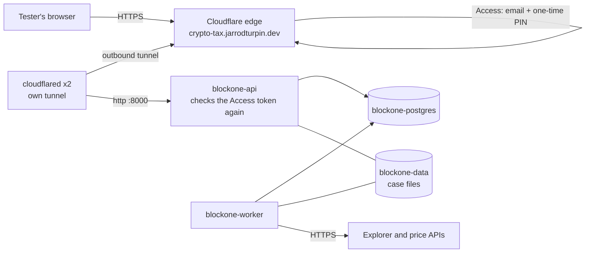
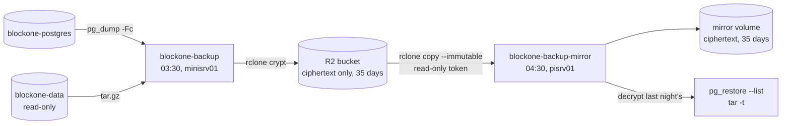

# BlockOne Crypto Tax tester app

Status: **deployed** 2026-11-11 (PR #32; Flux applied `main@2af851a`, pods Running on minisrv01). The owner checklist below is how it went live. Nightly backups are on branch `feat/blockone-backups`: see "Backups and restore".

AI-assisted: the manifests, the app's Dockerfile and image workflow, and this page were written with Claude Code. I set the requirements (private app, only two testers, no open ports, secrets encrypted, both architectures) and review and run each step.

## What it is

The web app for BlockOne Global Solutions' crypto tax reports (private repo `turpinator-x/blockone-crypto-tax`, `src/nftcb/web/`): a FastAPI API and a job worker that wrap the cost-basis engine, with PostgreSQL for accounts, taxpayers and jobs, and a volume for each taxpayer's case files. This deployment is for two testers. It is public on the internet only behind Cloudflare Access.



## How it's built

| Piece | Where | Notes |
|---|---|---|
| Namespace | `apps/base/blockone-crypto-tax/namespace.yaml` | Pod Security **restricted** enforced; not pruned (keeps data) |
| API | `api.yaml` | `uvicorn` on 8000, `/healthz` probes, trusts `X-Forwarded-*` only from the pod network |
| Worker | `worker.yaml` | polls for jobs; the only pod with the explorer API keys; 300 s to finish a job on shutdown |
| Migrations | initContainer `migrate` in both | see "Why an initContainer" |
| PostgreSQL 18 | `postgres.yaml` | StatefulSet, one replica, uid 999, read-only root, 2 Gi `local-path-retain` volume |
| Case files | `storage.yaml` | 5 Gi `local-path-retain`, shared by API and worker |
| NetworkPolicies | `networkpolicy.yaml`, overlay `cloudflare.yaml` | default deny, then per pod (below) |
| Tunnel | `apps/staging/blockone-crypto-tax/cloudflare.yaml` | own tunnel `blockone-crypto-tax`, 2 replicas, like Linkding's |
| Image pin | overlay `kustomization.yaml` (`images:`) | tag `sha-<commit>` plus digest; **placeholder until the first build** |
| Secrets | overlay `*-secret.yaml.example` | templates only; real ones are SOPS-encrypted (checklist step 4) |
| Flux | `clusters/staging/blockone-crypto-tax.yaml` | its own Kustomization, not part of `apps` |
| Backups | `backup.yaml`, `backup-alerts.yaml`, overlay `restore.yaml` | nightly, encrypted, to R2 and pisrv01; see "Backups and restore" |

- **One image, three commands.** The app repo's `Dockerfile` builds one image (`python:3.12.16-slim-trixie` pinned by digest, uid 10001, no secrets inside) whose entrypoint runs `api`, `worker` or `migrate`. Its `image` workflow builds linux/amd64 and linux/arm64 on pushes to `main` and `v*.*.*` tags and pushes `ghcr.io/turpinator-x/blockone-crypto-tax:sha-<commit>` (plus the version on tags). Actions are pinned by commit SHA; the job has `contents: read` and `packages: write` only.
- **All pods on minisrv01.** `local-path` volumes live on one node, and the API and worker share the case-files volume, so they and PostgreSQL are pinned to minisrv01 with a `nodeSelector` (as Audiobookshelf is). The image is still multi-arch, so moving them later is a manifest change.
- **Read-only root filesystems everywhere**, all capabilities dropped, no service account token, `RuntimeDefault` seccomp. Writable places are the volumes and size-limited `emptyDir`s for `/tmp`.
- **Database password once.** PostgreSQL reads it from Secret `blockone-db`; the app builds `BLOCKONE_WEB_DATABASE_URL` from the same key with Kubernetes' `$(VAR)` substitution. The variable is named `BLOCKONE_WEB_DB_PASSWORD` on purpose: the worker strips every `BLOCKONE_WEB_*` variable before starting the engine's child processes, so they never see it.
- **Two sign-in checks.** Cloudflare Access lets only the two allowed emails through (one-time PIN). The app (`BLOCKONE_WEB_AUTH_MODE=cloudflare`) then verifies the `Cf-Access-Jwt-Assertion` token against the team's signing keys and the application's AUD tag, and checks the email against `BLOCKONE_WEB_ALLOWED_EMAILS`. Someone reaching the Service from inside the cluster without a valid token gets 401.

### Why an initContainer for migrations, not a Job

A Flux-managed Job is immutable: a new image tag means Flux must delete and re-create it (`force`), and the API would still need a way to wait for it. An initContainer runs `python -m nftcb.web.migrate` before every API or worker start, which is idempotent (Alembic does nothing at head), needs no ordering between objects, and guarantees neither process runs against an older schema. If the API and worker migrate at the same moment, PostgreSQL's transactional DDL makes the second one fail cleanly, and Kubernetes restarts it.

### Why its own PostgreSQL

The cluster runs no shared database or operator (checked 2026-11-11). One small StatefulSet is the least to run for two testers. Backups are nightly dumps ("Backups and restore"); CloudNativePG (used in the AKS project) becomes worth it once point-in-time restore matters: see "Open items".

### Why its own Flux Kustomization

The app's Secrets and image are added after the manifests. As part of `apps`, a missing Secret file or a bad manifest would fail the whole `apps` build and stop Linkding, Audiobookshelf and the dashboard from reconciling. On its own (like `arc`), a problem here only shows on `flux get kustomization blockone-crypto-tax`. Missing Secrets don't fail the apply at all: the pods wait in `CreateContainerConfigError` until the Secret exists.

## Network policy, and what it can't do

| Pod | In | Out |
|---|---|---|
| everything | denied by `default-deny` unless listed | denied unless listed |
| cloudflared | nothing | DNS; the API on 8000; public addresses on 7844 (TCP/UDP) and 443 |
| blockone-api | cloudflared on 8000 | DNS; PostgreSQL; public addresses on 443 (Access signing keys) |
| blockone-worker | nothing | DNS; PostgreSQL; public addresses on 443 and 51234 (Ripple's XRPL node) |
| blockone-postgres | pods labelled `blockone-db-client: "true"` (API, worker) or `app: blockone-backup` (nightly backup, restore Job) on 5432 | nothing |
| blockone-backup | nothing | DNS; PostgreSQL; public addresses on 443 (R2) |
| blockone-backup-mirror | nothing | DNS; public addresses on 443 (R2) |

"Public addresses" means everything except the private ranges, so no pod here can reach the home network or other apps. **NetworkPolicy can't filter by hostname**: the worker may reach any public HTTPS server, not only the explorers it uses (Etherscan, Routescan, Alchemy, Helius, Solana, Flare/Songbird, XRPL, AlgoNode, Blockfrost, CryptoCompare, CoinGecko, GoPlus, mempool.space, Pi Network). Options, from least to most work:

1. **As built:** port and private-range limits. Stops lateral movement, not data leaving to an arbitrary public host.
2. **An egress proxy** (e.g. Squid or tinyproxy in this namespace) with a domain allowlist, the worker's `HTTPS_PROXY` pointed at it (the engine uses httpx, which honours it), and the worker's policy allowing only the proxy. Recommended next step if this goes past testing.
3. **An FQDN-aware CNI:** Cilium's `toFQDNs` policies. Planned with the Talos rebuild, not on k3s's Flannel.

The API's 443 egress is only for Cloudflare's signing keys (`<team>.cloudflareaccess.com/cdn-cgi/access/certs`); the same limitation applies.

## Backups and restore

Nightly, encrypted, in two places: a Cloudflare R2 bucket (off site) and pisrv01's disk (the other node). Built on branch `feat/blockone-backups`; it starts once the owner steps below are done. AI-assisted, like the rest of this page.



| Piece | Where | Notes |
|---|---|---|
| Backup | `backup.yaml`, CronJob `blockone-backup` | 03:30 America/Los_Angeles on minisrv01. initContainers `dump` (`pg_dump -Fc` over the Service, checked with `pg_restore --list`) and `archive` (tar of the whole volume, read-only), then `upload` (rclone: encrypt, upload to `YYYY/MM/DD/` in UTC, `cryptcheck` against the local files, delete anything older than 35 days) |
| Mirror | `backup.yaml`, CronJob `blockone-backup-mirror`, PVC `blockone-backup-mirror` (10 Gi) | 04:30 on pisrv01. Copies the encrypted objects as they are, keeps 35 days, then decrypts last night's pair from its own copy and checks them: `pg_restore --list` must list table data, `tar -tzf` must read the archive. Fails if there's no dump newer than 30 hours |
| Alerts | `backup-alerts.yaml` | `BlockOneBackupStale` (more than 26 h since either CronJob last succeeded), `BlockOneBackupNeverSucceeded` (same, before a first success, when the metric doesn't exist yet), `BlockOneBackupJobFailed` (a run failed after its retry; shown for 24 h) |
| Secrets | overlay `blockone-backup-secret.yaml.example`, `blockone-backup-mirror-secret.yaml.example` | R2 endpoint, bucket, token and the obscured crypt passwords; SOPS-encrypted once filled in |
| Restore | overlay `restore.yaml` (a Job) and a commented scale-to-zero patch in `kustomization.yaml` | run through Git, below |

- **Encryption: rclone's `crypt` remote**, layered on an S3 remote for R2, configured only by environment variables (`RCLONE_CONFIG_<REMOTE>_<OPTION>`), so there is no config file to mount or leak. File names, folder names and contents are encrypted (XSalsa20-Poly1305: a changed byte fails to decrypt, it can't restore wrong data). R2 and pisrv01 only ever hold ciphertext. The two crypt passwords are the only way back in: they live in the password manager as well as in the SOPS Secrets.
- **Two R2 tokens.** The nightly upload has Object Read & Write on the one bucket; the mirror and the restore Job use a second token with Object Read only.
- **Copy, not sync, to pisrv01.** If the bucket is emptied (a leaked key, a mistake), a sync would empty the second copy too. The mirror uses `rclone copy --immutable`: new objects come down, nothing is deleted because R2 deleted it, and an object that changed in R2 (tampering, corruption) fails the run instead of overwriting the good copy. Retention on pisrv01 is by age on its own.
- **Retention by `rclone delete --min-age 35d`, not an R2 lifecycle rule.** It's in Git and was tested, and it only runs after that night's upload succeeded, so backups that stop don't quietly age out. (A lifecycle rule would delete old backups even while new ones fail.)
- **Everything in the case-files volume is backed up**, including the per-case caches: the engine's "cached answers only" steps read them, so they are part of a reproducible result. Only a restore's set-aside copies (`.pre-restore-*`, `.restoring-*`) are skipped. The engine's SQLite files are read while the app runs; GNU tar fails the run if any file changes while it is read, so a job running at 03:30 shows up as a failed backup (and an alert), not a torn copy.
- **Same security settings as the app:** uid 10001 (the app's, so every case file is readable), read-only root filesystems, all capabilities dropped, `RuntimeDefault` seccomp, no service account token, `emptyDir`s for `/tmp` and the work files. Images: the app's `postgres:18.6-trixie` and `rclone/rclone:1.76.0`, both pinned by tag and digest, both amd64 and arm64.
- **Network:** the backup pod reaches PostgreSQL, DNS and HTTPS on public addresses; the mirror only DNS and HTTPS. PostgreSQL accepts the backup pod's label (`app: blockone-backup`) as well as `blockone-db-client`.
- **Time zone:** the CronJobs run on Los Angeles time; folder and file names use UTC (`2026/11/12/blockone-db-20261112T113000Z.dump`).

### Owner steps (once)

1. **R2 bucket** (Cloudflare dashboard, R2 Object Storage): create bucket `blockone-backups` (any name; location Automatic, Standard storage class). Leave public access off.
2. **Two API tokens** (R2, Manage API tokens, Create API token), each "Apply to specific buckets only" → the bucket:
   - `blockone-backup-rw`: **Object Read & Write**.
   - `blockone-backup-ro`: **Object Read only**.
   Copy each token's **Access Key ID** and **Secret Access Key** (shown once), and the S3 endpoint `https://<account id>.r2.cloudflarestorage.com`.
3. *Optional, recommended:* R2 bucket settings, **Bucket lock rules**: a rule on prefix `blockone/` keeping objects for 30 days. Then even the read-and-write token can't delete a backup younger than 30 days; the job's own retention (35 days) is unaffected. Not tested here (the test used MinIO).
4. **Crypt passwords and the Secrets.** From the repo root, with `sops` and `docker` (or a local `rclone`). Values go straight from variables into the SOPS-encrypted files:

   ```bash
   cd apps/staging/blockone-crypto-tax
   umask 077
   # Two random passwords. Save BOTH in the password manager now, as "BlockOne backups: crypt password" and
   # "BlockOne backups: crypt salt". Without them, no backup can ever be decrypted.
   CRYPT_PW=$(openssl rand -base64 48 | tr -d '\n'); CRYPT_SALT=$(openssl rand -base64 48 | tr -d '\n')
   printf '%s\n%s\n' "$CRYPT_PW" "$CRYPT_SALT"     # copy into the password manager, then clear the screen
   obscure() { printf '%s' "$1" | docker run --rm -i rclone/rclone:1.76.0 obscure -; }   # stdin, not argv
   O1=$(obscure "$CRYPT_PW"); O2=$(obscure "$CRYPT_SALT")

   read -rp 'R2 account id: ' R2_ACCOUNT; read -rp 'Bucket: ' R2_BUCKET
   read -rp 'RW Access Key ID: ' RW_ID; read -rsp 'RW Secret Access Key: ' RW_SECRET; echo
   read -rp 'RO Access Key ID: ' RO_ID; read -rsp 'RO Secret Access Key: ' RO_SECRET; echo
   mk() {  # <secret name> <key id> <secret key> <file>
     local envfile; envfile=$(mktemp)
     {
       printf 'R2_ENDPOINT=https://%s.r2.cloudflarestorage.com\n' "$R2_ACCOUNT"
       printf 'R2_BUCKET=%s\n' "$R2_BUCKET"
       printf 'R2_ACCESS_KEY_ID=%s\n' "$2"
       printf 'R2_SECRET_ACCESS_KEY=%s\n' "$3"
       printf 'RCLONE_CRYPT_PASSWORD=%s\n' "$O1"
       printf 'RCLONE_CRYPT_PASSWORD2=%s\n' "$O2"
     } > "$envfile"
     kubectl create secret generic "$1" --from-env-file="$envfile" --dry-run=client -o yaml > "$4"
     shred -u "$envfile"
     sops -e -i "$4"
   }
   mk blockone-backup "$RW_ID" "$RW_SECRET" blockone-backup-secret.yaml
   mk blockone-backup-mirror "$RO_ID" "$RO_SECRET" blockone-backup-mirror-secret.yaml
   unset CRYPT_PW CRYPT_SALT O1 O2 RW_SECRET RO_SECRET
   grep -c 'ENC\[' blockone-backup-secret.yaml blockone-backup-mirror-secret.yaml   # 7 each: 6 values + the MAC
   ```

5. Uncomment the two `blockone-backup*-secret.yaml` lines in `kustomization.yaml`, run `./scripts/validate.sh`, commit, and merge the branch.
6. **First run, without waiting for the night** (read-only checks plus one Job created from the CronJob; this is a one-off exception to "change Git, not the cluster", or simply wait until 04:30):

   ```bash
   kubectl --context homelab -n blockone-crypto-tax create job --from=cronjob/blockone-backup backup-first
   kubectl --context homelab -n blockone-crypto-tax logs -f job/backup-first --all-containers
   kubectl --context homelab -n blockone-crypto-tax create job --from=cronjob/blockone-backup-mirror mirror-first
   kubectl --context homelab -n blockone-crypto-tax logs -f job/mirror-first -c verify   # "OK: database dump lists ..."
   ```

   In the R2 dashboard the bucket should show only `blockone/<random>/<random>/...` names.

Until steps 4–5 are done, the backup pods can't start (`CreateContainerConfigError`), each run fails at its 45-minute deadline, and the alerts fire after 26 hours. Alertmanager has no receivers yet (`docs/status.md`, Next), so alerts show in Prometheus and Alertmanager, not as notifications.

### Restore

Everything here also works from the workstation, which is the way in if the cluster itself is gone. Install rclone 1.76 (`mise use -g rclone@1.76.0`, or the distribution's package) and a PostgreSQL 18 client (or use `docker run --rm -i postgres:18.6-trixie pg_restore --list < file`) and set the remotes from the password manager, in a shell that writes nothing to disk:

```bash
export RCLONE_CONFIG=/dev/null   # env-only configuration, like the CronJobs
export RCLONE_CONFIG_R2_TYPE=s3 RCLONE_CONFIG_R2_PROVIDER=Cloudflare RCLONE_CONFIG_R2_NO_CHECK_BUCKET=true
export RCLONE_CONFIG_R2_ENDPOINT=https://<account id>.r2.cloudflarestorage.com
read -rp 'RO Access Key ID: ' RCLONE_CONFIG_R2_ACCESS_KEY_ID; export RCLONE_CONFIG_R2_ACCESS_KEY_ID
read -rsp 'RO Secret Access Key: ' RCLONE_CONFIG_R2_SECRET_ACCESS_KEY; echo; export RCLONE_CONFIG_R2_SECRET_ACCESS_KEY
export RCLONE_CONFIG_BACKUP_TYPE=crypt RCLONE_CONFIG_BACKUP_REMOTE=r2:<bucket>/blockone
export RCLONE_CONFIG_BACKUP_FILENAME_ENCRYPTION=standard RCLONE_CONFIG_BACKUP_DIRECTORY_NAME_ENCRYPTION=true
read -rsp 'Crypt password: ' p; echo; RCLONE_CONFIG_BACKUP_PASSWORD=$(printf '%s' "$p" | rclone obscure -)
read -rsp 'Crypt salt: ' p; echo; RCLONE_CONFIG_BACKUP_PASSWORD2=$(printf '%s' "$p" | rclone obscure -); unset p
export RCLONE_CONFIG_BACKUP_PASSWORD RCLONE_CONFIG_BACKUP_PASSWORD2

rclone lsl backup:                                   # every backup, with decrypted names
mkdir -m 700 ~/blockone-restore
rclone copy backup:2026/11/12 ~/blockone-restore --include '*20261112T113000Z*'
pg_restore --list ~/blockone-restore/blockone-db-20261112T113000Z.dump | grep 'TABLE DATA'
tar -tzvf ~/blockone-restore/blockone-data-20261112T113000Z.tar.gz | head
```

If R2 is lost too, the same ciphertext is on pisrv01 under `/var/lib/rancher/k3s/storage/<pv>_blockone-crypto-tax_blockone-backup-mirror/blockone`: copy that folder to the workstation and set `RCLONE_CONFIG_BACKUP_REMOTE=/path/to/that/blockone` instead of `r2:...` (and `rclone copy` it back into a bucket for the restore Job). Delete `~/blockone-restore` when done: it is client data in plain form.

**Putting a backup back (through Git).** The Job `restore.yaml` downloads and decrypts one backup with the read-only token, checks both files, restores the database with `pg_restore --clean --if-exists --single-transaction` (all or nothing), unpacks the case files next to the live ones and then swaps them in, keeping the old ones in `/data/.pre-restore-<time>`.

1. **Stop the app.** On a branch, uncomment the `patches:` block (replicas 0 for `blockone-api` and `blockone-worker`) in `apps/staging/blockone-crypto-tax/kustomization.yaml`; validate, commit, merge. Wait until `kubectl --context homelab -n blockone-crypto-tax get pods` shows neither (the worker may take up to 5 minutes to finish a job).
2. **Run the restore.** Set `BACKUP` in `restore.yaml` to the stamp from the file names (e.g. `20261112T113000Z`), uncomment `- restore.yaml`, commit, merge. Follow it with `kubectl --context homelab -n blockone-crypto-tax logs -f job/blockone-restore --all-containers`: "database restored", then "case files restored; the previous ones are in ...". If it fails, nothing is half-done: the files are checked first, the database restore is one transaction, and the case files are swapped only after they unpacked.
3. **Check** (read-only): `kubectl --context homelab -n blockone-crypto-tax exec blockone-postgres-0 -- psql -U blockone -d blockone -c '\dt+'` and the row counts you expect.
4. **Start the app again.** Comment out `- restore.yaml` and the `patches:` block, commit, merge. Flux prunes the Job and scales the API and worker back to 1; their `migrate` initContainers bring the schema up to date if the backup is from an older release. Sign in and open a case.
5. Once satisfied, remove the set-aside files: `kubectl --context homelab -n blockone-crypto-tax exec deploy/blockone-worker -- rm -rf /data/.pre-restore-<time>`.

If minisrv01's disk is lost, the PVCs point at volumes that no longer exist. Deleting them (and their PVs) so Flux and the StatefulSet create new ones is a cluster change outside Git: ask first. Then follow the steps above. Completed backup pods keep `blockone-data` in use (`kubernetes.io/pvc-protection`), so delete the finished backup Jobs before deleting that PVC.

### How it was tested

Drilled on 2026-11-11 in a throwaway kind cluster (Kubernetes 1.37, three nodes; kind's node names patched in for minisrv01 and pisrv01; MinIO, the `pgsty/minio` build, standing in for R2 over plain HTTP; the namespace's restricted Pod Security level and NetworkPolicies enforced), with the manifests from this branch. The cluster was deleted afterwards. Not yet tried against real R2 or on the homelab.

| Check | Result |
|---|---|
| Backup Job from the CronJob, PostgreSQL with 500 rows, case files owned by uid 10001 with mode 0600 | passed; dump checked, archive checked, `cryptcheck` 0 differences |
| Objects in the bucket | names like `blockone/svgaaq.../7me37l...`, every object starts with rclone's `RCLONE\0\0` header; no table names, markers, `PGDMP` or gzip signature found in the raw bytes |
| Mirror Job (other node) | copied, decrypted, `pg_restore --list` 2 tables with data, archive 12 entries |
| Changed byte in an R2 object, decrypted (run before `--immutable` was added; the same check covers an object the mirror downloads for the first time) | decrypt failed: "failed to authenticate decrypted block"; Job Failed |
| Changed byte in R2 after the mirror had a good copy | `immutable file modified`; Job Failed, good local copy kept |
| Valid encryption, garbage dump inside | `pg_restore: error: input file does not appear to be a valid tar archive`; Job Failed |
| Bucket emptied | mirror run still succeeded from its own copy; nothing deleted on pisrv01 |
| Object older than 35 days | deleted by the mirror (local) and by the backup (R2) |
| PostgreSQL down | `pg_dump` failed, Job Failed, nothing uploaded |
| Pod with the mirror's label to PostgreSQL | refused; the backup's label accepted |
| Full restore: database and case-files volumes deleted, fresh ones created, `restore.yaml` run | 500 rows, same `sum(id)` and `md5` of every row as before; every case file the same SHA-256, owner and mode |
| Workstation download + decrypt with the env-only config above | passed (dump and archive listed) |
| Alert rules | `promtool test rules`: each alert fires when it should (26 h, never succeeded, failed job) and not before; a failed Renovate job doesn't trigger it |

The first restore attempt found a bug, fixed before the passing run: tar can't change the mode of the volume's root (owned by root), so unpacking straight into `/data` failed after the files had already been moved aside. The Job now unpacks into a folder first and swaps afterwards.

## Releases: staging, promotion, rollback

Since 2026-11-12 an app change reaches this deployment only through staging (`docs/blockone-crypto-tax-staging.md`) and the owner's approval. The scripts are in the app repo (`scripts/release/`, AI-assisted), the process in its `docs/release_process.md`. What they do here:

- **`stage.sh <app PR>`** changes nothing in this namespace. It reads production's schema revision (a SELECT on `alembic_version`) to report which migrations the change brings.
- **`promote.sh <sha>`** refuses a commit without a passing `staging/e2e` status, or whose GHCR digest differs from the one that passed. Then, before the image bump: a backup Job from `cronjob/blockone-backup` (`bk-predeploy-<sha>-<time>`), which must finish with `cryptcheck` matching both files, and a mirror Job from `cronjob/blockone-backup-mirror` (`bkv-...`), which must fetch that same backup from R2, decrypt it and read it (tables with data, archive entries). Either failing stops the promotion before anything is deployed. The backup stamp, both digests and both schema revisions go into the promotion record (workstation, `~/.local/state/blockone-release/releases.jsonl`) and into the homelab commit message. Then the usual image-bump PR and the checks (rollout, migrate Completed, schema equal to staging's, no API log errors, 302 from Access).
- **`rollback.sh app`** takes a fresh verified backup, takes the schema back with the current image's `migrate downgrade` if it moved (`kubectl exec deploy/blockone-worker`; the previous image's migrate step can't start on a revision it doesn't know), then an image-bump PR back to the previous digest, and the checks.
- **`rollback.sh data`** takes a fresh verified backup, then three PRs through this overlay, as in "Putting a backup back" above: (1) the scale-to-zero patch plus the previous image; (2) `restore.yaml` with `BACKUP` set to the promotion's pre-deploy stamp, under a Job name of its own (`blockone-restore-<stamp>`); (3) unlist the restore and remove the patch, so the previous image starts. It checks the Job's log ("database restored", "case files restored") and the taxpayer count. The owner types the current taxpayer count and the backup stamp first: those are the approval for these non-image PRs. **`rollback.sh undo`** restores the backup the last rollback took, with the image that ran then.

The backup Jobs these create follow the CronJobs' settings and land in the same R2 folders, so the 35-day retention applies to them too. A pre-deploy backup fails (and stops the promotion) if a job writes case files while tar reads them: promote when nothing is running.

### Restore drill

`scripts/blockone-restore-drill.sh [--fresh] [--backup <stamp>]` (AI-assisted) proves a backup restores, away from production and staging:

1. `--fresh` takes a backup first, so the comparison is exact.
2. A throwaway namespace `blockone-drill-<time>`: restricted Pod Security, default-deny, the drill pod may reach only DNS and HTTPS on public addresses. No Service, no ingress, no tunnel. Only the mirror's read-only Secret is copied in (piped, never printed).
3. One Job pod on minisrv01: fetch + decrypt (read-only token), restore into a PostgreSQL that lives inside the pod (bound to 127.0.0.1), unpack the case files, print every table's row count and every file's SHA-256. All its volumes are memory-backed (tmpfs): the decrypted data never touches a disk and goes with the pod.
4. Production's side, read-only: the same row-count query on `blockone-postgres-0`, and SHA-256 of every case file through `kubectl exec deploy/blockone-worker`.
5. Any difference fails the drill; the namespace is deleted whatever happens (trap), and the script checks it's gone.

It creates and deletes cluster objects directly (a namespace and its contents), an exception to "change Git, not the cluster" like the backups' first run: run it on purpose. **Suggested rhythm: monthly, and after any change to the backup or restore manifests.**

A scheduled version is proposed, **not enabled**: `apps/staging/blockone-crypto-tax/restore-drill.yaml`, a monthly CronJob (03:50 on the 1st, after that night's backup) that runs the same pod in this namespace instead of a throwaway one (a CronJob creating namespaces would need a ServiceAccount allowed to create namespaces and Secrets, more power than a drill should hold). It compares against production's database over the network (the backup's label and password, as `pg_dump` uses) and the case-files volume mounted read-only. Its Jobs are named `blockone-backup-drill-*`, so `BlockOneBackupJobFailed` reports a failed drill. To enable it: add `- restore-drill.yaml` to `kustomization.yaml`, with the owner's approval.

Tested on 2026-11-12 with a stand-in `kubectl` (not on the cluster): the generated manifests pass kubeconform strict; the comparison passes on matching data and fails, listing the table, on a changed row count; the namespace cleanup runs on success and failure. The row-count query was run on PostgreSQL 18. **Not yet run on the homelab.**

### Backup security review (2026-11-12)

| Question | Answer |
|---|---|
| Encrypted at rest? | Yes in R2 and on pisrv01: rclone crypt (XSalsa20-Poly1305, names and contents), checked in the drill above (2026-11-11). The plaintext dump and archive exist only in the backup pod's `emptyDir` on minisrv01 while the Job runs (disk-backed; see gaps). The live database and case files sit on minisrv01's local-path volumes: encrypted only if minisrv01's disk is (not checked here) |
| Off site? | R2 (Cloudflare), plus a second copy on pisrv01 (copy, never sync; `--immutable`) |
| Retention | 35 days in both places (`rclone delete --min-age 35d`, only after a successful run). Pre-deploy and pre-rollback backups follow the same rule |
| Who/what can read a backup | Anyone holding both crypt passwords (password manager; the SOPS Secrets). Anyone with the repo's age private key, which decrypts those Secrets (the workstation has it). Anyone who can read Secrets in `blockone-crypto-tax` (cluster admin: the `homelab` kubeconfig). Pods: the backup and mirror Jobs, the restore Job, and (temporarily) the drill pod. R2 tokens and the Cloudflare account, and root on pisrv01, give ciphertext only |
| Who can delete a backup | The read-and-write R2 token (the nightly job), any Cloudflare account admin, root on pisrv01 for the mirror copy |

Gaps found (none changed here; proposals for the owner):

1. **Plaintext on disk during the backup.** `blockone-backup`'s `work` `emptyDir` is disk-backed, so the unencrypted dump and tar are written to minisrv01's disk while the Job runs, until kubelet cleans up the finished pod's volumes. Proposal: `medium: Memory` with a size limit (the 2026-11-12 pair is 77 MiB) and a matching memory limit on the containers.
2. **Bucket lock not confirmed.** Owner step 3 above (an R2 bucket lock rule on `blockone/`, 30 days) is optional; without it, the read-and-write token alone can empty the bucket (the pisrv01 copy survives). Proposal: set it and record that it's on.
3. **One key opens everything.** The age private key decrypts the crypt passwords and both R2 tokens. Proposal: keep the age key and the crypt passwords offline as well (password manager), and consider a second age recipient held offline so a lost workstation isn't a lost key.
4. **Both off-site copies depend on one provider account for R2**, and the same account runs Access and the tunnels. Proposal (later, with more clients): a second off-site target outside Cloudflare.
5. **Node disk encryption unknown.** Check whether minisrv01 and pisrv01 use full-disk encryption; if not, the live volumes and staging's data are readable from a stolen disk.

## Owner checklist

Do these on the branch, in order, then merge. Values below in `<angle brackets>` are yours to fill in; none of them go into Git unencrypted.

### 1. Build the first image (app repo)

1. Merge the app repo's `feat/container-image` pull request **after** the Cloudflare auth mode and tester pages are on `main` (the image must include `BLOCKONE_WEB_AUTH_MODE=cloudflare`).
2. The `image` workflow runs on the push to `main`. Its run summary prints the tag (`sha-<commit>`) and the digest (`sha256:...`).
3. Check both architectures: `docker buildx imagetools inspect ghcr.io/turpinator-x/blockone-crypto-tax:sha-<commit>` lists linux/amd64 and linux/arm64.
4. Put the tag and digest into `apps/staging/blockone-crypto-tax/kustomization.yaml` under `images:` (replacing both PLACEHOLDER lines).

### 2. Let the cluster pull the private image

The package is private like its repo. Either:

- **Keep it private (recommended):** GitHub, Settings, Developer settings, Personal access tokens, **Tokens (classic)**, new token with only `read:packages`, 1-year expiry, note "homelab ghcr pull". (GHCR doesn't accept fine-grained tokens for pulls.) It becomes Secret `ghcr-pull` in step 4.
- **Or make the package public** (Package settings, Change visibility). The image holds no secrets or client data, but it does hold the app's source. Then drop `imagePullSecrets` from `api.yaml` and `worker.yaml` and skip `ghcr-pull`.

Also check the package page lists the repo under "Repository access" (the `org.opencontainers.image.source` label links it on the first push).

### 3. Tunnel and Cloudflare Access

Tunnel, from the workstation (as for the other apps):

```bash
cloudflared tunnel create blockone-crypto-tax          # writes ~/.cloudflared/<tunnel-id>.json
cloudflared tunnel route dns blockone-crypto-tax crypto-tax.jarrodturpin.dev
```

Access, in Cloudflare Zero Trust (one.dash.cloudflare.com):

1. **Settings, Authentication:** make sure **One-time PIN** is an enabled login method.
2. **Access, Applications, Add an application, Self-hosted.** Name `BlockOne Crypto Tax (tester)`, session duration 24 hours, public hostname `crypto-tax.jarrodturpin.dev` (path empty, so the whole host is covered).
3. **Policy:** name `testers`, action **Allow**, include rule **Emails**: the two tester addresses. No "Everyone" rule. Under login methods, allow One-time PIN (and turn off "instant auth" for other providers if they're listed).
4. Save, then open the application's **Overview** (or Basic information) and copy the **Application Audience (AUD) Tag** (64 hex characters).
5. **Settings, Custom Pages** (or Team and resources) shows the **team domain**, `<team>.cloudflareaccess.com`. The app accepts `<team>` or the full domain.
6. Check from a private window: `https://crypto-tax.jarrodturpin.dev` should show Cloudflare's sign-in page before anything from the cluster. An email not on the list gets no PIN.

### 4. Create the Secrets (SOPS)

Work in `apps/staging/blockone-crypto-tax/`. Each `.example` shows the shape; the commands below write the real files so values never sit in an editor buffer or Git unencrypted. `kubectl create ... --dry-run=client` doesn't talk to the cluster. After each file: `sops -e -i <file>` and check it shows `ENC[` for every value.

```bash
cd apps/staging/blockone-crypto-tax

# Tunnel credentials (the file from step 3), then delete the local copy if you don't keep tunnels' files
kubectl create secret generic tunnel-credentials \
  --from-file=credentials.json="$HOME/.cloudflared/<tunnel-id>.json" \
  --dry-run=client -o yaml > tunnel-credentials-secret.yaml
sops -e -i tunnel-credentials-secret.yaml

# PostgreSQL password: hex only, so the database URL needs no escaping
kubectl create secret generic blockone-db \
  --from-literal=password="$(openssl rand -hex 32)" \
  --dry-run=client -o yaml > blockone-db-secret.yaml
sops -e -i blockone-db-secret.yaml

# App settings. The tax id key is a Fernet key (32 random bytes, URL-safe base64), the same as
# cryptography's Fernet.generate_key(). Save it in the password manager too: without it, the stored
# SSNs/EINs can't be read back.
umask 077; envfile=$(mktemp)
{
  printf 'BLOCKONE_WEB_TAX_ID_KEYS=%s\n' "$(python3 -c 'import base64,os;print(base64.urlsafe_b64encode(os.urandom(32)).decode())')"
  printf 'BLOCKONE_WEB_CF_TEAM_DOMAIN=%s\n' '<team>'
  printf 'BLOCKONE_WEB_CF_AUD=%s\n' '<aud tag from step 3>'
  printf 'BLOCKONE_WEB_ALLOWED_EMAILS=%s\n' '<first email>,<second email>'
} > "$envfile"
kubectl create secret generic blockone-app --from-env-file="$envfile" \
  --dry-run=client -o yaml > blockone-app-secret.yaml
shred -u "$envfile"
sops -e -i blockone-app-secret.yaml

# Explorer and price API keys: new keys made for this deployment, not the laptop's. Leave out any you don't have.
umask 077; envfile=$(mktemp)
"${EDITOR:-vi}" "$envfile"   # ETHERSCAN_API_KEY=..., ALCHEMY_API_KEY=..., HELIUS_API_KEY=..., BLOCKFROST_PROJECT_ID=..., CRYPTOCOMPARE_API_KEY=...
kubectl create secret generic blockone-explorer-keys --from-env-file="$envfile" \
  --dry-run=client -o yaml > blockone-explorer-keys-secret.yaml
shred -u "$envfile"
sops -e -i blockone-explorer-keys-secret.yaml

# GHCR pull secret (skip if the package is public). read -s keeps the token out of shell history.
read -rsp 'GHCR token: ' GHCR_TOKEN; echo
kubectl create secret docker-registry ghcr-pull --docker-server=ghcr.io \
  --docker-username=turpinator-x --docker-password="$GHCR_TOKEN" \
  --dry-run=client -o yaml > ghcr-pull-secret.yaml
unset GHCR_TOKEN
sops -e -i ghcr-pull-secret.yaml
```

Then uncomment the five Secret lines in `kustomization.yaml`, run `./scripts/validate.sh`, and commit. The pre-commit hook refuses any of these files if it isn't encrypted.

To rotate the tax id key later: put the new key first, keep the old one after a comma (`new,old`), deploy; old records still decrypt.

### 5. Merge and let Flux apply it

Review the PR, merge, and Flux picks it up within a minute.

### 6. Verify (read-only)

```bash
flux get kustomizations blockone-crypto-tax            # Ready, with the merge commit's revision
kubectl -n blockone-crypto-tax get pods -o wide        # api, worker, postgres-0, 2x cloudflared: Running, on minisrv01 (cloudflared anywhere)
kubectl -n blockone-crypto-tax logs deploy/blockone-api -c migrate      # Alembic ran (or had nothing to do)
kubectl -n blockone-crypto-tax logs deploy/blockone-worker -c worker | head   # "worker ... started"
kubectl -n blockone-crypto-tax logs deploy/cloudflared | grep "Registered tunnel connection"
kubectl -n blockone-crypto-tax get networkpolicy        # default-deny, blockone-api, -worker, -postgres, cloudflared
cloudflared tunnel info blockone-crypto-tax
```

Then in a browser: `https://crypto-tax.jarrodturpin.dev` asks for an email and PIN; a listed tester gets in; any other address is refused by Access. Failure paths worth one check each: an unlisted email gets no PIN; `curl -s -o /dev/null -w '%{http_code}' https://crypto-tax.jarrodturpin.dev/healthz` without signing in returns Cloudflare's redirect (302), not the app's JSON.

When something's wrong: `kubectl -n blockone-crypto-tax describe pod <pod>` shows `ImagePullBackOff` (digest or pull secret), `CreateContainerConfigError` (a Secret is missing or a key misnamed), or an initContainer still waiting for PostgreSQL. `worker not started: web settings invalid: ...` in the worker log names the setting that's wrong, never its value.

## Open items

- **Backups** run nightly ("Backups and restore"): logical dumps, so up to a day of data can be lost (less around a release: `promote.sh` takes one just before). Point-in-time restore would need WAL archiving (CloudNativePG with object storage, or pgBackRest); revisit with more clients. A first restore drill on the homelab (`scripts/blockone-restore-drill.sh --fresh`) is still to do; the gaps in "Backup security review" are open.
- **Egress by hostname** (egress proxy or Cilium, above).
- **Image updates.** Renovate's kustomize manager can follow `images:` digests, but a new `sha-<commit>` tag isn't a version it can order. For now the tag and digest are bumped by hand after each app release; tagging the app repo with `v*.*.*` versions would let Renovate open those PRs.
- **CI minutes.** The image workflow uses GitHub's hosted runner (arm64 under QEMU) on each push to `main`. If minutes run short, add the repo to the self-hosted runners (`docs/github-runners.md`) or build arm64 natively.
