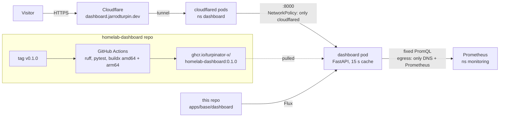

# Public Homelab Dashboard

A live public status page for the cluster: **https://dashboard.jarrodturpin.dev** (2026-10-21).

It shows CPU and memory across both nodes, running pods, nodes ready, uptime, and whether each app is up, refreshed every 15 seconds. The app is my own: a small Python (FastAPI) service in its own repo, [turpinator-x/homelab-dashboard](https://github.com/turpinator-x/homelab-dashboard), built into a multi-arch image by GitHub Actions and deployed here by Flux. The project idea came from the KubeCraft community (the "Homelab Apps & Projects" track); the build is mine, with Claude Code as tutor. I typed the backend; Claude Code generated the frontend.



## Design choices

- **Data from Prometheus, not the Kubernetes API.** Prometheus (kube-prometheus-stack, see [monitoring.md](monitoring.md)) already has every number on the page. Asking the API instead would mean a ServiceAccount with cluster read access on a public-facing pod; this way the pod has no API token at all (`automountServiceAccountToken: false`).
- **Fixed queries, cached.** The app runs seven PromQL queries plus one per app, in parallel, at most once every 15 seconds, and serves the cached result at `/api/stats`. Visitors can't send queries, and a traffic spike costs one round of queries per 15 seconds. If Prometheus is unreachable it keeps serving the last good numbers; with none cached it returns 503.
- **Totals only.** No pod names, IPs or internal hostnames on the page.
- **Separate app repo.** Source and image live in `homelab-dashboard`; this repo only has the manifests that pin a version. That's the usual GitOps split: app repo → image → config repo → Flux.
- **Multi-arch image** (`linux/amd64`, `linux/arm64`), so the pod can run on srv1 or the Pi. No `nodeSelector` and no volume.

## Layout

```
apps/base/dashboard/
├── kustomization.yaml   # also generates dashboard-configmap (PROMETHEUS_URL, CACHE_SECONDS, APPS)
├── namespace.yaml
├── deployment.yaml      # restricted securityContext, no SA token, /healthz probes
├── service.yaml         # ClusterIP 8000
└── networkpolicy.yaml   # in: cloudflared only; out: DNS + Prometheus only
apps/staging/dashboard/
├── kustomization.yaml   # namespace: dashboard
├── cloudflare.yaml      # cloudflared Deployment + tunnel config (copied from audiobookshelf)
└── cloudflare-secret.yaml   # tunnel credentials, SOPS-encrypted
```

## Hardening

| Setting | Effect |
|---|---|
| `runAsNonRoot`, `runAsUser: 10001` | Runs as an unprivileged numeric user that has no account in the image |
| `readOnlyRootFilesystem: true` | Nothing in the container can be written; Python bytecode is compiled at build time |
| `capabilities: drop: [ALL]`, `allowPrivilegeEscalation: false` | No Linux capabilities, no way to gain them |
| `seccompProfile: RuntimeDefault` | Unusual system calls are blocked |
| `automountServiceAccountToken: false` | No Kubernetes API token in the pod |
| NetworkPolicy | See below |
| Memory limit 128Mi (uses about 42 MiB), no CPU limit | A leak can't hurt the node; no CPU throttling |
| `/healthz` probes that don't call Prometheus | A Prometheus restart shows stale numbers instead of restarting a healthy pod |

Together these meet the Kubernetes "restricted" Pod Security level, one step stricter than the other apps here.

## NetworkPolicy

The first NetworkPolicy in an app namespace. Once a policy selects a pod, everything not listed is denied, both directions:

- **Ingress:** only pods labelled `app: cloudflared` in the same namespace, only on the named port `http`.
- **Egress:** DNS (CoreDNS in `kube-system`, 53/UDP and TCP) and the Prometheus pods in `monitoring` on 9090. No internet, no other apps, no API server.

k3s enforces NetworkPolicy with its embedded network policy controller (kube-router); a CNI without one would silently ignore the policy. Tested in a throwaway namespace before writing the manifests, and again after deploying:

```bash
# another pod in the same namespace: blocked (curl exit 7, connection refused)
kubectl -n dashboard run probe --rm -it --image=curlimages/curl --restart=Never -- curl -s -m 4 http://dashboard:8000/healthz
# from the dashboard pod: Prometheus allowed (200), Grafana blocked (connection refused)
kubectl -n dashboard exec deploy/dashboard -- python -c "import httpx; print(httpx.get('http://kube-prometheus-stack-prometheus.monitoring:9090/-/ready', timeout=4))"
kubectl -n dashboard exec deploy/dashboard -- python -c "import httpx; print(httpx.get('http://kube-prometheus-stack-grafana.monitoring', timeout=4))"
```

Blocked connections are refused rather than timing out: kube-router rejects them, so callers fail fast. Kubelet probes are unaffected, and the public URL works because its traffic arrives through cloudflared.

## Build and release (app repo)

- **Python 3.15** (started on 3.14; Renovate's first PR moved it, see Updates), **uv, FastAPI, httpx, pytest, ruff.** `uv.lock` pins every dependency; the laptop, CI and the image all install from it.
- **CI** (`.github/workflows/ci.yaml`): on every push and PR, `ruff format --check`, `ruff check`, `pytest` (6 tests, Prometheus faked with `monkeypatch`), then a `buildx` build for both architectures under QEMU. Only a `v*` tag pushes the image. About 1 minute end to end.
- **Registry:** GHCR, public package. The push logs in with the workflow's own `GITHUB_TOKEN`, so there's no registry password anywhere, and the cluster pulls without credentials.
- **Supply chain:** actions pinned by commit SHA, job permissions minimal (`packages: write` only on the image job), build provenance (`mode=max`) and an SBOM attached to every image.
- **Dockerfile:** two stages (uv only in the build stage), dependencies installed before the code is copied for layer caching, `chmod -R a+rX main.py static` so the image doesn't depend on the builder's file permissions, `USER 10001`.
- **Releasing a new version:** bump `version` in `pyproject.toml`, commit, `git tag v0.x.y && git push origin v0.x.y`, then update the image tag in `apps/base/dashboard/deployment.yaml` (or merge the Renovate PR).

## Updates

Renovate (the same in-cluster CronJob and GitHub App as this repo) also manages the app repo since 2026-10-21: the app was added to the GitHub App's selected repositories and to the CronJob's `args`, and the app repo has its own `renovate.json`. It tracks 20 dependencies there: the Python and uv images in the Dockerfile, `.python-version`, the Python packages in `pyproject.toml`/`uv.lock`, and the SHA-pinned actions. Each PR runs the app's CI (tests plus both image builds) before I merge it; a merge is then released with a version tag, and Renovate in this repo opens the PR that deploys the new image tag.

First full run, 2026-10-21: Renovate PR #1 in the app repo (Python 3.14 → 3.15, CI green on both architectures) → merged → `v0.1.2` tagged → image published → Renovate PR #12 here (image `0.1.0` → `0.1.2`, `validate` green) → merged → Flux rolled it out. The pod now runs `0.1.2` on Python 3.15.1.

```
app repo:  Renovate PR → CI (tests + amd64/arm64 build) → merge → commit + tag vX.Y.Z → CI publishes image
homelab:   Renovate PR (image tag) → validate CI → merge → Flux deploys
```

## Problems hit

- **`PermissionError: /app/main.py` in the container.** Some local tools had written `main.py` and `index.html` as mode 600; `COPY` keeps the mode, root owned them, and UID 10001 couldn't read its own code. Fixed in the Dockerfile with `chmod -R a+rX main.py static` rather than locally, so the image is the same whoever builds it. (A first version ran `chmod -R` over all of `/app`, which took 16 s walking the virtualenv; narrowed to the two copied paths.)
- **`kubectl diff -k` showed nothing for the new app**, because the `dashboard` namespace didn't exist yet. `scripts/validate.sh` is the pre-push check that matters for a brand-new app.

- **A tag on the wrong commit.** `v0.1.1` was tagged before pulling the merged PR and before committing the version bump, so it was built from the old code. Tags are never moved or deleted once published (a registry, Renovate or a node may already have it), so `v0.1.1` was left as a skipped version and the fix shipped as `v0.1.2`. Order that works: pull, bump the version, commit, tag, push both.

## Verify

```bash
kubectl -n dashboard get pods,svc,netpol -o wide
kubectl -n dashboard logs deploy/cloudflared | grep -c "Registered tunnel connection"   # 4+
curl -s https://dashboard.jarrodturpin.dev/api/stats | jq .
curl -s -o /dev/null -w '%{http_code}\n' https://dashboard.jarrodturpin.dev/docs        # 404, API docs off
```

Result on 2026-10-21: one dashboard pod and two cloudflared pods (one per node), four tunnel connections, live JSON from the internet, `/docs` 404.

## Next

- Uptime Kuma as a second data source (response times, uptime %).
- A `/metrics` endpoint so Prometheus scrapes the dashboard itself.
