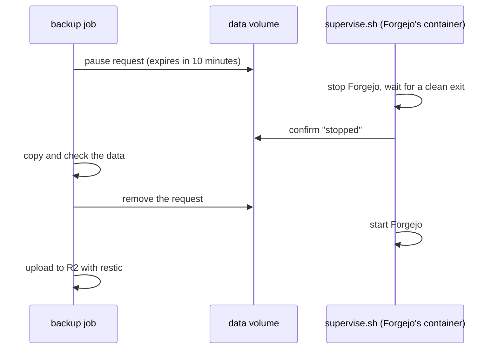

# Forgejo trial

A two-week trial of [Forgejo](https://forgejo.org/), a self-hosted Git server, on the homelab cluster. Built with AI assistance (Claude Code).

**The question it should answer:** could Forgejo later be the main home for my private repos? Moving any other repo is decided only after the trial.

## Decisions (2026-11-27)

| Topic | Decision |
|---|---|
| Test repo | `chain-explorer`: private, tiny, quiet. `homelab` stays on GitHub, because Flux rebuilds the cluster from it |
| Safety copy | GitHub stays unchanged. A separate copy goes into Forgejo, and test changes go only there |
| Access | Home network only, no tunnel or public address |
| Address | `https://git.home.arpa`, with a self-signed certificate that Git on the main laptop trusts for this address only. Certificate checks stay on. No SSH, second laptop not included |
| Import | Code and history only, so no GitHub token is needed. Issues and pull requests stay on GitHub |
| Sign-in | One account. Sign-ups off. The owner types the password and creates the access token; neither goes into a chat or Git |
| Backups | Forgejo goes offline briefly each night (its [backup guide](https://forgejo.org/docs/latest/admin/setup/backup/) strongly recommends this). Encrypted copies to R2 and pisrv01, with failure alerts. Measure the pause, and test that Forgejo starts again after a failed backup |
| Automated checks | Second stage: a secret scan on a Forgejo runner. The isolation design is reviewed before the runner is added; if it isn't good enough, the runner is left out |
| Version and database | Long-term support line 15, SQLite. Renovate is limited to below 16 |

## Pass or fail, after two weeks

- [ ] Import, clone and push work.
- [ ] A backup restores into a working copy.
- [ ] The secret scan passes a clean test and catches a fake secret (if the runner is left out, record that automated checks weren't proven).
- [ ] It is comfortable to use.

The two weeks start when `chain-explorer` is imported.

## Build order

- [x] 1. Forgejo running on the cluster at `git.home.arpa` (2026-11-27).
- [x] 2. The account and sign-in (2026-11-27, after one password reset). The certificate is saved on the laptop; Git is pointed at it in step 5.
- [x] 3. Nightly backup with alerts, copied to pisrv01 (2026-11-27).
- [x] 4. Restore into a separate working copy, from R2 and from pisrv01 (2026-11-27, with no repository yet: repeat after step 5).
- [ ] 5. Import `chain-explorer`; clone and push. The two weeks start here.
- [ ] 6. Second stage: runner isolation design, owner review, then the secret scan.

## How it runs

| Part | Setting |
|---|---|
| Image | `forgejo:15.0.12-rootless`, pinned by digest, amd64 and arm64 |
| Security | non-root, read-only root filesystem, all capabilities dropped, `restricted` Pod Security, no service account token |
| Network | only Traefik may connect; Forgejo may open no outbound connections |
| Data | one volume (`forgejo-data`, `local-path-retain`): repositories, database, `app.ini` and the keys Forgejo creates on first start |
| Settings | `apps/base/forgejo/forgejo.env` (no secrets in it) |
| Backup | 03:00 Pacific, with a short pause (below) |
| Turned off | sign-ups, SSH, Actions, packages, mirrors, federation, mail, update check, external avatars, Git hooks |
| Certificate | `apps/staging/forgejo/forgejo-tls-secret.yaml` (SOPS), expires 2027-11-27 |

## Account setup (owner, once)

Run `./scripts/setup-forgejo-account.sh` in a terminal. It adds `git.home.arpa` to `/etc/hosts`, saves the public certificate under `~/.config/forgejo-trial/`, and creates one admin account with a temporary password that must be changed at the first sign-in. It creates nothing if an account already exists.

**Lost password:** run `./scripts/reset-forgejo-password.sh`. It shows your username, then sets a new temporary password (to be changed at the next sign-in) and copies it to the clipboard, marked sensitive. Tested against a local container with the clipboard step replaced: no account, cancel and two accounts change nothing; after a reset the new password gets "you must change your password" and a wrong one is refused.

## Checks so far (2026-11-27)

| Check | Result |
|---|---|
| Pod | running, no restarts or warning events at first start |
| HTTPS with the certificate trusted | health check passed; without trusting it, curl refused the connection |
| Plain HTTP | 404 |
| Repo list while signed out | redirected to sign-in |
| Git with the certificate trusted | got as far as asking for a username |
| Setup script, against a local container | bad or reserved username: no account; good run: one admin account; rerun: no change; failing account command or a conflicting hosts entry: stops. The `sudo` and hosts-file steps used a test file |

**Not tested at first deployment:** that the network policy blocks outbound connections and connections from other pods (the attempt to test outbound from inside the live container was stopped by the coding agent's safety check). This is still untested.

**Limit:** during the trial, GitHub stays the main home: nothing goes into Forgejo that isn't also on GitHub.

## Backup and restore

Forgejo's database and repositories only match while it is stopped, so each backup pauses it. The backup job gets no cluster access:

- A request that is left behind expires by itself. One more than 15 minutes ahead, or malformed, is ignored. If the pause ends before the copy finishes, the copy is rejected.
- The liveness check passes while the wrapper says Forgejo is stopped on purpose.
- Saved: `app.ini` with Forgejo's keys, signing keys, repositories (and LFS files), the SQLite database, attachments and avatars. Left out: search indexes, queues, caches and logs. For every repository the database lists, its files must be in the copy.
- Same R2 repository, keys, 35-day history, monthly restore check, pisrv01 copy and alerts as the other apps ([backups.md](backups.md)). **Trade-off (owner approved):** the Forgejo namespace now holds a copy of the read-and-write R2 key, which can delete every app's backups in R2. Only the backup and restore-check jobs are given it. The pisrv01 copy is read from R2 with a read-only key and cleaned up on its own.
- Restore practice: `./scripts/app-restore-drill.sh forgejo` (add `--from-pi` for the pisrv01 copy).

### Test results (2026-11-27)

| Test | Result |
|---|---|
| `scripts/test-forgejo-backup.sh` (Docker, real Forgejo) | 15 checks passed: back up and restore a pushed repository (same test sign-in; the clone is at the saved commit), an instance with no repository, a missing repository, failed and abandoned pauses, ignored requests, clean stop, crash |
| First live run | **failed**: it required `git/repositories`, which Forgejo creates with its first repository. Both attempts reported it and Forgejo started again. Fixed (the tests had always pushed a repository first) |
| Live run after the fix | succeeded, R2 read back in full; Forgejo was offline for about 2 seconds, measured from the laptop (one account, no repository) |
| Restore from R2, and from pisrv01 | both: data matched the backup's list, and a separate Forgejo started on it and passed its health check |
| pisrv01 copy | run by hand; copied and verified all three apps |
| Alert rules | unit tests pass with Forgejo added; loaded in Prometheus, healthy and not firing. No separate Telegram test: the route is the one tested for the other apps |

**Not tested:** signing in to a restored copy of the live instance with the real password; a live restore that contains a repository (do it after step 5); the first scheduled run (2026-11-28 03:00 Pacific); how long the pause gets as data grows; replacing live data.

**Removing the trial:** the namespace and volume are protected from Flux pruning, so deleting them is a separate, deliberate step.
