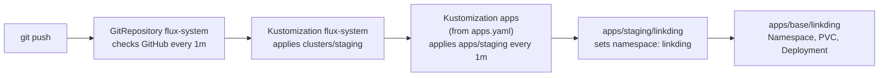

# Deploying Apps with Flux

How applications get onto the cluster. Nothing is applied with `kubectl apply`: an app is added to this repo, and Flux deploys it.

## Repository layout

Following the [Flux repository structure guide](https://fluxcd.io/flux/guides/repository-structure/) (monorepo with Kustomize overlays):

```
apps/
├── base/                     # plain manifests, one folder per app
│   └── linkding/
│       ├── kustomization.yaml
│       ├── namespace.yaml
│       ├── deployment.yaml
│       └── storage.yaml      # PersistentVolumeClaim
└── staging/                  # per-environment overlays that point at base
    └── linkding/
        └── kustomization.yaml
clusters/
└── staging/
    ├── apps.yaml             # Flux Kustomization: apply ./apps/staging
    └── flux-system/          # generated by flux bootstrap, never edited
```

`infrastructure/` (base and staging) will follow the same pattern, and a `production` overlay can be added for a second cluster without copying any manifests.

## How a change flows



- `clusters/staging/apps.yaml` is a Flux `Kustomization` (`kustomize.toolkit.fluxcd.io/v1`) with `path: ./apps/staging`, `interval: 1m0s` and `prune: true`, so removing an app's files from Git removes it from the cluster.
- The `kustomization.yaml` files are Kustomize's own (`kustomize.config.k8s.io/v1beta1`): the staging overlay pulls in the base and sets the namespace.

## Checking a deployment

```bash
flux get kustomizations                    # each Kustomization and the commit it applied
kubectl describe -n flux-system kustomizations.kustomize.toolkit.fluxcd.io apps   # Inventory: what it created
kubectl get pods -n linkding
kubectl port-forward -n linkding deploy/linkding 8080:9090   # then http://localhost:8080
```

## Apps

| App | What it is | Status |
|---|---|---|
| [Linkding](https://github.com/sissbruecker/linkding) | Self-hosted bookmark manager | Deployed (2026-10-15) with a 1Gi PVC on k3s local-path storage for its SQLite database. Next: a hardened security context |

## Storage

Apps that keep data get a PersistentVolumeClaim in their base folder. With no `storageClassName`, it uses k3s's default `local-path` class, which provisions a folder on the node's disk when the first pod uses the claim (`WaitForFirstConsumer`). Trade-offs I'm aware of:

- The volume is pinned to the node it was created on, so the pod can't move to the other node if that one goes down.
- The requested size isn't enforced; the folder can grow into the node's free space.
- The reclaim policy is `Delete`, so removing the claim from Git (with Flux pruning on) deletes the data. Backups and replicated storage are on the roadmap.
