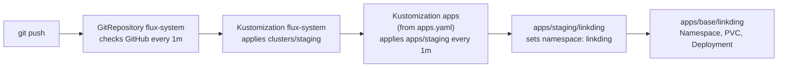
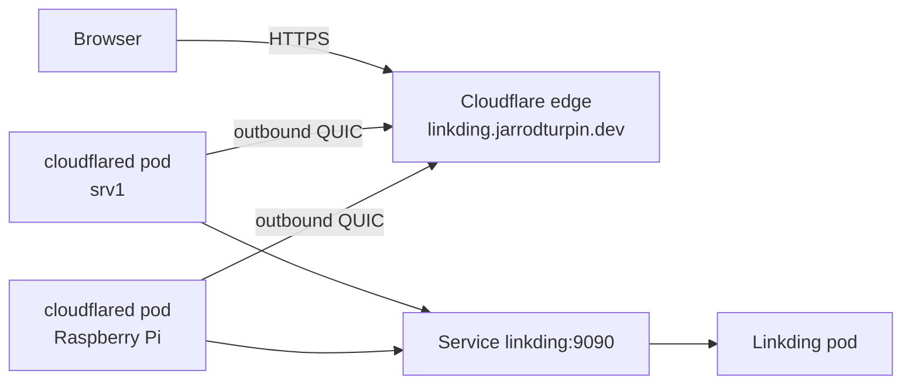
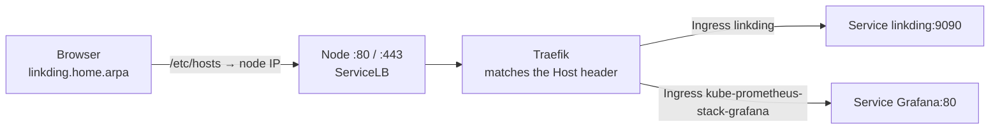
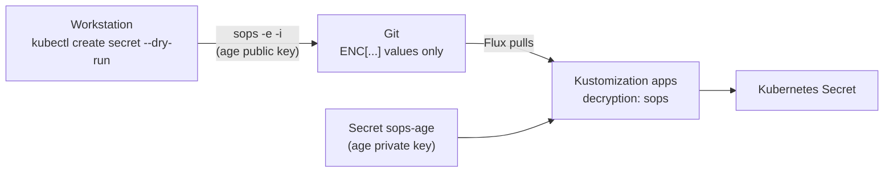
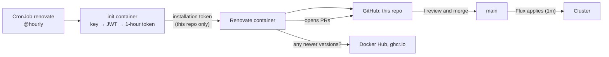

# Deploying Apps with Flux

How applications get onto the cluster. Nothing is applied with `kubectl apply`: an app is added to this repo, and Flux deploys it.

## Repository layout

Following the [Flux repository structure guide](https://fluxcd.io/flux/guides/repository-structure/) (monorepo with Kustomize overlays):

```
apps/
├── base/                     # plain manifests, one folder per app
│   ├── audiobookshelf/       # see audiobookshelf.md
│   └── linkding/
│       ├── kustomization.yaml
│       ├── namespace.yaml
│       ├── deployment.yaml
│       ├── service.yaml      # ClusterIP Service on 9090
│       └── storage.yaml      # PersistentVolumeClaim
└── staging/                  # per-environment overlays that point at base
    ├── kustomization.yaml    # lists the apps that are switched on
    ├── audiobookshelf/
    └── linkding/
        ├── kustomization.yaml   # also generates linkding-configmap (staging settings)
        ├── cloudflare.yaml   # cloudflared Deployment + ConfigMap (staging hostname)
        ├── cloudflare-secret.yaml   # tunnel credentials, SOPS-encrypted
        ├── ingress.yaml      # LAN hostname through Traefik
        └── linkding-container-env-secret.yaml   # Linkding admin account, SOPS-encrypted
infrastructure/
└── controllers/              # tools that run the cluster itself
    ├── base/
    │   └── renovate/         # Namespace, ConfigMap, CronJob
    └── staging/
        ├── kustomization.yaml   # lists the controllers that are switched on
        └── renovate/         # GitHub App private key, SOPS-encrypted
monitoring/
└── controllers/              # kube-prometheus-stack (see monitoring.md)
clusters/
└── staging/
    ├── apps.yaml             # Flux Kustomization apps: apply ./apps/staging
    ├── infrastructure.yaml   # Flux Kustomization infra-controllers: apply ./infrastructure/controllers/staging
    ├── monitoring.yaml       # Flux Kustomization monitoring-controllers
    └── flux-system/          # generated by flux bootstrap, never edited
```

- **`apps/`** is what the cluster exists to run. **`infrastructure/controllers/`** is tools that run the cluster (Renovate now, cert-manager next). A later `infrastructure/configs/` will hold settings that need those controllers first (such as a cert-manager ClusterIssuer), and `apps` can wait for it with `dependsOn`. This is the layout of Flux's [official example repo](https://github.com/fluxcd/flux2-kustomize-helm-example).
- A `production` overlay can be added for a second cluster without copying any manifests.
- **Moving files between Flux Kustomizations without deleting anything:** each object carries a `kustomize.toolkit.fluxcd.io/name` label naming its owner, and Flux only prunes objects still labelled with its own name. When Renovate moved from `apps/` to `infrastructure/`, `apps` was suspended (`flux suspend kustomization apps`) until `infra-controllers` had applied the objects and taken over the label, then resumed. The creation timestamps were unchanged afterwards. The same steps matter more for an app with a volume, where a prune would delete the data.

## How a change flows



- `clusters/staging/apps.yaml` is a Flux `Kustomization` (`kustomize.toolkit.fluxcd.io/v1`) with `path: ./apps/staging`, `interval: 1m0s` and `prune: true`, so removing an app's files from Git removes it from the cluster.
- **Switching an app off and on:** `apps/staging/kustomization.yaml` lists the apps. Commenting a line out makes Flux prune that app's Deployments, Services and config; uncommenting brings them back. Its Namespace and PVCs carry `kustomize.toolkit.fluxcd.io/prune: disabled`, so the data stays. Both are needed: pruning a Namespace deletes every PVC in it, whatever the PVC's own annotation says.
- The `kustomization.yaml` files are Kustomize's own (`kustomize.config.k8s.io/v1beta1`): the staging overlay pulls in the base and sets the namespace.

## Checking a deployment

```bash
flux get kustomizations                    # each Kustomization and the commit it applied
kubectl describe -n flux-system kustomizations.kustomize.toolkit.fluxcd.io apps   # Inventory: what it created
kubectl get pods -n linkding
kubectl port-forward -n linkding deploy/linkding 8080:9090   # then http://localhost:8080
```

## Apps

| App | What it is | Status |
|---|---|---|
| [Linkding](https://github.com/sissbruecker/linkding) | Self-hosted bookmark manager | Deployed (2026-10-15) with a 1Gi PVC on k3s local-path storage for its SQLite database. Runs as non-root (UID 33, `www-data`) with privilege escalation disabled; background tasks run in a second container in the same pod. Public at `https://linkding.jarrodturpin.dev` through a Cloudflare Tunnel (2026-10-17) |
| [Audiobookshelf](https://github.com/advplyr/audiobookshelf) | Audiobook and podcast server (course capstone) | Deployed (2026-10-21), translated from the project's Docker Compose file: four PVCs on srv1, non-root (UID 1000), `Recreate` strategy for its SQLite database, health probes. Public at `https://audiobooks.jarrodturpin.dev` through its own Cloudflare Tunnel. See [audiobookshelf.md](audiobookshelf.md) |

## Storage

Apps that keep data get a PersistentVolumeClaim in their base folder. With no `storageClassName`, it uses k3s's default `local-path` class, which provisions a folder on the node's disk when the first pod uses the claim (`WaitForFirstConsumer`). Trade-offs I'm aware of:

- The volume is pinned to the node it was created on, so the pod can't move to the other node if that one goes down.
- The requested size isn't enforced; the folder can grow into the node's free space.
- The reclaim policy is `Delete`, so deleting a claim deletes its folder. Flux won't do that on its own: every PVC and its Namespace are annotated `kustomize.toolkit.fluxcd.io/prune: disabled`, so removing an app from Git leaves its data in place (deleting it is a deliberate `kubectl delete pvc` or `kubectl delete namespace`). Backups and replicated storage are on the roadmap.

## Security

Containers don't run as root. Linkding's pod sets `runAsUser`, `runAsGroup` and `fsGroup` to 33 (the image's `www-data` user), and the container sets `allowPrivilegeEscalation: false`. Verified by `id` inside the container returning `uid=33(www-data)`, and `apt update` failing, so a compromised app can't install tools into its container.

**Background worker as a second container.** Linkding normally starts its task worker (huey: favicons, preview images, snapshots) through supervisord, which expects to start as root and then switch to `www-data`. As non-root it refuses (`Error: Can't drop privilege as nonroot user` in the web container's log), so the worker never ran. The fix keeps the hardening: the pod has a second container, `linkding-tasks`, from the same image, running `python manage.py run_huey -f` directly. It shares the data volume (the queue is `data/tasks.sqlite3`), inherits UID 33 from the pod, and gets the ConfigMap but not the Secret, since it doesn't need the admin credentials. The web container still prints the supervisord error once at startup; that's expected and harmless. Check it with `kubectl logs -n linkding deploy/linkding -c linkding-tasks`.

## Public access: Cloudflare Tunnel



- **Tunnel created from the CLI:** `cloudflared tunnel login`, `cloudflared tunnel create homelab`, then `cloudflared tunnel route dns homelab linkding.jarrodturpin.dev` for the proxied CNAME.
- **Credentials are encrypted in Git:** the tunnel's credentials file is a Secret in `apps/staging/linkding/cloudflare-secret.yaml`, encrypted with SOPS (see Secrets below). The account certificate stays on my workstation.
- **cloudflared runs from Git:** `apps/staging/linkding/cloudflare.yaml` holds the Deployment (2 replicas spread across both nodes, image pinned to a release, non-root) and a ConfigMap with the ingress rules: the hostname goes to `http://linkding:9090`, everything else gets a 404. It sits in the staging overlay because the hostname is environment-specific.
- **Django behind a proxy:** Linkding gets `LD_CSRF_TRUSTED_ORIGINS=https://linkding.jarrodturpin.dev` from the staging ConfigMap (see Configuration), otherwise logins through the tunnel fail CSRF checks.
- **Verify:** `kubectl logs -n linkding deploy/cloudflared | grep "Registered tunnel connection"` and `cloudflared tunnel info homelab`.

## LAN access: Traefik Ingress

Besides the public tunnel, Linkding has a LAN-only hostname, `linkding.home.arpa`, through the Traefik ingress controller that ships with k3s (default IngressClass `traefik`, exposed on ports 80 and 443 of both nodes by k3s's ServiceLB).



- **Why `home.arpa`:** it's reserved for home networks (RFC 8375), so it can never clash with a real site. `.dev` names (like my public domain) are on the browsers' HSTS preload list, which forces HTTPS and blocks clicking past a self-signed certificate.
- **Name resolution:** no local DNS server yet, so the names are in `/etc/hosts` on the workstations. Check with `getent hosts <name>`; `nslookup` asks DNS directly and ignores the hosts file. The plan is a wildcard DNS record for a subdomain of my own domain pointing at the nodes, with a trusted wildcard certificate from cert-manager and Let's Encrypt, so phones and other devices work too (on the roadmap).
- **Exposure:** ServiceLB forwards ports 80 and 443 to Traefik, and forwarded traffic doesn't pass ufw's input rules, so every Ingress is reachable from the whole LAN. Nothing is reachable from the internet (no router port forwards; the Traefik Service is IPv4 only). Everything published this way has its own login.
- **Gotcha:** a browser proxy (in my case a VPN extension) sends `*.home.arpa` to the proxy instead of reading `/etc/hosts`, which shows up as a 404. curl working while the browser fails points at the browser. Fix: exclude `home.arpa` from the proxy.

## Configuration

Following [12-factor config](https://12factor.net/config), settings that change per environment live outside the manifests that define the app. The base Deployment only says *where* its settings come from:

```yaml
envFrom:
  - configMapRef:
      name: linkding-configmap      # settings
  - secretRef:
      name: linkding-container-env  # credentials
```

The staging overlay supplies the values. `linkding-configmap` comes from a Kustomize `configMapGenerator`, which adds a hash of the contents to the name (`linkding-configmap-<hash>`) and updates the Deployment's reference to match. Changing a setting therefore changes the pod template, so the Deployment rolls out new pods automatically; a plain ConfigMap would leave running pods on the old values until a manual restart. Flux prunes the old ConfigMap.

## Secrets

Secrets live in this public repo, encrypted with [SOPS](https://getsops.io/) and [age](https://github.com/FiloSottile/age). Flux decrypts them as it applies them.



- **Only values are encrypted:** `.sops.yaml` at the repo root encrypts `data` and `stringData`, so the kind, name and namespace stay readable in diffs.
- **The private key exists in two places:** my workstation (outside the repo, backed up offline) and the `sops-age` Secret in `flux-system`, created by hand. It is the only Secret not in Git; a rebuilt cluster needs just this one to recover everything else.
- **Decryption is per Kustomization:** `clusters/staging/apps.yaml` has a `decryption` block with `provider: sops` pointing at `sops-age`.
- **Linkding's admin account:** `LD_SUPERUSER_NAME` and `LD_SUPERUSER_PASSWORD` come from an encrypted Secret, so a fresh install (new cluster or empty volume) creates the admin user with no manual `createsuperuser` step. Linkding skips this when the user already exists and never changes an existing password.
- **Editing:** `sops <file>` opens the decrypted Secret in an editor and re-encrypts it on save.

### Guardrails

A versioned pre-commit hook in [`.githooks/pre-commit`](../.githooks/pre-commit) blocks a commit when:

- a staged YAML file contains `kind: Secret` but no `sops:` block (a Secret that was never encrypted), or
- [gitleaks](https://github.com/gitleaks/gitleaks) finds keys, tokens or credentials in the staged changes.

Git doesn't run hooks from a clone automatically, so each clone enables it once:

```bash
git config core.hooksPath .githooks
```

`.gitignore` is the second layer: it blocks age keys, Cloudflare credential files, kubeconfigs and the k3s node token from being staged at all.

**`main` is protected on GitHub** with a repository ruleset (`protect-main`, 2026-10-21): no force pushes and no deletion. `main` is what Flux deploys, so rewriting or deleting it would change or remove what runs in the cluster. Pull requests and status checks aren't required: I push to `main` directly and there's no CI yet. Pushes, merges, Renovate's branches and Flux's read-only deploy key are unaffected. To force-push on purpose (for example to scrub a leaked secret from history), switch the ruleset off, push, switch it back on.

## Automated updates: Renovate

[Renovate](https://docs.renovatebot.com/) runs in the cluster as a CronJob (`infrastructure/controllers/base/renovate`, GitHub App key in `infrastructure/controllers/staging/renovate`, applied by the `infra-controllers` Kustomization). Every hour it reads this repo, checks every container image and Helm chart for newer versions, and opens a pull request per update, plus a Dependency Dashboard issue listing what's pending.



- **Merging is deploying.** Flux applies whatever lands on `main`, so each Renovate PR is a change request: read the release notes, merge, watch the rollout. No automerge.
- **`renovate.json`:** `config:recommended`, plus `managerFilePatterns` for two managers: `kubernetes` (container images in manifests) and `flux` (the chart version in the `OCIRepository`). Without the Flux manager, Helm charts are never updated.
- **Flux's own files are excluded** (`ignorePaths: clusters/staging/flux-system/**`). Renovate would bump Flux's controller images one at a time; Flux is upgraded as a set with its CLI.
- **The image is pinned** (`renovate/renovate:44.175.3`), so the 440 MB image is cached on the node instead of pulled every hour, and Renovate opens PRs to update itself.
- **Renovate signs in as a GitHub App, with 1-hour tokens.** A private GitHub App (`turpinator-x-renovate`) is installed on this repo only, with Contents, Pull requests, Issues, Commit statuses and Checks read/write and Dependabot alerts read. Its private key is the one long-lived secret (SOPS-encrypted in Git). Each run:
  1. The init container (same Renovate image, `node mint-token.mjs` from a generated ConfigMap) signs a 9-minute JWT with the key.
  2. GitHub exchanges it for an installation token that expires in one hour.
  3. The token is written to a memory-only `emptyDir` as Renovate's config file (`RENOVATE_CONFIG_FILE`), and the Renovate container starts.

  Only the init container mounts the private key; Renovate only ever sees the 1-hour token. Nothing needs renewing, and PRs come from `turpinator-x-renovate[bot]` rather than a personal account. This replaced a 90-day fine-grained personal token on 2026-10-21; personal tokens can't be created or regenerated through the API, so they can't be rotated automatically.
- **Rotating the app key (optional, e.g. yearly):** generate a new key on the app's settings page, re-create `renovate-github-app-secret.yaml` with `kubectl create secret generic renovate-github-app --from-file=private-key.pem=<file> --dry-run=client -o yaml` and `sops -e -i`, push, test with a manual job, then delete the old key on GitHub and `shred -u` the download.
- **When it fails:** `kubectl -n renovate logs job/<job> -c github-app-token`. `401` means a wrong Client ID or key; `404` a wrong installation ID or the app isn't installed on the repo.
- **Switching identity orphans the old PRs and dashboard:** Renovate only manages issues and PRs it authored, so after the switch the old Dependency Dashboard and an open PR from the personal token had to be closed by hand.
- **Least privilege:** the app is the only credential in the cluster that can write to GitHub, limited to this repo; Flux itself uses a read-only deploy key. Both containers run as non-root.
- **First run (2026-10-20):** three PRs, all merged and rolled out by Flux: cloudflared 2026.10.1 → 2026.10.2, kube-prometheus-stack chart 92.10.1 → 92.11.0 (Helm upgrade to release v4), Linkding 1.31.0 → 1.47.0 (database migrations ran on start; all bookmarks intact).
- **Habit:** `main` now moves on GitHub without me, so `git pull` before every change.
- **Run it on demand:** `kubectl create job -n renovate --from=cronjob/renovate renovate-manual-<n>`, then `kubectl logs -n renovate -f job/renovate-manual-<n>`.
