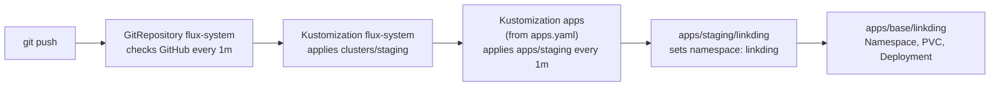
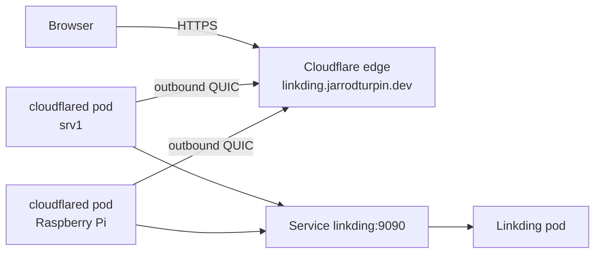
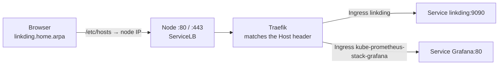
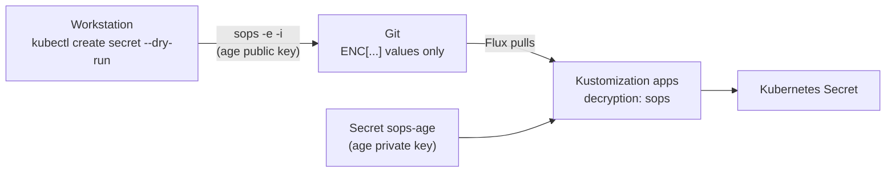

# Deploying Apps with Flux

How applications get onto the cluster. Nothing is applied with `kubectl apply`: an app is added to this repo, and Flux deploys it.

## Repository layout

Following the [Flux repository structure guide](https://fluxcd.io/flux/guides/repository-structure/) (monorepo with Kustomize overlays):

```
apps/
├── base/                     # plain manifests, one folder per app
│   └── linkding/
│       ├── kustomization.yaml
│       ├── namespace.yaml
│       ├── deployment.yaml
│       ├── service.yaml      # ClusterIP Service on 9090
│       └── storage.yaml      # PersistentVolumeClaim
└── staging/                  # per-environment overlays that point at base
    └── linkding/
        ├── kustomization.yaml   # also generates linkding-configmap (staging settings)
        ├── cloudflare.yaml   # cloudflared Deployment + ConfigMap (staging hostname)
        ├── cloudflare-secret.yaml   # tunnel credentials, SOPS-encrypted
        ├── ingress.yaml      # LAN hostname through Traefik
        └── linkding-container-env-secret.yaml   # Linkding admin account, SOPS-encrypted
clusters/
└── staging/
    ├── apps.yaml             # Flux Kustomization: apply ./apps/staging
    └── flux-system/          # generated by flux bootstrap, never edited
```

`infrastructure/` (base and staging) will follow the same pattern, and a `production` overlay can be added for a second cluster without copying any manifests.

## How a change flows



- `clusters/staging/apps.yaml` is a Flux `Kustomization` (`kustomize.toolkit.fluxcd.io/v1`) with `path: ./apps/staging`, `interval: 1m0s` and `prune: true`, so removing an app's files from Git removes it from the cluster.
- The `kustomization.yaml` files are Kustomize's own (`kustomize.config.k8s.io/v1beta1`): the staging overlay pulls in the base and sets the namespace.

## Checking a deployment

```bash
flux get kustomizations                    # each Kustomization and the commit it applied
kubectl describe -n flux-system kustomizations.kustomize.toolkit.fluxcd.io apps   # Inventory: what it created
kubectl get pods -n linkding
kubectl port-forward -n linkding deploy/linkding 8080:9090   # then http://localhost:8080
```

## Apps

| App | What it is | Status |
|---|---|---|
| [Linkding](https://github.com/sissbruecker/linkding) | Self-hosted bookmark manager | Deployed (2026-10-15) with a 1Gi PVC on k3s local-path storage for its SQLite database. Runs as non-root (UID 33, `www-data`) with privilege escalation disabled. Public at `https://linkding.jarrodturpin.dev` through a Cloudflare Tunnel (2026-10-17) |

## Storage

Apps that keep data get a PersistentVolumeClaim in their base folder. With no `storageClassName`, it uses k3s's default `local-path` class, which provisions a folder on the node's disk when the first pod uses the claim (`WaitForFirstConsumer`). Trade-offs I'm aware of:

- The volume is pinned to the node it was created on, so the pod can't move to the other node if that one goes down.
- The requested size isn't enforced; the folder can grow into the node's free space.
- The reclaim policy is `Delete`, so removing the claim from Git (with Flux pruning on) deletes the data. Backups and replicated storage are on the roadmap.

## Security

Containers don't run as root. Linkding's pod sets `runAsUser`, `runAsGroup` and `fsGroup` to 33 (the image's `www-data` user), and the container sets `allowPrivilegeEscalation: false`. Verified by `id` inside the container returning `uid=33(www-data)`, and `apt update` failing, so a compromised app can't install tools into its container.

## Public access: Cloudflare Tunnel



- **Tunnel created from the CLI:** `cloudflared tunnel login`, `cloudflared tunnel create homelab`, then `cloudflared tunnel route dns homelab linkding.jarrodturpin.dev` for the proxied CNAME.
- **Credentials are encrypted in Git:** the tunnel's credentials file is a Secret in `apps/staging/linkding/cloudflare-secret.yaml`, encrypted with SOPS (see Secrets below). The account certificate stays on my workstation.
- **cloudflared runs from Git:** `apps/staging/linkding/cloudflare.yaml` holds the Deployment (2 replicas spread across both nodes, image pinned to a release, non-root) and a ConfigMap with the ingress rules: the hostname goes to `http://linkding:9090`, everything else gets a 404. It sits in the staging overlay because the hostname is environment-specific.
- **Django behind a proxy:** Linkding gets `LD_CSRF_TRUSTED_ORIGINS=https://linkding.jarrodturpin.dev` from the staging ConfigMap (see Configuration), otherwise logins through the tunnel fail CSRF checks.
- **Verify:** `kubectl logs -n linkding deploy/cloudflared | grep "Registered tunnel connection"` and `cloudflared tunnel info homelab`.

## LAN access: Traefik Ingress

Besides the public tunnel, Linkding has a LAN-only hostname, `linkding.home.arpa`, through the Traefik ingress controller that ships with k3s (default IngressClass `traefik`, exposed on ports 80 and 443 of both nodes by k3s's ServiceLB).



- **Why `home.arpa`:** it's reserved for home networks (RFC 8375), so it can never clash with a real site. `.dev` names (like my public domain) are on the browsers' HSTS preload list, which forces HTTPS and blocks clicking past a self-signed certificate.
- **Name resolution:** no local DNS server yet, so the names are in `/etc/hosts` on the workstations. Check with `getent hosts <name>`; `nslookup` asks DNS directly and ignores the hosts file.
- **Exposure:** ServiceLB forwards ports 80 and 443 to Traefik, and forwarded traffic doesn't pass ufw's input rules, so every Ingress is reachable from the whole LAN. Nothing is reachable from the internet (no router port forwards; the Traefik Service is IPv4 only). Everything published this way has its own login.
- **Gotcha:** a browser proxy (in my case a VPN extension) sends `*.home.arpa` to the proxy instead of reading `/etc/hosts`, which shows up as a 404. curl working while the browser fails points at the browser. Fix: exclude `home.arpa` from the proxy.

## Configuration

Following [12-factor config](https://12factor.net/config), settings that change per environment live outside the manifests that define the app. The base Deployment only says *where* its settings come from:

```yaml
envFrom:
  - configMapRef:
      name: linkding-configmap      # settings
  - secretRef:
      name: linkding-container-env  # credentials
```

The staging overlay supplies the values. `linkding-configmap` comes from a Kustomize `configMapGenerator`, which adds a hash of the contents to the name (`linkding-configmap-<hash>`) and updates the Deployment's reference to match. Changing a setting therefore changes the pod template, so the Deployment rolls out new pods automatically; a plain ConfigMap would leave running pods on the old values until a manual restart. Flux prunes the old ConfigMap.

## Secrets

Secrets live in this public repo, encrypted with [SOPS](https://getsops.io/) and [age](https://github.com/FiloSottile/age). Flux decrypts them as it applies them.



- **Only values are encrypted:** `.sops.yaml` at the repo root encrypts `data` and `stringData`, so the kind, name and namespace stay readable in diffs.
- **The private key exists in two places:** my workstation (outside the repo, backed up offline) and the `sops-age` Secret in `flux-system`, created by hand. It is the only Secret not in Git; a rebuilt cluster needs just this one to recover everything else.
- **Decryption is per Kustomization:** `clusters/staging/apps.yaml` has a `decryption` block with `provider: sops` pointing at `sops-age`.
- **Linkding's admin account:** `LD_SUPERUSER_NAME` and `LD_SUPERUSER_PASSWORD` come from an encrypted Secret, so a fresh install (new cluster or empty volume) creates the admin user with no manual `createsuperuser` step. Linkding skips this when the user already exists and never changes an existing password.
- **Editing:** `sops <file>` opens the decrypted Secret in an editor and re-encrypts it on save.

### Guardrails

A versioned pre-commit hook in [`.githooks/pre-commit`](../.githooks/pre-commit) blocks a commit when:

- a staged YAML file contains `kind: Secret` but no `sops:` block (a Secret that was never encrypted), or
- [gitleaks](https://github.com/gitleaks/gitleaks) finds keys, tokens or credentials in the staged changes.

Git doesn't run hooks from a clone automatically, so each clone enables it once:

```bash
git config core.hooksPath .githooks
```

`.gitignore` is the second layer: it blocks age keys, Cloudflare credential files, kubeconfigs and the k3s node token from being staged at all.
