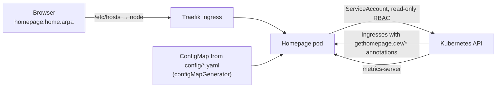

# Homepage: private start page

[Homepage](https://gethomepage.dev) is a start page for the homelab, at `http://homepage.home.arpa` (LAN only, no tunnel). It shows live cluster CPU and memory per node, discovers LAN apps from their Ingress annotations, and links to the public apps and repos. Deployed 2026-10-23, written step by step with Claude Code.

## Files

```
apps/base/homepage/
├── namespace.yaml
├── rbac.yaml            # ServiceAccount + read-only ClusterRole/Binding
├── deployment.yaml      # pinned image, restricted security context, probes, subPath config mounts
├── service.yaml         # ClusterIP :3000
├── kustomization.yaml   # configMapGenerator builds the config ConfigMap from config/
└── config/              # settings, kubernetes, widgets, services, bookmarks (+ empty required files)
apps/staging/homepage/
├── ingress.yaml         # homepage.home.arpa through Traefik
└── kustomization.yaml   # namespace: homepage
```

## How it works



- **Kubernetes access:** `mode: cluster` in `kubernetes.yaml` uses the pod's ServiceAccount. Its ClusterRole only allows `get`/`list` on namespaces, pods, nodes, Ingresses and node/pod metrics: no writes, no Secrets, no `watch`. The upstream example also reads Traefik IngressRoutes and Gateway API routes; those were left out because nothing here uses them.
- **Auto-discovery:** with `ingress: true`, any Ingress annotated `gethomepage.dev/enabled: "true"` becomes a tile. Linkding's Ingress (in `apps/staging/linkding/ingress.yaml`) and Grafana's (through the chart's `grafana.ingress.annotations` value in the kube-prometheus-stack HelmRelease patch) carry name, description, group, icon and a `pod-selector` for the status badge, because neither app's pods use the default `app.kubernetes.io/name=<ingress name>` label. The tile belongs to the app, so removing an app removes its tile.
- **Config changes roll out by themselves:** the config files are mounted one by one with `subPath` (so the rest of `/app/config` stays as the image built it), and subPath mounts don't update live. `configMapGenerator` names the ConfigMap after a hash of its contents, so any config change renames it, changes the Deployment, and rolls out a new pod.
- **`HOMEPAGE_ALLOWED_HOSTS`:** Homepage rejects requests whose Host header isn't listed. The list is `$(MY_POD_IP):3000` (the kubelet probes the pod by IP) and `homepage.home.arpa`. `MY_POD_IP` comes from the Downward API and must be defined before the variable that uses it.
- **Security:** non-root (UID 1000), no privilege escalation, all capabilities dropped, `RuntimeDefault` seccomp; memory limit but no CPU limit; liveness and readiness probes on `/api/healthcheck`. No storage: the config lives in Git.
- **Updates:** the image is pinned (`v2.6.0`); Renovate proposes newer releases after its 3-day wait, and minor updates wait for the Monday review.

## Gotcha: every config file must exist

The container runs as non-root and can't write to `/app/config`, so every file Homepage expects must be supplied, even empty ones (`custom.css`, `custom.js`, `docker.yaml`). The upstream Kubernetes example lists eight files, but v2.6.0 also requires `proxmox.yaml`. Without it the page loaded, but the first widget request tried to create the file, failed, showed "API Error", and crashed the container (exit code 1, three restarts in six minutes). The cause was in Homepage's own log inside the pod (`/app/config/logs/homepage.log`), not in `kubectl logs`. Fix: add the empty file, its generator entry and its mount. The list to check against, for any version, is the `src/skeleton/` folder of that release tag.

## Access

`/etc/hosts` on each laptop maps the LAN names to srv1: `linkding.home.arpa grafana.home.arpa homepage.home.arpa`. Done on the Stealth; still to do on Odin. Proper LAN DNS (instead of hosts files) is on the roadmap.

## Ideas for later

- Service widgets with live stats (Grafana, Linkding, Audiobookshelf): need API keys as SOPS-encrypted Secrets passed in as `HOMEPAGE_VAR_*` environment variables.
- The GitHub bookmark icon is a dark logo on the dark theme; `mdi-github` or a light variant would read better.
