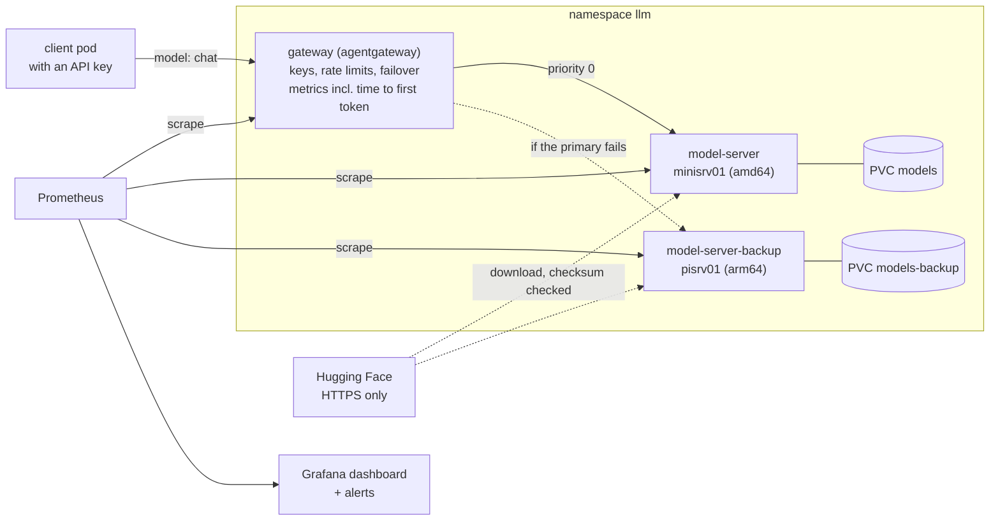

# Self-hosted Model Platform (P1)

A small language model served on the cluster, run the way a platform team runs a production service: deployed from Git by Flux, pinned and checked, locked down, measured and alerted on. Started 2026-11-07.

It's project P1 of the AI Platform Engineering plan in the private course repo. P1 is built in phases, and this page is updated as each one lands.

**AI-assisted:** Claude Code wrote these manifests and the download script, and tested them first on my laptop with the cluster's security settings. I set the requirements and reviewed the work. Before calling P1 done, I'll explain every part without notes.

**Honest scale:** one tiny model (0.5 billion parameters) on CPU, on a two-node homelab. No GPU. The patterns are the ones used at scale, and the numbers are small.



## Phases

| Phase | What | Status |
|---|---|---|
| 1 | Model server: pinned model, download check, probes, limits, NetworkPolicy, metrics, dashboard, basic alerts | Deployed 2026-11-07 (#22), checked on the cluster |
| 2 | Gateway in front of the model: one API, keys, rate limits, request logs, failover to a second model | Built and tested on my laptop. Waiting on API keys and review before deploying ([decision record](llm-gateway-decision.md)) |
| 3 | SLO on time to first token, with a load test and an error-budget alert | After the gateway, which measures it per request |
| 4 | Failure drill and postmortem, demo, cost note | Last |

## Phase 2: the gateway

Clients send OpenAI-style requests to the `gateway` Service on port 4000, asking for the model `chat`. The gateway checks the API key, applies that key's limits, and sends the request to the primary model server. If the primary fails, it's taken out for 30 seconds and the backup on the other node answers. Why agentgateway and not LiteLLM: [the decision record](llm-gateway-decision.md).

- **A backup model on the other node.** `model-server-backup` is a copy of the primary, required to run on pisrv01 (arm64), with its own volume. If either node goes down, one model is still up. It's the same model for now, so failover keeps the same answers.
- **API keys, one per client.** Two for now: mine, and one for the phase 3 load test. The keys live in an encrypted Secret (`gateway-keys`) and reach the gateway as environment variables. The config itself is a plain ConfigMap anyone can read in this repo.
- **Limits per key:** 60 requests a minute and 50,000 tokens an hour. Over either, the gateway answers 429. The counters are in the gateway's memory, so there's one replica.
- **Only the gateway can call the models.** The model servers' NetworkPolicy now allows the gateway and Prometheus, and nothing else, not even other pods in `llm`. The gateway can reach DNS and the two model servers, and has no internet access.
- **Metrics and alerts.** Prometheus scrapes the gateway on port 15020 for tokens per key and model, time to first token and time per output token. New alerts: `GatewayDown` (critical) and `ModelServerBackupDown` (warning: the primary still answers, but there's no failover).

### What was tested, and how (phase 2)

On my laptop, in Docker, with the cluster's security settings (non-root, read-only filesystem, no capabilities), the same llama.cpp image and two model servers (2026-11-08):

| Test | Result |
|---|---|
| No key, and a wrong key | 401 both times. The log line says why: "no API Key found" or "invalid credentials" |
| A real key | 200, with a correct answer. The log line shows which model server answered, and the token counts |
| Request limit (5 a minute in the test) | Requests 1 to 5 got 200, then 429. Another key still got 200, so the limit is per key |
| Token limit (400 a minute in the test) | Long prompts got 200, 200, then 429 once the key had used its tokens |
| Time to first token | Recorded for streamed answers only. A non-streamed request doesn't add a sample, so the phase 3 load test has to stream |
| Primary stopped | The next request got **503**, then every request after it got 200 from the backup |
| Primary started again | Requests went back to the primary |
| Keys from environment variables | Work. If one is missing, the gateway refuses to start, so it can't run without a key by mistake |
| The exact config file in this repo | Starts, answers through the primary, and fails over to the backup |
| `scripts/llm-gateway-check.sh` | Passes against a real key. With a wrong key it fails and exits 1 |

**Found in testing:** in this simple config mode, v1.7.0 has no retry setting (the config is refused with "unknown field `retry`"). So the one request that finds the primary down fails with 503 before failover starts. Clients should retry once on a 503. The full routing mode has retries, and it's worth switching to if one failed request matters.

**Not tested yet:** anything on the cluster. That waits for the API keys (below) and review. Then: the check script against the cluster, the NetworkPolicy blocks with controls as in phase 1, failover by scaling the primary to 0 through Git, and the alerts.

**Before it can deploy:** the `gateway-keys` Secret. Two random keys, encrypted with SOPS before they're committed.

## Design choices (phase 1)

- **llama.cpp's server, on CPU.** One small binary with an OpenAI-style API and Prometheus metrics built in. It runs on amd64 and arm64, so it fits this cluster's rule. vLLM is the usual choice for GPU fleets, and it isn't needed here.
- **The model is pinned like an image.** The URL names an exact Hugging Face commit, and the init container checks the file's SHA-256. A wrong or changed file stops the pod before the server starts. Models are code we didn't write, so they get the same treatment as images.
- **Qwen2.5 0.5B Instruct, Q4_K_M (491 MB).** Apache-2.0 license, small enough for either node. On my laptop's CPU it answered at about 94 tokens a second, and used about 150 MB of memory plus the file cache.
- **Locked down like the dashboard.** Non-root user 10001, read-only root filesystem, all capabilities dropped, seccomp, and no ServiceAccount token. The model volume is read-only for the server. Only the init container writes to it.
- **NetworkPolicy.** Inbound: only Prometheus and pods in this namespace (the gateway, in phase 2). Outbound: DNS, and HTTPS to the internet with all private ranges blocked, for the download. The policy covers the whole pod, so the server could reach the internet too. Moving the download to its own Job would close that. It's noted for phase 2.
- **No API key yet.** Nothing outside the namespace can reach the server, and it isn't exposed on the LAN or the internet. The gateway in phase 2 adds keys.
- **Startup probe.** `/health` returns 503 while the model loads, so the startup probe allows up to 5 minutes before liveness checks begin.
- **Prefers the amd64 node, can run on the Pi.** The volume binds to whichever node the pod starts on first, so it stays there after that.
- **Renovate holds llama.cpp updates for Monday.** llama.cpp tags several builds a day (`server-b<number>`). A regex versioning rule makes each build a reviewable update in the weekly batch instead of a daily PR.

## What was tested, and how

On my laptop, in Docker, with the cluster's security settings (2026-11-07):

| Test | Result |
|---|---|
| Server starts non-root with a read-only filesystem and no capabilities | Pass. `/health` returned `ok` |
| Chat request through the OpenAI-style API | Pass. A correct one-sentence answer in 0.44 s |
| `/metrics` serves Prometheus metrics | Pass. `llamacpp:` counters and gauges |
| Download step with a wrong checksum | Stops with exit 1, "checksum mismatch", and removes the partial file |
| Download step with the right checksum | Downloads, checks, exits 0 |
| Second start | Skips the download |
| File changed on disk | Downloads it again, and the checksum then matches |

On the cluster, before merging: `./scripts/validate.sh` passes, and a server-side dry run (`kubectl apply --dry-run=server`) accepted every object.

On the cluster, after Flux deployed it (2026-11-07). Each block was checked against a control that's allowed, so a refusal means the policy, not a missing service:

| Test | Result |
|---|---|
| Download step on first start | "model downloaded and checksum matches". The pod was Ready about 30 seconds after Flux applied it, on minisrv01 |
| Chat request, through a port-forward | A correct answer. 71 ms to read the prompt, 113 tokens a second |
| Prometheus scrape | Target up, `llamacpp:` metrics arriving |
| Alert rules | Both loaded, healthy and inactive. The `ModelServerDown` expression returns nothing while the server is up |
| Grafana dashboard | Loaded by the sidecar. Not yet viewed in a browser |
| Ingress from another namespace (homepage) | Refused. Control: the same request from inside `llm` returns `{"status":"ok"}` |
| Egress to Hugging Face over HTTPS | Allowed (HTTP 200) |
| Egress to the Kubernetes API Service | Blocked |
| Egress to the control plane node's API port | Blocked. Control: the homepage pod reaches the same port and gets HTTP 401 |
| Egress over plain HTTP to the internet | Blocked |

**Not tested yet:** an alert actually firing and reaching Alertmanager. That's the failure drill in phase 4, where the server is broken on purpose.

## Using it

Once the gateway is deployed, through the gateway, with a key:

```bash
kubectl -n llm port-forward svc/gateway 4000:4000
curl -s localhost:4000/v1/chat/completions -H 'Content-Type: application/json' \
  -H "Authorization: Bearer $GATEWAY_KEY" \
  -d '{"model":"chat","messages":[{"role":"user","content":"In one sentence, what is Kubernetes?"}],"max_tokens":60}'
```

Straight to the model server (phase 1, no key):

```bash
kubectl -n llm port-forward svc/model-server 8080:8080
curl -s localhost:8080/v1/chat/completions -H 'Content-Type: application/json' \
  -d '{"messages":[{"role":"user","content":"In one sentence, what is Kubernetes?"}],"max_tokens":60}'
```

## Layout

| File | What it is |
|---|---|
| `apps/base/llm/deployment.yaml` | The init container and the server |
| `apps/base/llm/deployment-backup.yaml` | The backup model server, on the arm64 node |
| `apps/base/llm/gateway.yaml`, `gateway-config.yaml` | The gateway and its config: keys, limits, failover |
| `scripts/llm-gateway-check.sh` | Checks the gateway through a port-forward: 401s, a 200, metrics |
| `apps/base/llm/fetch-model.sh` | The download and checksum script, mounted from a ConfigMap |
| `apps/base/llm/kustomization.yaml` | Pins the model: file, URL with commit, SHA-256 |
| `apps/base/llm/networkpolicy.yaml` | Who can talk to it, and where it can go |
| `apps/base/llm/servicemonitor.yaml`, `alerts.yaml`, `dashboard.yaml` | Metrics, alerts and the Grafana dashboard |
| `apps/staging/llm/` | The staging overlay |
