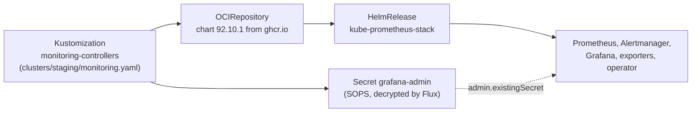

# Monitoring with Helm and Flux

The cluster is monitored with [kube-prometheus-stack](https://github.com/prometheus-community/helm-charts/tree/main/charts/kube-prometheus-stack): Prometheus, Alertmanager, Grafana, node-exporter, kube-state-metrics and the Prometheus Operator. It's a Helm chart, installed and upgraded by Flux from this repo rather than with `helm install`.

## How it's deployed



```
monitoring/controllers/
├── base/kube-prometheus-stack/
│   ├── namespace.yaml        # monitoring
│   ├── repository.yaml       # OCIRepository: chart source and pinned version
│   └── release.yaml          # HelmRelease: install options and values
└── staging/kube-prometheus-stack/
    ├── kustomization.yaml
    ├── release-patch.yaml          # staging values: Grafana Ingress hostname and TLS
    ├── grafana-admin-secret.yaml   # Grafana login, SOPS-encrypted
    └── grafana-tls-secret.yaml     # self-signed certificate, SOPS-encrypted
```

Same layout as Flux's [flux2-monitoring-example](https://github.com/fluxcd/flux2-monitoring-example), and the same base and overlay pattern as `apps/`.

Choices that differ from older guides:

- **Chart from an OCI registry.** The chart is pulled from `oci://ghcr.io/prometheus-community/charts` by an `OCIRepository`, and the HelmRelease points at it with `chartRef`. This is the current Flux approach; the older one is a `HelmRepository` with the version inside the HelmRelease.
- **Exact version pin.** `ref.tag: "92.10.1"`, so an upgrade is a reviewed one-line commit and a rollback is `git revert`.
- **CRDs managed by Flux.** `install.crds: Create` and `upgrade.crds: CreateReplace`, because Helm on its own never upgrades CRDs.
- **Drift detection on.** If someone edits a resource the chart created, Flux restores it.
- **No password in values.** Grafana reads its admin login from the encrypted `grafana-admin` Secret (`grafana.admin.existingSecret`), so nothing sensitive is in the HelmRelease.

## Grafana Ingress and TLS

Grafana is at `https://grafana.home.arpa` on the LAN. I didn't write an Ingress: the chart creates one from its `grafana.ingress` values (found with `helm show values`). The values sit in a Kustomize patch in the staging overlay, because the hostname is environment-specific; Kustomize merges it into the base HelmRelease's values.

```yaml
# monitoring/controllers/staging/kube-prometheus-stack/release-patch.yaml (values part)
grafana:
  ingress:
    enabled: true
    ingressClassName: traefik
    hosts: [grafana.home.arpa]
    tls:
      - secretName: grafana-tls
        hosts: [grafana.home.arpa]
```

The certificate is self-signed (`openssl req -x509`, with the hostname in `subjectAltName`, which is the field browsers check). The key was generated in a temporary directory, turned into a `kubernetes.io/tls` Secret, encrypted with SOPS and the plaintext deleted, so the private key only exists encrypted in Git and decrypted in the cluster. Traefik serves it for that host instead of its default certificate. It expires after a year, and browsers warn because no trusted CA signed it; cert-manager with Let's Encrypt is the proper fix.

## k3s adjustments

- **Control plane scrapes turned off.** k3s runs the controller manager, scheduler and kube-proxy inside one process with their metrics on `127.0.0.1`, and this single-server cluster uses SQLite rather than etcd. The chart's defaults would show those targets as down and fire alerts from day one, so `kubeControllerManager`, `kubeScheduler`, `kubeProxy` and `kubeEtcd` are disabled. API server, kubelet, node and workload metrics are unaffected.
- **Firewall rule for node-exporter.** node-exporter runs on each node's host network on port 9100. Prometheus scrapes the other node by its IP, and that traffic leaves the pod network with the node's own address (Flannel masquerades it), so ufw treats it as node-to-node traffic. Each node allows 9100/tcp from the other one (see [k3s-cluster.md](k3s-cluster.md)). I found this by testing from a pod before installing: the kubelet port connected and 9100 timed out.

## Checking it

```bash
flux get kustomizations                     # monitoring-controllers Ready
flux get sources oci -n monitoring          # chart fetched
flux get helmreleases -n monitoring         # Helm install succeeded
kubectl -n monitoring port-forward svc/kube-prometheus-stack-grafana 8080:80        # Grafana
kubectl -n monitoring port-forward svc/kube-prometheus-stack-prometheus 9090:9090   # Prometheus
curl -s localhost:9090/api/v1/targets | jq -r '.data.activeTargets[] | "\(.health) \(.labels.job)"' | sort | uniq -c
```

At install (2026-10-20): all 18 targets up, including node-exporter on both nodes. The only firing alert is `Watchdog`, which always fires on purpose to prove the alerting pipeline works. The whole stack uses about 1.2 GiB of memory.

## Not done yet

- Prometheus keeps its data in an `emptyDir`, so a restart loses metric history (retention is 10 days). A PersistentVolumeClaim via `prometheus.prometheusSpec.storageSpec` is the next step.
- Prometheus and Alertmanager are still only reachable through `kubectl port-forward`.
- Grafana also still answers on plain HTTP; redirecting to HTTPS is a Traefik middleware away.
- Only BlockOne alerts (`warning` and `critical`) and other `severity=critical` alerts notify (Telegram); other warnings and all `info` alerts are visible in the Alertmanager UI only.

## Alerting

Alertmanager's config is in the HelmRelease values (`monitoring/controllers/base/kube-prometheus-stack/release.yaml`). One receiver, `telegram` (Alertmanager's native `telegram_configs`), posts to the owner's Telegram bot. The bot token and chat id are a SOPS Secret, `alertmanager-telegram` in the staging overlay, mounted by `alertmanagerSpec.secrets` and read with `bot_token_file` / `chat_id_file`, so neither appears in the rendered config.

| Route | Receiver | Repeat |
|---|---|---|
| `Watchdog`, `InfoInhibitor` | `null` | |
| `BlockOneBackup*` and `AppBackup*` (any severity) | `telegram` | 24 h |
| `BlockOne*` with `severity` warning or critical (app alerts, `apps/base/blockone-crypto-tax/app-alerts.yaml`) | `telegram` | 24 h |
| any other `severity=critical` | `telegram` | 12 h |
| everything else (warnings, info) | `null` (UI only) | |

Grouped by `alertname` and `namespace` (30 s wait, 5 min group interval), resolved notices on. Inhibitions: the chart's defaults (critical hides warning/info for the same alert and namespace, warning hides info), plus `BlockOneBackupStale` hides `BlockOneBackupJobFailed` while both fire (and `AppBackupStale` hides `AppBackupJobFailed`). The config was checked with `amtool check-config` and `amtool config routes test` from the pinned Alertmanager image (v0.34.1).

Test a notification: port-forward `svc/kube-prometheus-stack-alertmanager 9093` and POST an alert with `severity=critical` to `/api/v2/alerts`, then check `alertmanager_notifications_total{integration="telegram"}` rose and `alertmanager_notifications_failed_total{integration="telegram"}` didn't.

### Weekly storage report (BlockOneStorageReport)

The weekly storage report job (`apps/base/blockone-crypto-tax/storage-report.yaml`, docs/blockone-crypto-tax.md, "Weekly storage report") reaches me through this same Alertmanager: it POSTs one synthetic alert, `alertname=BlockOneStorageReport`, to `http://kube-prometheus-stack-alertmanager.monitoring.svc:9093/api/v2/alerts`, with the digest in `summary` and `description`. `severity=warning` is the normal weekly digest; `severity=critical` with a `GROWTH:` prefix means a growth limit was crossed. Both match the `BlockOne*` route (warning or critical), so no Alertmanager config changed. The alert is only active for 15 minutes; the resolved notice that follows is normal. The monitoring namespace has no NetworkPolicy, so Alertmanager needs no ingress rule; the job's own egress rule allows DNS and the `app.kubernetes.io/name=alertmanager` pod on 9093 only.

If the job itself fails, `BlockOneStorageReportJobFailed` (job names starting `blockone-storage-report-`, shown for a day) and `BlockOneStorageReportStale` / `BlockOneStorageReportNeverSucceeded` (8 days) fire, both warnings and both under the `BlockOne*` route. They are unit-tested with promtool (`apps/base/blockone-crypto-tax/tests/storage-report-alerts.test.yaml`, run by `scripts/test-blockone-alerts.sh`).

Run the report now and read it:

```
job=blockone-storage-report-manual-$(date +%Y%m%d%H%M)
kubectl --context homelab -n blockone-crypto-tax create job --from=cronjob/blockone-storage-report "$job"
kubectl --context homelab -n blockone-crypto-tax wait --for=condition=complete --timeout=300s "job/$job"
kubectl --context homelab -n blockone-crypto-tax logs "job/$job"
```
