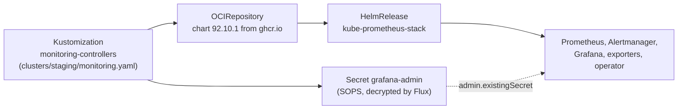

# Monitoring with Helm and Flux

The cluster is monitored with [kube-prometheus-stack](https://github.com/prometheus-community/helm-charts/tree/main/charts/kube-prometheus-stack): Prometheus, Alertmanager, Grafana, node-exporter, kube-state-metrics and the Prometheus Operator. It's a Helm chart, installed and upgraded by Flux from this repo rather than with `helm install`.

## How it's deployed



```
monitoring/controllers/
├── base/kube-prometheus-stack/
│   ├── namespace.yaml        # monitoring
│   ├── repository.yaml       # OCIRepository: chart source and pinned version
│   └── release.yaml          # HelmRelease: install options and values
└── staging/kube-prometheus-stack/
    ├── kustomization.yaml
    └── grafana-admin-secret.yaml   # Grafana login, SOPS-encrypted
```

Same layout as Flux's [flux2-monitoring-example](https://github.com/fluxcd/flux2-monitoring-example), and the same base and overlay pattern as `apps/`.

Choices that differ from older guides:

- **Chart from an OCI registry.** The chart is pulled from `oci://ghcr.io/prometheus-community/charts` by an `OCIRepository`, and the HelmRelease points at it with `chartRef`. This is the current Flux approach; the older one is a `HelmRepository` with the version inside the HelmRelease.
- **Exact version pin.** `ref.tag: "92.10.1"`, so an upgrade is a reviewed one-line commit and a rollback is `git revert`.
- **CRDs managed by Flux.** `install.crds: Create` and `upgrade.crds: CreateReplace`, because Helm on its own never upgrades CRDs.
- **Drift detection on.** If someone edits a resource the chart created, Flux restores it.
- **No password in values.** Grafana reads its admin login from the encrypted `grafana-admin` Secret (`grafana.admin.existingSecret`), so nothing sensitive is in the HelmRelease.

## k3s adjustments

- **Control plane scrapes turned off.** k3s runs the controller manager, scheduler and kube-proxy inside one process with their metrics on `127.0.0.1`, and this single-server cluster uses SQLite rather than etcd. The chart's defaults would show those targets as down and fire alerts from day one, so `kubeControllerManager`, `kubeScheduler`, `kubeProxy` and `kubeEtcd` are disabled. API server, kubelet, node and workload metrics are unaffected.
- **Firewall rule for node-exporter.** node-exporter runs on each node's host network on port 9100. Prometheus scrapes the other node by its IP, and that traffic leaves the pod network with the node's own address (Flannel masquerades it), so ufw treats it as node-to-node traffic. Each node allows 9100/tcp from the other one (see [k3s-cluster.md](k3s-cluster.md)). I found this by testing from a pod before installing: the kubelet port connected and 9100 timed out.

## Checking it

```bash
flux get kustomizations                     # monitoring-controllers Ready
flux get sources oci -n monitoring          # chart fetched
flux get helmreleases -n monitoring         # Helm install succeeded
kubectl -n monitoring port-forward svc/kube-prometheus-stack-grafana 8080:80        # Grafana
kubectl -n monitoring port-forward svc/kube-prometheus-stack-prometheus 9090:9090   # Prometheus
curl -s localhost:9090/api/v1/targets | jq -r '.data.activeTargets[] | "\(.health) \(.labels.job)"' | sort | uniq -c
```

At install (2026-10-20): all 18 targets up, including node-exporter on both nodes. The only firing alert is `Watchdog`, which always fires on purpose to prove the alerting pipeline works. The whole stack uses about 1.2 GiB of memory.

## Not done yet

- Prometheus keeps its data in an `emptyDir`, so a restart loses metric history (retention is 10 days). A PersistentVolumeClaim via `prometheus.prometheusSpec.storageSpec` is the next step.
- Grafana and Prometheus are only reachable through `kubectl port-forward`. Access through Traefik ingress comes next.
- Alertmanager has no receivers configured, so alerts aren't sent anywhere yet.
